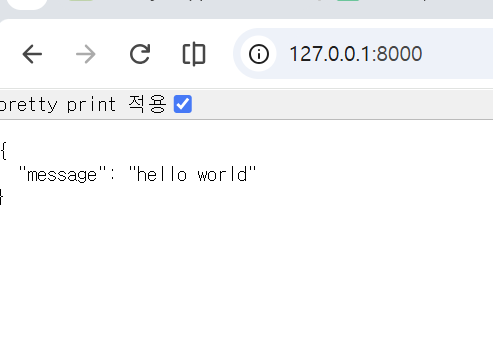

## Backend API

> DATE: 2026-10-26 Montag

## 1장 1강 FastAPI 개요 및 환경 설정

### IO bound vs. CPU bound

#### IO 바운드 방식

- 연산량 낮음, 대기시간 김
- 예: 네트워크 작업 (api), DB 조회, 파일 읽기/쓰기
- 비동기 특화 작업 → 기다리는 동안 다른 요청을 처리할 수 있음

#### CPU 바운드 방식

- 연산량 높음, 대기시간 짧음 (CPU가 계속 일하는 중)
- 예: 이미지/영상 처리, 대용량 데이터 계산, 머신러닝 학습
- 비동기로는 이득이 적음 → 멀티프로세싱(`--workers`, 별도 작업 서버 등)으로 해결

> [보충] 웹 API 서버의 작업은 대부분 **IO 바운드**라서 FastAPI는 비동기(`async`)를 기본으로 설계됨.
> 그래서 요청 처리 함수(라우트 핸들러)는 특별한 이유가 없으면 `async def`로 정의한다.

### Logging

- 기존에는 print() 명령어를 통해 기록/ 출력 확인
- 실제 출력 양식 유지 및 모니터링을 위해 로그를 남김
- 문제 해결을 위해서도 사용됨. 문제 해결 시에는 문제의 경중을 판단하는 것도 필요
- 로그는 콘솔뿐 아니라 **파일**이나 **원격 모니터링 서버**로 보낼 수도 있음
- 로그에는 메시지 외에 발생 시각, 로그 레벨, 로거 이름, 파일명, 함수명, 줄 번호 등을 담을 수 있음 → 특히 **시간 + 레벨**은 문제 시점 분석과 로그 검색에 유용
- 이벤트의 긴급도와 중요도 (1번과 2번은 심각한 문제로 긴급하게 해결 필요) :
  1. CRITICAL (=FATAL) 서버가 다운될 수 있는 심각한 오류
  2. ERROR 오류 발생 (기능 실패)
  3. WARNING 당장은 오류가 아니지만 향후 문제가 될 수 있는 상황
  4. INFO 일반적인 진행 정보 (서버 시작, 요청 처리 완료 등)
  5. DEBUG / TRACE 개발·문제 분석을 위한 단계별 상세 정보 (TRACE가 더 상세함)

> [보충] 설정한 레벨 **이상**만 출력된다. (예: WARNING으로 설정 → WARNING, ERROR, CRITICAL만 출력, INFO는 출력 X)
>
> [참고] Python `logging` 모듈에는 TRACE 레벨이 없음 (`logging.FATAL`은 `CRITICAL`의 별칭).
> TRACE는 uvicorn(`--log-level trace`)이나 Java 계열 로깅 라이브러리 등에서 쓰는 레벨.

- 백엔드 실습 환경 구축 과정

```ps1
# ax_study 폴더에서
mkdir 11_backend_api
cd 11_backend_api
uv init --package chapter01-1 --python 3.13   # 프로젝트 생성 (src 구조)
cd chapter01-1
uv add fastapi uvicorn              # 의존성 설치
# chapter01-1 내부에 생성된 src 폴더에 main.py 생성
```

> [참고] 튜터님 레포의 `src/chapter01_1/__init__.py`, `pyproject.toml`의 `[project.scripts]`는 `--package` 옵션으로 만들 때 생기는 구조.
> 옵션 없이 `uv init`만 하면 `src` 폴더 없이 루트에 `main.py`가 생김.

- fast api 객체에 대한 이름이 app

```python
from fastapi import FastAPI
app = FastAPI()
```

- **server 실행:**
- 서버에 연결할 파일 주소 등록 &rarr; 파일명:fastapi 객체 이름

```
 uv run uvicorn main:app --app-dir src --reload
```

| 부분            | 의미                                   |
| --------------- | -------------------------------------- |
| `main:app`      | `main.py` 파일 안의 `app` 객체를 실행  |
| `--app-dir src` | `main.py`를 `src` 폴더에서 찾음        |
| `--reload`      | 코드 변경 시 서버 자동 재시작 (개발용) |
| `--port 8080`   | 포트 변경 (기본값 8000)                |

- 개발할때 `--reload` 하는게 좋음 변경사항을 서버를 껐다가 켜지 않아도 적용 되도록 함.
  - 파일을 저장할 때마다 터미널에 `StatReload detected changes ... Reloading...`이 찍히는 것은 정상
- localhost == 127.0.0.1 (IPv4 루프백 주소 = 지금 내 컴퓨터 자신)
- @app 데코레이터 : `@app.get("/")`처럼 **경로 + HTTP 메서드**를 함수에 연결 → 이 함수를 **라우트 핸들러**라고 함
- 함수에서 딕셔너리를 반환하면 FastAPI가 JSON 문자열로 변환되어 응답으로 나옴
- 

```python
@app.get("/")
async def hello_world() -> dict:     # -> dict : 반환 타입 명시
    return {"message": "hello world"}
```

```py
import logging

logger = logging.getLogger("app")

"""
.critical(...)
.error(...)
.warning(...)
.info(...)
.debug(...)
"""
```

- **server 종료 : ctrl + c**
- logging.basicConfig : 루트 로거의 기본 설정 (출력할 최소 로그 레벨의 하한선(threshold), 출력 형식, 날짜 형식)을 정함
- 현재 별도로 설정을 하지 않은 상태에서는 logging.WARNING으로 되어 있음 -> INFO레벨 출력 x

```py
logging.basicConfig(
    level = logging.INFO,
    format = "%(asctime)s [%(levelname)s] (%(name)s)- %(message)s",
    datefmt="%Y-%m-%d %H:%M:%S"
)
```

| 포맷 키                                        | 출력 내용                              |
| ---------------------------------------------- | -------------------------------------- |
| `%(asctime)s`                                  | 발생 시각 (`datefmt` 형식)             |
| `%(levelname)s`                                | 로그 레벨 (INFO, ERROR ...)            |
| `%(name)s`                                     | 로거 이름 (`getLogger("app")`의 `app`) |
| `%(message)s`                                  | 로그 메시지                            |
| `%(filename)s` / `%(funcName)s` / `%(lineno)d` | 파일명 / 함수명 / 줄 번호              |

- 추후 이러한 양식은 모듈화하면 편리!
- 프로덕션 및 성능 최적화 설정에서 `--workers <개수>` (여러 프로세스로 요청 분산, `--reload`와 함께 쓰지 않음)
- 프록시 및 보안 설정 (Nginx, ALB 등 연동 시)에서 `--proxy-headers`
- `uv run uvicorn main:app --app-dir src --reload --log-level debug`
  - `--log-level`은 **uvicorn 자체 로그**의 레벨만 바꿈
  - 내 코드의 `logger.debug(...)`를 보려면 `basicConfig(level=logging.DEBUG)`로 바꿔야 함

> [트러블슈팅] 서버를 켰는데 `logger.info()` 로그가 안 찍힌다?
> → 요청이 아직 안 들어온 것. 핸들러 함수는 **요청이 올 때만** 실행된다.
> 브라우저에서 `127.0.0.1:8000` 접속(새로고침) 또는 `/docs`에서 실행하면 아래 두 줄이 찍힘.
>
> ```
> 2026-10-26 10:05:09 [INFO] (app)- 로깅 연습, hello world!   ← 내 logger.info()
> INFO:     127.0.0.1:60553 - "GET / HTTP/1.1" 200 OK        ← uvicorn 접속 로그
> ```
>
> 리턴값(`{"message": ...}`)은 서버 터미널이 아니라 **클라이언트(브라우저)** 에 표시된다.

## 1장 2강 HTTP 메서드와 기본 라우팅

### HTTP METHOD

- 요청 정보 중 하나 (정확히는 헤더가 아니라 요청의 첫 줄인 **요청 라인**에 들어감 → `POST /books HTTP/1.1`)
- 서버가 요청을 어떻게 처리할지 = 자원에 대해 **어떤 작업**을 할지 나타냄
- 요청 방식과 목적에 따라 선택함. 종종 보안상의 문제와 연관짓는 의견도 있으나 근본적으로 관련이 크게 없다. `(현장에서는 그냥 알고만 있고, 상황에 따라 잘 이해하기!)`
  - 예: POST라고 데이터가 암호화되는 게 아님. 보안은 HTTPS가 담당
- GET
  - 조회
  - BODY 데이터 X
  - 검색 데이터 -> URL포함 (쿼리 스트링 `?keyword=값` 또는 경로 `/books/1`)
- DELETE (GET에서 분기되어 나온 요청 매서드)
  - 삭제
  - 대상은 URL/경로 매개변수로 지정 (예: `DELETE /books/1`)
- POST
  - 작성(생성)
  - BODY 데이터 O : 요청 헤더 (content-type 필수)
- PUT (POST에서 분기되어 나온 요청 매서드)
  - 완전 치환 (자원 **전체**를 보낸 값으로 교체)
- PATCH (POST에서 분기되어 나온 요청 매서드)
  - 부분 수정 (보낸 필드만 변경)

> [참고] "분기"는 데이터 전달 위치로 묶은 수업용 비유.
> GET/DELETE는 대상이 **URL**에, POST/PUT/PATCH는 데이터가 **Body**에 실린다는 공통점으로 기억하면 됨. (실제로는 각각 독립된 메서드)

### REST (Representational State Transfer) : 표현적 상태 전이

- `제어하려는 대상 (명사) + 대상을 제어하는 명령어 (동사)`
- FastAPI는 웹 페이지보다 **API 엔드포인트** 제작에 특화 → 그 엔드포인트를 설계하는 방식이 REST

#### 1. 표현적 (RE)

- URI (Uniform Resource Identifier) : 통합 자원 식별자
  - 예) 1번 게시글을 나타내는 식별자 `/board/view/1`
  - 자원의 위치 (**명사**)
- URL (Uniform Resource Locator) : 통합 자원 위치 지정자
  - 자원이 **어디에 있는지**(위치)를 나타냄. URL은 URI의 한 종류 (URL ⊂ URI)

#### 2. 상태 전이 (ST)

- 요청 매서드 (**동사**)
  - 예) `GET /board/view/1` 해당 자원을 조회
  - 예) `POST /board/write` 해당 경로에 자원을 작성

> [보충] RESTful하게 다듬으면 URL에서 동사(view, write)를 빼고 **자원(명사)** 만 남긴 뒤, 동작은 메서드로 구분한다.
>
> | 동작          | 동사가 들어간 URL      | RESTful URL        |
> | ------------- | ---------------------- | ------------------ |
> | 목록 조회     | `GET /board/list`      | `GET /boards`      |
> | 1번 조회      | `GET /board/view/1`    | `GET /boards/1`    |
> | 작성          | `POST /board/write`    | `POST /boards`     |
> | 1번 전체 수정 | `POST /board/update/1` | `PUT /boards/1`    |
> | 1번 삭제      | `GET /board/delete/1`  | `DELETE /boards/1` |

#### 안전성과 멱등성

- safety (안전성) - get 조회는 아무리 많이 해도 서버의 데이터를 변경하지 않음.
- idempotency (멱등성) - 같은 요청을 여러 번 보내도 최종 결과는 늘 같음 (실수로 버튼을 여러 번 눌러도 OK)
  - PUT: 같은 값으로 전체 교체 → 몇 번을 해도 결과 동일 → 멱등 O
  - POST: 보낼 때마다 새 자원이 생김 → 멱등 X
  - PATCH: 요청 내용과 현재 상태에 따라 결과가 달라질 수 있음 (예: "재고 +1") → 멱등 보장 X, 주의!
- GET과 DELETE는 요청 본문(Body)을 권장하지 않음
- **RESTful** 통신을 설계할 때 주로 사용하는 핵심 HTTP 명령어들의 성질을 비교한 표:

| HTTP 메서드 | 주된 역할 (CRUD)   | 안전함 (Safety) | 멱등성 (Idempotency) | 요청 본문 (Payload) | 성공 시 표준 상태 코드     |
| ----------- | ------------------ | --------------- | -------------------- | ------------------- | -------------------------- |
| GET         | 조회 (Read)        | Yes             | Yes                  | 권장하지 않음       | 200 OK                     |
| POST        | 등록 (Create)      | No              | No                   | 필수                | 201 Created                |
| PUT         | 전체 교체 (Update) | No              | Yes                  | 필수                | 200 OK 또는 204 No Content |
| PATCH       | 부분 수정 (Update) | No              | 보장 X               | 필수                | 200 OK 또는 204 No Content |
| DELETE      | 완전 삭제 (Delete) | No              | Yes                  | 권장하지 않음       | 204 No Content             |

### DOMAIN MODEL : 비즈니스 요구사항에 중점을 두고 설계 (즉, 전문 용어 일치도 중요함)

- 도메인 : 전문가 영역 (개발 대상이 되는 업무·비즈니스 영역)
- 개발 시 업계 전문가와 대화를 통해 이해가 필요
  - 코드 작성 기술보다 **업무 이해 부족**이 더 큰 어려움이 될 수 있음
  - 요구사항은 처음부터 완성되어 있지 않음 → 계속 확인하고 변경 사항을 모델에 반영
- **비즈니스 요구사항**; 개발자가 해결해야 할 문제 영역
- 비즈니스 요구사항을 담은 설계도 (데이터 + 행위)
  - 필드만 나열한 객체 X → 데이터 + **규칙(검증)** + **동작**을 함께 표현
- 변수 & 함수 & 용어 &rarr; 비즈니스 영역의 용어와 일치시켜야함!
- 도메인 모델은 FastAPI 같은 **웹 기술에 의존하지 않게** 작성 → 기술이 바뀌어도 핵심 규칙은 유지·검증하기 쉬움

[질문]

- 아키텍쳐와 도메인 모델의 어떠한 차이가 있는지?
  - 이것도 아키텍쳐 중 한 종류임
  - 설계 방법 중 하나
  - 기술 중심, 비즈니스 중심, ...

```ps1
cd ..                               # 11_backend_api로 폴더 이동
uv init --package chapter01-2 --python 3.13
cd chapter01-2
uv add fastapi uvicorn              # fast api와 uvicorn 설치하기
```

> [트러블슈팅] 기존 프로젝트 폴더를 **복사**해서 만들면 `.venv`까지 복사되어 아래 오류가 남.
>
> ```
> warning: `VIRTUAL_ENV=...chapter01-1\.venv` does not match the project environment path `.venv`
> error: uv trampoline failed to canonicalize script path
> ```
>
> - warning: 다른 프로젝트(chapter01-1)의 가상환경이 활성화된 상태 → `deactivate`
> - error: 복사된 `.venv`가 원래 폴더의 절대 경로를 가리킴 → 지우고 다시 만들기
>
> ```ps1
> deactivate
> Remove-Item -Recurse -Force .venv
> uv sync
> uv run uvicorn main:app --app-dir src --reload
> ```
>
> - VS Code 오른쪽 아래 인터프리터도 현재 프로젝트의 `.venv`로 변경 (`Ctrl+Shift+P` → `Python: Select Interpreter`)
> - `uv run`은 현재 폴더의 `.venv`를 알아서 쓰므로 가상환경을 따로 활성화할 필요 없음
> - 실행 후 생기는 `__pycache__` 폴더는 파이썬 컴파일 캐시 → 정상. `.gitignore`에 `.venv/`, `__pycache__/` 추가

- 도메인 모델링을 위한 폴더 생성 `src/book/domain`
- `/domain/book.py`
- 내부에 요구사항을 정리하고, 코드를 작성하면 이야기의 흐름이 보이는 구조가 된다.

- 요구사항 분석을 작성하고 하단에 필요한 코드를 작성해 나간다. 해결된 요구사항을 체크하면서 진행해보자! (✅)

```python
# src/book/domain/book.py (튜터님 코드)
""" 요구사항 분석
1. 도서 대여점의 도서는 2가지 상태로 관리가 된다.
   (대출중(RENTED), 대출가능(AVAILABLE)) - O
2. 대출중인 도서는 대여가 불가능 - O
3. 소규모 대여점이라서 도서별 재고는 1개씩만 있어서 관리를 하지 않는다.
4. 도서 번호, 제목, 저자의 정보를 확인할 수 있고... - O
"""
from datetime import datetime

class Book:
    def __init__(self, book_id: int, title: str, author: str, status: str):

        self.id = book_id
        self.title = title
        self.author = author
        self.status = status

    @classmethod
    def create(self, book_id: int, title: str, author: str, status: str):
        # 도서의 상태는 AVAILABLE, RENTED 한정해야 한다.
        if status not in ['AVAILABLE', 'RENTED']:
            raise ValueError("허용되지 않는 도서 상태입니다.")

        if not title or not title.strip():
            raise ValueError("도서의 제목은 필수항목 입니다.")

        if not author or not author.strip():
            raise ValueError("도서의 저자는 필수항목 입니다.")

        book = Book(book_id, title, author, status)
        book.created_at = datetime.now()

        return book

    def rent(self):
        if self.status != 'AVAILABLE':
            raise ValueError("대출 가능한 도서가 아닙니다.")

        self.status = 'RENTED'


    def returnBook(self):
        if self.status != 'RENTED':
            raise ValueError("대출중인 도서가 아닙니다.")

        self.status = 'AVAILABLE'

    def to_dict(self) -> dict:
        """
        네트워크로 전송할 수 있도록 도메인 객체를 기본 딕셔너리로 가공합니다.
        """
        return {
            "id": self.id,
            "title": self.title,
            "author": self.author,
            "status": self.status,
            "created_at": self.created_at.isoformat()
        }
```

- 요구사항을 파일 상단 docstring에 적고, 구현된 항목에 `- O` 표시 → 코드와 요구사항이 한 파일에서 이야기처럼 읽힘
- 메서드 = 업무 규칙
  - `create()` : 상태값 검증 + 제목/저자 필수·공백 검증 + 생성 시각(`created_at`) 기록
  - `rent()` : AVAILABLE일 때만 RENTED로 변경 (요구사항 2)
  - `returnBook()` : RENTED일 때만 AVAILABLE로 변경
  - `to_dict()` : 네트워크 전송용 dict로 변환 (`datetime`은 JSON에 바로 못 넣으므로 `.isoformat()`으로 문자열 변환)
- @classmethod
  - 인스턴스가 아니라 **클래스 자체** 를 첫 인자로 받는 메서드 → `Book.create(...)`처럼 객체 없이 호출
  - 주로 객체를 **검증한 뒤 생성**하는 팩토리 메서드로 사용
  - 생성 규칙을 한곳에 모아두므로 잘못된 상태의 객체가 만들어지는 것을 막음

> [참고] 코드 읽을 때 알아둘 점
>
> - `@classmethod`의 첫 인자는 관례상 `cls`로 씀 (튜터님 코드의 `self`도 동작은 같지만, 들어오는 값은 인스턴스가 아니라 `Book` 클래스).
>   `cls`로 쓰면 `Book(...)` 대신 `cls(...)`로 생성할 수 있어 상속에도 유리
> - `created_at`은 `create()`에서만 붙음 → `Book(...)`으로 직접 만든 객체는 `to_dict()`에서 `AttributeError`.
>   그래서 객체는 항상 `Book.create()`로 만드는 것이 규칙
> - 파이썬 메서드 이름은 보통 snake_case (`return_book`). `return`은 예약어라 메서드명으로 못 씀

> 도메인 모델은 `HTTPException`이 아니라 **`ValueError`** 를 던짐 → 웹 기술과 분리.
> HTTP 응답으로 바꾸는 일은 API 계층(main.py)이 담당.

### 요청 데이터 받기: Body / Query / Form / Field

```plain text
POST /users?page=2&size=10 HTTP/1.1        ← URL 뒤 ?부분 = 쿼리 스트링
Content-Type: application/json             ← 헤더 (바디 형식 안내)

{"name": "철수", "age": 20}                 ← 바디 (본문)
```

- 이 함수들은 요청 데이터가 HTTP 요청의 어디에 실려 오는지 FastAPI에 알려 주고, 그 값의 검증 규칙을 붙이는 도구
- `...` (Ellipsis) = 기본값 없음 = **필수 값**. 빠지면 FastAPI가 자동으로 **422** 응답
- 옵션 예: `description="설명"`(문서에 표시), `ge=1`(1 이상), `min_length` / `max_length`(길이 제한)
- Body(...)
  - 요청 바디의 데이터 (POST, PUT PATCH...)
  - `application/json` : JSON 문자열 (기본)
  - {"이름":"값"}
  - [참고] 일반 양식 (`application/x-www-form-urlencoded`)
    - 일반 form 태그로 보낼때; `Form(...)`
    - 바디가 `name=철수&age=20` 형태라 `Body()`로는 못 읽음
    - `uv add python-multipart` 설치 필요
- Query(...)
  - 쿼리스트링 값
  - URL에 포함된 `?이름=값&...`
  - 검색어, 정렬, 페이지 번호 등 조회 조건 (주로 GET)
  - `page: int = 1`처럼만 써도 쿼리로 인식. 검증 규칙/설명을 붙일 때 `Query()` 명시
- Field(...) \*pydantic에서 자세히 배울 예정!
  - 함수 매개변수가 아니라 **Pydantic 모델(클래스) 안의 필드**에 검증 규칙·기본값·설명을 붙임

| 구분        | Query              | Body             | Form            | Field                 |
| ----------- | ------------------ | ---------------- | --------------- | --------------------- |
| 쓰는 곳     | 함수 매개변수      | 함수 매개변수    | 함수 매개변수   | Pydantic 모델 내부    |
| 데이터 위치 | URL `?a=1`         | 요청 본문 (JSON) | 요청 본문 (폼)  | 위치 무관 (모델 소속) |
| 대표 용도   | 검색, 필터, 페이지 | 생성, 수정       | HTML 폼, 로그인 | 필드 검증·설명        |

```python
from fastapi import Query

@app.get("/items")
async def list_items(page: int = Query(1, ge=1), keyword: str | None = Query(None)):
    ...                                   # GET /items?page=2&keyword=노트북

from pydantic import BaseModel, Field

class BookCreate(BaseModel):
    title: str = Field(..., min_length=1, description="도서 제목")
    author: str = Field(..., min_length=1, description="저자")
```

### 응답 코드와 예외 처리

- 응답에는 데이터뿐 아니라 **HTTP 상태 코드**로 성공/실패를 명확히 표현해야 함
- `HTTPException(status_code=..., detail=...)` : 상태 코드 + 상세 메시지를 담아 오류 응답
- 사용자가 보낸 값이 잘못된 경우 → 서버 내부 오류(500)가 아니라 **잘못된 요청(400 계열)** 으로 응답
- 오류 시 로그도 함께 남겨서 사용자 응답 + 서버 측 원인 추적을 동시에

| 코드                      | 의미                 | 사용 예                                  |
| ------------------------- | -------------------- | ---------------------------------------- |
| 200 OK                    | 성공                 | 조회, 수정                               |
| 201 Created               | 생성 성공            | POST로 도서 등록                         |
| 204 No Content            | 성공, 응답 본문 없음 | 삭제                                     |
| 400 Bad Request           | 잘못된 요청          | 도메인 규칙 위반 (빈 제목 등)            |
| 404 Not Found             | 자원 없음            | 없는 도서 ID 조회                        |
| 422 Unprocessable Entity  | 요청 형식 검증 실패  | 필수 필드 누락, 타입 오류 (FastAPI 자동) |
| 500 Internal Server Error | 서버 내부 오류       | 처리하지 못한 예외                       |

### 도서 등록 API 실습

- src에 main.py 추가
  `from fastapi import FastAPI, Body, status, HTTPException`

```python
# src/main.py (튜터님 코드)
import logging
from fastapi import FastAPI, Body, status, HTTPException
from book.domain.book import Book

logging.basicConfig(level=logging.INFO)

logger = logging.getLogger("book_app")

app = FastAPI(
    title="도서 대출 서비스",
    description="서비스에 대한 설명....",
    version="0.0.1"
)

in_memory_db: dict = {}
id_generator: int = 1

@app.post("/books", status_code=status.HTTP_201_CREATED)
async def create_book(
    title: str = Body(..., description="등록할 책의 이름"), # 필수 입력
    author: str = Body(..., description="등록할 책의 저자")
):
    global id_generator
    logger.info(f"신규 도서 등록: 제목 = {title}, 저자 = {author}")

    try:
        new_book = Book.create(id_generator, title, author, 'AVAILABLE')

        logger.info(f"신규 도서 등록 성공: 제목 = {title}, 저자 = {author}")

        id_generator += 1
        return new_book.to_dict()
    except ValueError as err:

        logger.error(f"신규 도서 등록 실패: {str(err)}")

        raise HTTPException(status_code=status.HTTP_400_BAD_REQUEST, detail=str(err))
```

- `FastAPI(title=..., description=..., version=...)` → `/docs` 상단의 제목·설명·버전 배지로 표시됨
- `status_code=status.HTTP_201_CREATED` → 성공 시 기본 200 대신 201로 응답 (숫자 대신 `status` 상수를 쓰면 의미가 읽힘)
- `in_memory_db` : DB 대신 메모리(딕셔너리)를 저장소로 사용 → 서버를 재시작하면 데이터가 사라짐
- `id_generator` : 등록할 때마다 1씩 증가시켜 도서 ID로 사용
- `global id_generator` : 함수 밖 변수를 함수 안에서 **수정**하려면 필요 (없으면 `UnboundLocalError`)
- 흐름: 요청 Body 수신 → 도메인 모델(`Book.create`)로 생성·검증 → 성공 시 201 + 도서 JSON / 규칙 위반(`ValueError`) 시 400 + 오류 메시지
- 로그: 요청 수신(info) → 성공(info) / 실패(error) 단계별로 남김
- `Body()` 매개변수가 **2개 이상**이면 `{"title": ..., "author": ...}`처럼 이름을 키로 묶인 JSON을 받음 (`/docs` Schemas의 `Body_create_book_books_post`)

> [참고] 현재 코드는 `in_memory_db`를 선언만 하고 저장은 하지 않음 → 조회 API를 만들 때 아래 한 줄이 필요
>
> ```python
> in_memory_db[new_book.id] = new_book   # Book.create(...) 다음에 추가
> ```

- 정상 응답 예시

```json
{
  "id": 1,
  "title": "도서1",
  "author": "저자1",
  "status": "AVAILABLE",
  "created_at": "2026-10-26T12:19:00.123456"
}
```

- 우리가 만든 엔드포인트가 잘 작동하는지 확인하기: `uv run uvicorn main:app --app-dir src --reload`

### API 테스트 방법

#### 1. 자동 API 문서 (`/docs`, Swagger UI)

- FastAPI가 코드(경로, 메서드, Body, 설명, 응답)를 바탕으로 문서를 **자동 생성**
- `http://127.0.0.1:8000/docs` → `POST /books` → **Try it out** → Body 입력 → **Execute**

```json
{ "title": "도서1", "author": "저자1" }
```

- 정상: Code `201` + 등록된 도서 JSON
- 검증 확인: 필드를 빼면 `422`, 제목을 `" "`(공백)으로 보내면 `400`

#### 2. curl

```bash
curl -X 'POST' \
  'http://127.0.0.1:8000/books' \
  -H 'accept: */*' \
  -H 'Content-Type: application/json' \
  -d '{
  "title": "도서1",
  "author": "저자1"
}'
```

| 옵션 | 의미                                                  |
| ---- | ----------------------------------------------------- |
| `-X` | 요청 메서드 지정                                      |
| `-H` | 헤더 지정 (JSON이면 `Content-Type: application/json`) |
| `-d` | Body 데이터 전달                                      |
| `-i` | 응답 헤더까지 출력                                    |

- Windows PowerShell은 따옴표·한글 인코딩 문제가 생기기 쉬움 → `curl.exe`로 실행하거나 `/docs` 화면으로 테스트

#### 과제

- [ ] 도서 조회 (`GET /books`, `GET /books/{id}`)
- [ ] 도서 수정 (`PUT` / `PATCH /books/{id}`)
- [ ] 도서 삭제 (`DELETE /books/{id}`)
- [ ] 대출·반납 API (`Book.rent()`, `Book.returnBook()` 활용)

### 오늘의 핵심 정리

1. 로그는 문제를 추적하기 위한 기록. 레벨(설정 레벨 **이상**만 출력)과 형식(시간·레벨·로거 이름)을 설정해 필요한 정보를 남긴다.
2. FastAPI 앱 + 라우트 핸들러(`async def`)를 만들고, 개발 중에는 `--reload`를 쓴다.
3. 메서드는 **동작(동사)**, URI는 **자원(명사)**. GET 조회 / POST 생성 / PUT 전체 수정 / PATCH 부분 수정 / DELETE 삭제.
4. 도메인 모델은 데이터 + 업무 규칙 + 동작. 웹 기술과 분리해서 작성한다.
5. Body·Query 입력은 API 계층에서 받고, 도메인 규칙 위반은 적절한 HTTP 상태 코드(400 등)로 바꿔 응답한다.
6. `/docs`로 요청 형식·검증·응답을 바로 확인한다.
