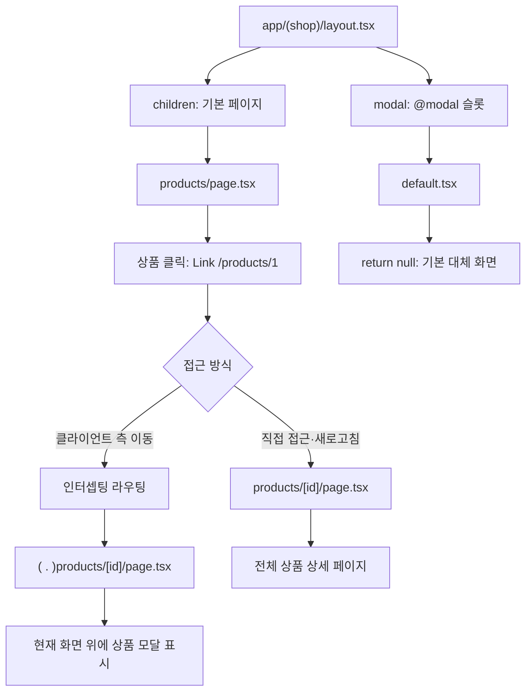

# TIL | React 상태 관리와 Next.js App Router 실습

> **Date:** 2026-10-12 Montag  
> **Tech Stack:** React · Next.js · TypeScript · shadcn/ui  
> **학습 범위:** 3장 3강, 4장 3강 관련 개념, 5장 1·2·4강 일부

## 오늘의 학습 키워드

`useState` · `Immutability` · `Destructuring` · `Automatic Batching` · `useCallback` · `React.memo` · `CRUD` · `App Router` · `Route Groups` · `params` · `searchParams`

**학습 흐름:** 기존 개념 복습 → React State와 Todo 실습 → 함수형 업데이트 및 목록 렌더링 → UI 컴포넌트 활용 → Next.js 정적·동적 라우팅.

## GO TO LECTURE NOTE 🔎

[Part 1 — React 상태 관리와 컴포넌트 설계](#lecture-note-1) | [Part 2 — Next.js App Router 심화](#lecture-note-2)

---

## REVIEW

- Next.js는 SSR(Server-Side Rendering)을 지원하며, SSR 외에도 CSR(Client-Side Rendering), 정적 렌더링 등 다양한 렌더링 방식을 지원한다.
- Next.js App Router에서 `onClick`, `onChange` 등 브라우저 이벤트 핸들러나 `useState`와 같은 클라이언트 Hook을 사용하는 컴포넌트는 Client Component여야 한다.
  - 파일 최상단에 `'use client';`를 선언하여 Client Component 경계를 지정한다.
  - `'use client'`는 JavaScript/TypeScript의 지시문(Directive)이며, CSR만 수행한다는 의미는 아님.
- React 컴포넌트에서 여는 태그와 닫는 태그 사이의 내용을 전달받는 Props 이름은 `children`이며, `React.ReactNode`는 렌더링 가능한 React 자식 콘텐츠를 표현하는 타입.
- React 리스트 렌더링에서 항목의 추가, 삭제, 순서 변경 시 항목 식별에 문제가 생길 수 있어 `key`로 사용하는 것이 권장되지 않는 것: `index`
  - 인덱스도 사용 가능하지만 항목이 추가·삭제되거나 순서가 변경되면 React가 기존 항목과 새 항목을 잘못 연결하여 UI 상태가 예상과 다르게 유지될 수 있음.
  - 가능하면 데이터마다 고유하고 안정적인 `id`를 `key`로 사용.

---

<a id="lecture-note-1"></a>

## LECTURE NOTE [1] — React 상태 관리와 컴포넌트 설계

(교안: 3장 3강 + 새로운 실습 폴더 생성 `chapter03`)

- 터미널에서 다음 명령어를 통해 Next.js 환경의 새로운 프로젝트 디렉터리 생성
- `npx create-next-app@latest chapter03`
- 설치 과정에서 나타나는 설정 질문에 따라 옵션을 선택하고 설치 진행
- Hook: React 함수 컴포넌트 또는 사용자 정의 Hook에서 React의 상태 및 여러 기능을 사용할 수 있게 하는 함수.
  - Hook은 일반적으로 이름이 `use`로 시작함.
  - Hook은 컴포넌트 또는 사용자 정의 Hook의 최상위 수준에서 호출해야 함.
- `useState`: React 컴포넌트의 상태(State)를 저장하고 변경하는 Hook.
  - 상태값과 상태 변경 함수(Setter)를 반환함.
  - Setter를 호출하면 React에 상태 업데이트를 요청함.
  - React는 컴포넌트를 다시 실행하여 새로운 UI를 계산(Render)하고, 이전 렌더링 결과와 비교(Reconciliation)한 뒤 필요한 실제 DOM 변경만 반영(Commit)함.
  - **컴포넌트 함수의 재실행과 브라우저 전체 새로고침은 다른 개념.**
  - 상태값이 이전 값과 `Object.is()` 기준으로 같으면 재렌더링을 생략할 수 있음.
- 일반적으로 부모 컴포넌트가 재렌더링되면 하위 자식 컴포넌트도 재렌더링될 수 있음.
  - 불필요한 렌더링과 연산이 발생하면 성능에 영향을 줄 수 있음.
  - 메모이제이션(Memoization): 이전 계산 결과나 함수 참조 등을 재사용하여 불필요한 연산을 줄이는 최적화 기법.
  - 관련 기능: `React.memo`, `useMemo`, `useCallback`
    - `React.memo`: Props가 변경되지 않은 컴포넌트의 불필요한 재렌더링을 줄이는 데 사용.
    - `useMemo`: 계산 결과를 재사용.
    - `useCallback`: 함수 참조를 재사용.
  - React Compiler를 사용하는 환경에서는 일부 메모이제이션을 자동으로 최적화할 수 있음.
  - React 19 자체가 모든 컴포넌트를 자동으로 메모이제이션하는 것은 아님. React Compiler 사용 여부를 구분해야 함.
- Automatic Batching: 여러 상태 업데이트를 React가 하나의 배치로 묶어 불필요한 재렌더링을 줄이는 기능.
  - 하나의 이벤트 핸들러에서 상태 변경이 여러 번 일어나더라도 일반적으로 한 번의 재렌더링으로 처리할 수 있음.
  - 이전 상태를 기준으로 여러 번 업데이트해야 할 때는 함수형 업데이트를 사용.

```tsx
setCount(count + 1);
setCount(count + 1);
// 동일한 렌더링의 count 값을 사용하므로 일반적으로 +1
setCount((prev) => prev + 1);
setCount((prev) => prev + 1);
// 이전 상태를 순차적으로 계산하므로 +2
```

- (교안 3장 3강 2. 불변성을 지키는 Todo 리스트 컴포넌트 구현)
- 불변성(Immutability): 기존 객체나 배열을 직접 변경하지 않고, 변경된 내용을 포함한 새로운 객체나 배열을 생성하는 방식.
  - React는 상태 업데이트 시 이전 값과 새로운 값을 `Object.is()`로 비교함.
  - 객체·배열은 참조값(Reference)이 같으면 내부 속성을 수정했더라도 같은 값으로 판단될 수 있음.
  - 따라서 객체·배열 상태를 변경할 때는 새로운 참조를 가진 값을 생성해 Setter에 전달해야 함.
  - `push()`, `pop()`은 원본 배열을 변경하는 메서드이므로 State 배열에 직접 사용하는 것을 피해야 함.
  - `map()`, `filter()`, `concat()`, `slice()`는 새로운 배열을 반환하므로 불변성 유지에 활용할 수 있음. 단, 배열 안의 객체까지 자동으로 깊은 복사되는 것은 아님.
- [참고] Array Method
  - 원본 배열 변경: `push`, `pop`, `sort` 등
  - 새로운 배열 반환: `map`, `filter`, `concat`, `slice`
  - 원본 배열을 순회하며 반환값이 `undefined`인 메서드: `forEach`
  - 문자열 반환: `join`
  - 포함 여부 확인: `includes`
  - 누적 계산: `reduce`
  - `forEach`, `reduce` 등은 콜백 함수 내부에서 무엇을 수행하느냐에 따라 원본 데이터 변경 여부가 달라질 수 있음.
- 도메인(Domain): 소프트웨어가 해결하려는 업무·문제 영역.
  - 예: Todo 도메인 → 할 일 등록, 조회, 완료 여부 변경, 삭제 등의 문제 영역.
  - 애플리케이션(Application): 사용자가 특정 목적을 수행할 수 있도록 기능을 제공하는 소프트웨어.
  - 예: 회원 관리·인증 도메인 → 회원 정보, 로그인, 인증 및 권한 등의 문제 영역.
  - 인증 시스템은 해당 문제를 해결하는 애플리케이션의 일부 기능 또는 시스템에 해당함.
- 구조가 있는 값: JavaScript에서 원시값(Primitive Value)을 제외한 객체(Object)는 속성이나 요소 등을 포함하는 구조를 가질 수 있음.
  - 원시값: `string`, `number`, `boolean`, `undefined`, `null`, `bigint`, `symbol`
  - 객체: 일반 객체, 배열, 함수 등
  - 배열(Array)과 객체(Object)는 구조 분해 할당에 주로 사용됨.
- 구조 분해 할당(Destructuring Assignment): 배열이나 객체의 구조를 분해하여 내부 값을 개별 변수에 할당하는 문법.
  - 배열 구조 분해 할당: 요소의 위치를 기준으로 값을 할당.
  - 객체 구조 분해 할당: 속성 이름을 기준으로 값을 할당.

```ts
// 배열 구조 분해 할당
const values = [10, 20];
const [first, second] = values;
console.log(first); // 10
console.log(second); // 20
// 객체 구조 분해 할당
const todo = { title: "공부하기", checked: false };
const { title, checked } = todo;
console.log(title); // "공부하기"
console.log(checked); // false
```

- `useState()`와 구조 분해 할당
  - `useState()`는 현재 상태값과 상태 변경 함수로 구성된 배열(튜플)을 반환함.
  - 따라서 배열 구조 분해 할당을 사용하여 각각의 값을 변수에 저장할 수 있음.
  - 첫 번째 요소: 현재 상태값.
  - 두 번째 요소: 상태 변경 함수(Setter).

```js
// useState 반환 구조를 이해하기 위한 가상 함수
function useState(initValue) {
  return [
    initValue,
    function (newValue) {
      // 상태 변경 함수
    },
  ];
}
const value = useState([]);
value; // [Array(0), f]
const [items, setItems] = useState([]);
```

- 위 코드는 `useState()`의 반환 형태를 설명하기 위한 단순화된 예제이며, 실제 React의 내부 구현은 아님.
- `const value = useState([]);`
  - `value[0]`: 초기 상태값인 빈 배열 `[]`.
  - `value[1]`: 상태 변경 함수.
- `const [items, setItems] = useState([]);`
  - `items`: 반환 배열의 첫 번째 요소인 상태값.
  - `setItems`: 반환 배열의 두 번째 요소인 상태 변경 함수.
  - 배열 구조 분해 할당을 사용하므로 `value[0]`, `value[1]`처럼 인덱스로 접근하지 않아도 됨.
- 실제 React의 `useState()`는 렌더링 사이에 상태를 유지하고, Setter 호출 시 업데이트를 예약하는 기능을 포함함.

### 실습 코드 파일 `chapter03`

```text
chapter03/
├── app/
│   └── todo/
│       └── page.tsx
├── domains/
│   └── todo/
│       └── components/
│           └── TodoItem.tsx
└── .prettierrc
```

- `app`: Next.js App Router에서 페이지와 레이아웃, 라우팅을 정의하는 디렉터리.
  - `app/todo/page.tsx` → `/todo` URL에 해당하는 페이지.
  - App Router에서 컴포넌트는 기본적으로 Server Component.
  - `'use client'`가 선언된 파일은 Client Component 경계가 됨.
- `domains`: 기능이나 업무 도메인별로 컴포넌트, 타입, 로직 등을 정리하기 위한 일반 디렉터리.
  - `app` 외부가 모두 CSR인 것은 아님.
  - Server/Client Component 여부는 폴더 위치가 아니라 `'use client'` 경계와 컴포넌트의 사용 관계에 따라 결정됨.
- `.prettierrc`: Prettier 코드 포맷팅 설정 파일.
- 폴더 구조를 잡은 후 `page.tsx`에 기본 내보내기 함수 컴포넌트 정의.
  - `export default function TodoPage()`는 Next.js가 해당 경로의 페이지 컴포넌트로 사용할 수 있도록 내보내는 것.
- `cd chapter03` / `npm run dev` / `http\://localhost:3000/todo`에서 페이지 확인.
- `interface Todo`로 Todo 데이터의 타입 정의.
  - `id?: number` → `id` 속성은 선택적이며 값이 존재하면 `number` 타입.
  - `title?: string` → `title` 속성은 선택적이며 값이 존재하면 `string` 타입.
  - `checked?: boolean` → `checked` 속성은 선택적이며 값이 존재하면 `boolean` 타입.
  - `?`는 속성을 생략할 수 있다는 의미.
- `useState` → `const [form, setForm] = useState<Todo>({});`
  - `form`: 현재 상태값.
  - `setForm`: 상태를 변경하도록 React에 요청하는 Setter 함수.
  - `useState()`는 상태값과 Setter 함수로 구성된 배열(튜플)을 반환하며, 배열 구조 분해 할당으로 각각의 값을 받음.
  - `setForm`은 상태 변경 시 자동 실행되는 함수가 아니라 개발자가 호출하는 함수.
- `const [items, setItems] = useState<Todo[]>([]);`
  - `items`: Todo 객체들이 들어 있는 배열 상태.
  - `setItems`: Todo 배열 상태를 변경하는 Setter.
- Generic 타입은 최초 인수값으로 정의되는 것이 아니라, `<>` 안에서 명시적으로 지정할 수 있음.
  - `useState<Todo>({})` → 상태 타입을 `Todo`로 명시.
  - `useState<Todo[]>([])` → 상태 타입을 `Todo` 객체 배열로 명시.
  - Generic을 생략하면 TypeScript가 초기값을 바탕으로 타입을 추론할 수 있음.
- 이벤트 객체는 TypeScript에서 이벤트 종류와 HTML 요소에 맞는 타입을 지정하는 것이 좋음.

```tsx
const onChange = (e: ChangeEvent<HTMLInputElement>) => {
  setForm({ ...form, title: e.target.value });
};
```

- `ChangeEvent<HTMLInputElement>`: input 요소에서 발생한 값 변경 이벤트 타입.
- `e.target.value`: 이벤트가 발생한 input의 현재 입력값.
- `onChange={onChange}`
  - 왼쪽 `onChange`: React가 제공하는 이벤트 핸들러 Props.
  - 오른쪽 `onChange`: 개발자가 선언한 함수 이름.
  - 중괄호 `{}`는 JavaScript 표현식을 JSX에 전달하는 문법.
  - 함수를 즉시 실행하는 것이 아니라 함수 참조를 전달함.
- `value={form.title}`
  - 입력창의 값을 React State와 연결하는 Controlled Component 방식.
  - 현재 `title`이 선택적 속성이므로 초기값은 `undefined`일 수 있음.
  - 입력창이 처음부터 문자열 값을 갖도록 `value={form.title ?? ""}`를 사용하거나 State 초기값에 `title: ""`을 지정하는 것이 안전함.
- 렌더링에 반영할 객체 State를 변경할 때는 기존 객체를 직접 수정하지 않고 새로운 객체를 생성해야 함. ⭐

```tsx
const onChange = (e: ChangeEvent<HTMLInputElement>) => {
  // ❌ 기존 객체를 직접 수정하는 방식
  // form.title = e.target.value;
  // ✅ 새로운 객체를 생성하여 상태 변경 요청
  setForm({ ...form, title: e.target.value });
};
```

- `{ ...form }`: 기존 객체의 속성을 복사한 새로운 객체를 생성.
- `title: e.target.value`: 복사한 객체의 `title` 속성을 새 입력값으로 설정.
- 새로운 객체는 기존 객체와 참조가 다르므로 React가 상태 변경을 인식할 수 있음.
- 기존 객체를 직접 변경하는 것만으로는 React에 상태 업데이트가 요청되지 않음.
- `const onSubmit = (e: FormEvent<HTMLFormElement>) => {};`
  - 폼 제출 이벤트를 처리하기 위한 함수로, 현재 구현 전 단계.
  - `FormEvent<HTMLFormElement>`는 폼 이벤트에 널리 사용되는 타입. 일부 React 19 타입 정의에서는 `React.SubmitEvent<HTMLFormElement>`도 사용할 수 있으며, 실제 사용 가능한 타입과 deprecated 여부는 설치된 `@types/react` 버전을 확인.
  - 제출 시 기본 브라우저 동작을 막으려면 필요에 따라 `e.preventDefault()`를 사용.
  - `<form onSubmit={onSubmit}>`으로 함수 연결이 필요함.
  - 이후 `setItems`로 새로운 Todo 항목을 추가하는 로직을 구현.

**---**

### 2교시 — useCallback, 함수형 업데이트, Todo 등록 및 리스트 렌더링

(교안: 3장 3강 — `useState` & Automatic Batching / 관련 개념: 4장 3강 — 메모이제이션)

- 초기값을 설정하는 방법
  - `useState()` 호출 시 초기값을 직접 전달하거나, 별도로 정의한 초기값 객체를 전달할 수 있음.
  - 객체를 초기값으로 사용하는 경우 해당 객체의 구조와 State 타입이 일치해야 함.

```tsx
export interface Todo {
  id?: number;
  title?: string;
  checked?: boolean;
}
const initialValue: Todo = {
  title: "",
  checked: false,
};
export default function TodoPage(): React.JSX.Element {
  const [form, setForm] = useState<Todo>(initialValue);
  const [items, setItems] = useState<Todo[]>([]);
}
```

- `useState<Todo>(initialValue)` → `initialValue` 객체를 초기 상태값으로 사용.
- `useState<Todo>({ initialValue })` → `{ initialValue: ... }`라는 새로운 객체를 생성하는 문법이므로 현재 `Todo` 인터페이스와 일치하지 않아 타입 오류 발생.
- `id?`, `title?`, `checked?`의 `?`는 선택적 속성을 의미함.
  - 현재는 모든 속성이 선택적이지만, 실제 등록된 Todo 항목에는 `id`, `title`, `checked`가 필요하므로 이후 입력 폼 타입과 Todo 항목 타입을 구분하는 것도 가능.
- React 컴포넌트는 재렌더링될 때 함수 본문이 다시 실행됨.
  - 컴포넌트 내부에서 선언한 일반 함수도 렌더링마다 새로 생성될 수 있음.
  - 함수 참조가 매번 바뀌면 이를 Props로 전달받는 자식 컴포넌트의 메모이제이션 등에 영향을 줄 수 있음.
  - 이를 최적화하기 위한 Hook 중 하나가 `useCallback`.
- 메모이제이션(Memoization): 이전에 계산한 결과나 함수 참조를 재사용하는 최적화 기법.
  - `useCallback`: 의존성(Dependencies)이 변경되지 않았다면 이전 함수 참조를 재사용하는 Hook.
  - React 18뿐 아니라 React 19에서도 사용 가능.
  - React Compiler가 활성화된 환경에서는 일부 메모이제이션이 자동으로 처리될 수 있음.
  - 모든 함수에 반드시 `useCallback`을 적용해야 하는 것은 아님.

```tsx
const onChange = useCallback(
  (e: ChangeEvent<HTMLInputElement>) => {
    setForm({ ...form, title: e.target.value });
  },
  [form],
);
```

- `useCallback(함수, 의존성 배열)`의 구조
  - 첫 번째 인수: 재사용할 함수.
  - 두 번째 인수: 함수가 의존하는 값들의 배열.
  - `[]`: 의존하는 반응형 값이 없으므로 일반적으로 렌더링 사이에 같은 함수 참조를 유지.
  - `[form]`: `form`이 변경되면 이번 렌더링에서 전달된 새 함수 참조를 저장하고 반환.
  - React는 의존성의 이전 값과 현재 값을 `Object.is()`로 비교함.
  - `[]`라고 해서 함수 표현식 자체가 매번 생성되지 않는다는 뜻은 아님. React가 이전 함수 참조를 재사용한다는 의미이며, 개발 모드나 캐시 폐기 상황 등의 예외가 있음.
- 위 코드는 `form`을 참조하고 있으므로 `[form]`을 의존성으로 지정하는 것이 올바름.
- **`form`을 참조한다고 해서 비순수 함수가 되는 것은 아니며, `[form]`을 사용해도 오류가 발생하지 않음.**
- 다만 `form`이 바뀔 때마다 `onChange` 함수 참조도 새로 생성되므로, 함수형 업데이트를 사용하면 의존성을 줄일 수 있음.

```tsx
const onChange = useCallback((e: ChangeEvent<HTMLInputElement>) => {
  setForm((prev) => ({
    ...prev,
    title: e.target.value,
  }));
}, []);
```

- `setForm(prev => ...)`: 함수형 업데이트(Functional Update).
  - `prev`: React가 전달하는 이전 State 값.
  - `{ ...prev }`: 이전 객체의 속성을 복사한 새로운 객체 생성.
  - `title: e.target.value`: 변경할 속성만 새로운 값으로 설정.
  - 이전 `form` 변수를 직접 참조하지 않으므로 `onChange`의 의존성 배열을 `[]`로 설정할 수 있음.
  - 객체의 불변성을 유지하면서 상태 변경을 요청하는 방식.
- 순수 함수(Pure Function): 동일한 입력에 대해 동일한 결과를 반환하고, 실행 과정에서 외부 상태를 변경하는 부수 효과(Side Effect)가 없는 함수.
  - 부수 효과의 예: 외부 변수 변경, DOM 직접 조작, 네트워크 요청 등.
  - 외부 값을 읽는다고 무조건 부수 효과가 발생하는 것은 아님.
  - 외부의 변경 가능한 값에 따라 결과가 달라진다면 순수성에 영향을 줄 수 있음.
  - `useCallback`은 함수를 순수 함수로 변환하는 Hook이 아니라 함수 참조를 메모이제이션하는 Hook.
  - `setForm`은 State 업데이트를 요청하는 동작이므로 이벤트 핸들러 자체를 순수 함수라고 단정하지 않음. React의 렌더링 로직은 순수하게 작성해야 하지만 이벤트 핸들러에서는 State 업데이트 등 부수 효과를 수행할 수 있음.
  - 함수형 업데이트를 사용하는 이유는 순수 함수로 만들기 위해서가 아니라 **이전 State를 안전하게 참조하고 불필요한 의존성을 줄이기 위해서**임.
- Todo 등록 함수 `onSubmit` 구현

```tsx
const onSubmit = useCallback(
  (e: FormEvent<HTMLFormElement>) => {
    e.preventDefault();
    // setItems(items.concat([{ ...form, id: Date.now() }]));
    setItems((prev) => prev.concat([{ ...form, id: Date.now() }]));
    // 등록 완료 이후 입력값 초기화
    setForm({ ...initialValue });
  },
  [form],
);
```

- `e.preventDefault()`: HTML Form 제출 시 발생하는 기본 브라우저 동작을 방지.
- `setItems()`: Todo 목록 State를 업데이트하는 Setter.
- `concat()`: 기존 배열을 직접 수정하지 않고 새로운 배열을 반환하는 메서드.
- `{ ...form, id: Date.now() }`
  - `...form`: 현재 입력 폼 객체의 속성을 복사.
  - `id: Date.now()`: 등록 시점의 타임스탬프를 ID로 사용.
  - `Date.now()`는 밀리초 단위이므로 빠르게 연속 생성하면 ID가 중복될 가능성이 있음.
- `setItems(prev => prev.concat(...))`
  - 이전 Todo 배열을 기준으로 새로운 항목을 추가.
  - 기존 `items`를 직접 참조하지 않으므로 이전 상태를 안전하게 업데이트할 수 있음.
- `onSubmit` 내부에서는 `form` 값을 직접 사용하므로 의존성 배열에 `[form]`을 지정.
- `setForm({ ...initialValue })`: Todo 등록 후 입력 폼을 초기 상태로 변경.
  - 전개 연산자로 초기값 객체를 복사하여 새로운 객체를 생성함.
- Todo 리스트 렌더링

```tsx
<ul>
  {items.length === 0 ? (
    <li>등록된 할일이 없습니다.</li>
  ) : (
    items.map((item) => <TodoItem key={item.id} {...item} />)
  )}
</ul>
```

- `items.length === 0`: Todo 목록이 비어 있는지 확인.
- 삼항 연산자 `조건 ? 참일 때 : 거짓일 때`를 사용해 조건부 렌더링.
  - 항목이 없으면 안내 문구 출력.
  - 항목이 있으면 `map()`을 사용하여 각 Todo 데이터를 `TodoItem` 컴포넌트로 변환.
- `items.map(item => ...)`: 배열의 각 요소를 순회하며 JSX 요소 배열 생성.
- `key={item.id}`: React가 각 목록 항목을 식별하기 위한 고유한 Key 지정.
  - `key`는 일반 Props처럼 `TodoItem` 내부에 자동 전달되지 않음.
  - 항목의 추가·삭제·순서 변경 시 React가 항목의 정체성을 구분하는 데 사용.
- `{...item}`: 객체 전개 연산자(Object Spread)를 사용해 `item` 객체의 속성을 각각 Props로 전달.
  - `key`와 `{...item}`은 서로 다른 역할을 수행함.

```tsx
// 객체의 각 속성을 직접 전달
<TodoItem
    key={item.id}
    id={item.id}
    title={item.title}
    checked={item.checked}
/>
// 객체 전개 연산자를 사용해 전달
<TodoItem key={item.id} {...item} />
```

- 두 코드는 `TodoItem`에 전달하는 일반 Props 기준으로 동일한 의미.
- `key`는 목록 식별에 사용되며, 객체의 속성을 자동으로 펼치는 기능은 아님.
- `TodoItem`의 Props 타입은 전달되는 `item` 객체의 속성과 일치해야 함.
- JSX 이벤트 핸들러 연결

```tsx
<form onSubmit={onSubmit}>
  <input
    type="text"
    name="title"
    className="border"
    onChange={onChange}
    value={form.title ?? ""}
  />
  <button type="submit" className="border">
    할일 등록
  </button>
</form>
```

- `onSubmit={onSubmit}`
  - 왼쪽 `onSubmit`: React의 폼 제출 이벤트 Props.
  - 오른쪽 `onSubmit`: 개발자가 정의한 이벤트 처리 함수.
- `onChange={onChange}`
  - 왼쪽 `onChange`: React의 입력값 변경 이벤트 Props.
  - 오른쪽 `onChange`: 개발자가 정의한 이벤트 처리 함수.
- `value={form.title ?? ''}`
  - `form.title`이 `undefined` 또는 `null`이면 빈 문자열을 사용.
  - 입력창을 처음부터 Controlled Component로 유지할 수 있음.
- 현재 코드 점검
  - `useState<Todo>({ initialValue })` → `useState<Todo>(initialValue)`로 수정 필요.
  - `import { title } from 'process';` → 현재 사용하지 않으며 브라우저 컴포넌트에서 불필요한 Node.js 모듈 import이므로 제거.
  - `TodoItem` 컴포넌트의 Props 타입이 `Todo` 인터페이스와 일치하는지 확인 필요.
  - 등록된 Todo의 `id`는 가능하면 필수 속성으로 정의하는 것이 좋음.
  - 빈 문자열도 등록될 수 있으므로 이후 `form.title?.trim()`을 이용한 입력값 검증 추가 가능.
- `React.memo`: React 컴포넌트를 메모이제이션하여, 부모가 재렌더링되더라도 자식 컴포넌트의 Props가 동일하면 불필요한 재렌더링을 생략할 수 있도록 하는 기능.
  - `export default React.memo(TodoItem);` → 메모이제이션한 `TodoItem` 컴포넌트를 기본 내보내기.
  - `export default function TodoItem()` → 메모이제이션 없이 일반 컴포넌트를 기본 내보내기.
  - `React.memo`는 필수 기능이 아니며 성능 최적화가 필요한 경우 사용.
  - React 19에서도 사용할 수 있고, React Compiler가 활성화된 환경에서는 일부 수동 메모이제이션을 줄일 수 있음.
- `useCallback`과의 차이
  - `React.memo`: 컴포넌트의 불필요한 재렌더링을 줄임.
  - `useCallback`: 함수 참조를 재사용함.
- `import { type Todo } from '@/app/todo/page';`
  - `Todo`가 TypeScript 타입임을 명시하는 타입 전용 import.
  - `import type { Todo } from '@/app/todo/page';`로도 작성 가능. 다만 도메인 컴포넌트가 페이지 파일에 의존하지 않도록 추후 `domains/todo/types.ts`에 타입을 분리하는 편이 좋음. 등록된 Todo의 필수 속성과 입력 폼의 선택적 속성은 별도 타입으로 정의할 수 있음.
- `function TodoItem({ id, title, checked }: Todo)`
  - Props 객체를 매개변수에서 바로 구조 분해 할당.
  - `function TodoItem(item: Todo)`로 객체 전체를 받은 뒤 `const { id, title, checked } = item;`으로 분해해도 동일함.

**---**

#### UI 컴포넌트 라이브러리 및 렌더링 개념

- 프론트엔드 개발에서는 버튼, 입력창, 아이콘, 대화상자 등 UI 구현에 활용할 수 있는 라이브러리와 컴포넌트 도구가 있음.
- `shadcn/ui`: React 프로젝트에 필요한 UI 컴포넌트 코드를 추가하여 사용하는 도구.
  - 일반적인 UI 컴포넌트 라이브러리처럼 모든 컴포넌트를 하나의 패키지에서 가져오는 방식과는 다름.
  - CLI(Command-Line Interface)를 이용해 컴포넌트 코드를 프로젝트에 추가하고 직접 수정할 수 있음.
  - 사이트: https\://ui.shadcn.com/

```bash
npx shadcn@latest init
```

- `npx`: npm 패키지의 CLI 명령어를 실행할 때 사용하는 명령어.
- `shadcn@latest`: 최신 shadcn CLI 사용.
- `init`: 현재 프로젝트에서 shadcn/ui를 사용할 수 있도록 초기 설정.
- 설치 과정에서 설정 질문이 나타나면 프로젝트 환경에 맞게 선택.
  - 실습에서는 안내에 따라 `y`, `Enter` 등을 입력하고 `Nova` 스타일을 선택.
  - 실제 질문과 선택지는 CLI 버전 및 프로젝트 설정에 따라 달라질 수 있음.
- `shadcn/ui`의 UI 컴포넌트와 아이콘 라이브러리는 별개의 개념임.
  - shadcn/ui는 주로 UI 컴포넌트 구현에 사용.
  - 아이콘은 Lucide 등 별도 아이콘 패키지를 활용할 수 있음.
- `react-icons`: 여러 아이콘 세트를 React 컴포넌트 형태로 사용할 수 있는 라이브러리.

```bash
npm i react-icons
```

- `npm i`: npm install의 축약형으로 패키지를 설치하는 명령어.
- 설치 후 필요한 아이콘을 import하여 JSX에서 컴포넌트처럼 사용.

```tsx
import { FaCheck } from "react-icons/fa";
export default function CheckIcon() {
  return <FaCheck />;
}
```

- `FaCheck`: Font Awesome 아이콘 세트의 체크 아이콘.
- 아이콘은 JSX에서 `<FaCheck />`와 같이 컴포넌트로 사용 가능.
- shadcn/ui와 react-icons는 서로 다른 도구이므로 필요한 목적에 따라 선택하여 사용.

### 렌더링(Rendering)과 재렌더링(Re-rendering)

- 렌더링(Rendering): React가 컴포넌트를 실행하여 화면에 표시할 UI를 계산하는 과정.
  - 함수 컴포넌트는 JSX를 반환함.
  - React는 반환된 결과를 바탕으로 실제 DOM에 반영할 내용을 결정함.
- 재렌더링(Re-rendering): State 업데이트, 부모 컴포넌트 렌더링, Context 변경 등의 영향으로 React가 컴포넌트를 다시 실행하여 새로운 UI를 계산하는 과정. Props는 부모의 렌더링 과정에서 새로 전달될 수 있음.
  - 재렌더링은 브라우저 전체 새로고침과 다름.
  - 컴포넌트가 다시 실행되어도 실제 DOM 전체가 새로 생성되는 것은 아님.
- React의 렌더링 흐름
  1. Trigger: 최초 마운트 또는 State 업데이트 등으로 렌더링 요청.

  2. Render: 컴포넌트 함수를 실행하여 새로운 UI 계산.

  3. Reconciliation: 이전 렌더링 결과와 새로운 결과 비교.

  4. Commit: 변경이 필요한 실제 DOM만 반영.

```tsx
"use client";
import { useState } from "react";
export default function Counter() {
  const [count, setCount] = useState(0);
  console.log("컴포넌트 실행");
  return (
    <>
      <p>{count}</p>
      <button onClick={() => setCount((prev) => prev + 1)}>증가</button>
    </>
  );
}
```

- 버튼 클릭 → `setCount()` 호출 → State 업데이트 → 컴포넌트 재렌더링.
- `Counter()` 함수가 다시 실행되면서 새로운 JSX를 계산함.
- 기존 결과와 비교한 뒤 필요한 DOM 변경만 반영.
- 브라우저 새로고침(F5)과 달리 컴포넌트 State는 일반적으로 유지됨.

### 렌더링과 최적화의 관계

- 부모 컴포넌트가 재렌더링되면 자식 컴포넌트도 Props가 같더라도 재렌더링될 수 있음. `React.memo`로 렌더링을 생략할 수 있지만, 자식 자신의 State나 사용하는 Context가 변경되면 다시 렌더링될 수 있음.
- 실제 DOM이 변경되지 않더라도 컴포넌트 함수의 실행과 계산 비용은 발생할 수 있음.
- `React.memo`: Props가 동일하면 자식 컴포넌트의 불필요한 재렌더링을 생략할 수 있도록 하는 기능.
- `useCallback`: 의존성이 변경되지 않았다면 함수 참조를 재사용하는 Hook.
- `useMemo`: 의존성이 변경되지 않았다면 이전 계산 결과를 재사용하는 Hook.
- React Compiler가 활성화된 환경에서는 일부 메모이제이션이 자동으로 최적화될 수 있음.
- 단순한 컴포넌트에 모든 최적화 기능을 적용할 필요는 없으며, 실제 성능 문제가 있는지 확인하고 사용하는 것이 좋음.

**---**

**---**

### 3교시 — UI 컴포넌트 추가 및 활용

(교안: UI 컴포넌트 설치 실습 / `useCallback`과 CRUD 구현 복습)

- shadcn/ui 초기 설정 이후 필요한 컴포넌트를 프로젝트에 추가할 수 있음.
- 실습에서는 개발 서버를 종료한 후 CLI 명령어를 실행하여 Button과 Input 컴포넌트를 추가함.
  - 반드시 서버를 종료해야만 설치할 수 있는 것은 아님.
  - 개발 서버 실행과 별개로 터미널에서 설치 명령어 실행 가능.

```bash
npx shadcn@latest add button input
```

- `npx shadcn@latest add`: shadcn/ui 컴포넌트를 프로젝트에 추가하는 명령어.
- `button input`: 추가할 컴포넌트 이름.
- 설정된 컴포넌트 경로에 파일이 생성됨.

```text
components/
└── ui/
    ├── button.tsx
    └── input.tsx
```

- `components/ui/input.tsx`: 재사용 가능한 Input UI 컴포넌트.
- `components/ui/button.tsx`: 재사용 가능한 Button UI 컴포넌트.
- 컴포넌트 설치 경로는 프로젝트의 `components.json` 설정에 따라 달라질 수 있음.
- `shared`: 여러 기능이나 도메인에서 공통으로 사용하는 컴포넌트, 함수, 타입 등을 관리하기 위한 디렉터리 또는 모듈 구성 방식.
  - Next.js나 React가 반드시 요구하는 폴더 이름은 아님.
  - 공통 UI 컴포넌트를 `shared`에 배치하는 것은 프로젝트 구조를 설계하는 방법 중 하나.

#### React의 Checkbox 및 Radio

- React에서도 HTML의 `checkbox`, `radio` 요소를 사용할 수 있음.
- 체크 여부나 선택값을 React State와 연결하여 관리할 수 있음.
- 필요에 따라 기본 입력 요소 대신 아이콘이나 이미지를 사용해 UI를 직접 구현할 수도 있음.
- 아이콘을 사용하더라도 접근성, 키보드 조작, 체크 상태 전달 등을 고려해야 함.

```tsx
// 컴포넌트 함수 내부의 코드 예시
const [checked, setChecked] = useState(false);
return (
  <input
    type="checkbox"
    checked={checked}
    onChange={(e) => setChecked(e.target.checked)}
  />
);
```

- `checked={checked}`: 체크 여부를 State와 연결.
- `e.target.checked`: 체크박스의 현재 선택 상태를 boolean 값으로 반환.
- `setChecked()`: 체크 상태 변경을 React에 요청.

#### CRUD와 useCallback 복습

- CRUD: 데이터를 다루는 기본적인 네 가지 작업.
  - Create: 데이터 생성.
  - Read: 데이터 조회.
  - Update: 데이터 수정.
  - Delete: 데이터 삭제.
- Todo 앱에서의 예시
  - Create: 새로운 할 일 등록.
  - Read: 등록된 할 일 목록 출력.
  - Update: 할 일의 완료 여부 또는 제목 변경.
  - Delete: 등록된 할 일 삭제.
- `useCallback`은 CRUD 기능 자체를 구현하는 Hook이 아님.
  - 이벤트 처리 함수의 참조를 재사용하기 위한 최적화 기능.
  - CRUD 구현에는 `useState`, 배열 메서드, 이벤트 핸들러 등을 활용할 수 있음.

**---**

### 4교시 — Next.js App Router 라우팅과 Route Groups

(교안: 5장 1강 — App Router 라우팅 & Route Groups / 5장 2강과 4강 일부)

#### A. 라우팅(Routing)의 개념

- 라우팅(Routing): 사용자가 접근한 URL에 따라 적절한 페이지나 콘텐츠를 연결하는 과정.
- Next.js App Router는 파일 시스템 기반 라우팅(File-system Based Routing)을 사용함.
- `app` 디렉터리의 폴더 구조를 이용해 URL 경로를 정의함.
- `page.tsx`: 해당 URL에서 렌더링할 페이지 컴포넌트를 정의하는 파일.

```text
app/
├── page.tsx
├── login/
│   └── page.tsx
└── board/
    └── page.tsx
```

- `app/page.tsx` → `/`
- `app/login/page.tsx` → `/login`
- `app/board/page.tsx` → `/board`

#### B. Route Groups — 경로 그룹화

- Route Groups: App Router에서 관련 페이지를 논리적으로 그룹화하는 기능.
- 폴더 이름을 소괄호 `()`로 감싸서 정의함.
- Route Group의 폴더 이름은 실제 URL 경로에 포함되지 않음.
- 관리자 페이지와 일반 사용자 페이지처럼 레이아웃이나 기능 구성이 다른 영역을 분리하는 데 활용할 수 있음.

```text
app/
├── (user)/
│   ├── layout.tsx
│   └── login/
│       └── page.tsx
└── (admin)/
    ├── layout.tsx
    └── dashboard/
        └── page.tsx
```

- `app/(user)/login/page.tsx` → `/login`
- `app/(admin)/dashboard/page.tsx` → `/dashboard`
- `(user)`, `(admin)`은 URL에 표시되지 않음.
- 서로 다른 Route Group에 각각 다른 `layout.tsx`를 적용할 수 있음.
- 공통 컴포넌트는 별도 디렉터리에서 관리하고 필요한 페이지에서 import하여 재사용 가능.

**주의**

- Route Groups는 페이지 구조와 레이아웃을 구분하는 기능.
- 폴더를 나눈다고 관리자 접근 권한이 자동으로 제한되는 것은 아님.
- 관리자 페이지 보호를 위해서는 인증(Authentication)과 인가(Authorization) 로직이 별도로 필요함.

#### C. SPA와 MPA

- SPA(Single-Page Application)
  - 하나의 페이지 문서를 기반으로 화면과 콘텐츠를 동적으로 변경하는 애플리케이션 방식.
  - 페이지 이동 시 브라우저 문서 전체를 다시 로드하지 않고 필요한 내용을 갱신할 수 있음.
  - 상황에 따라 페이지 전환이 빠르고 사용자 경험이 자연스러울 수 있음.
- MPA(Multi-Page Application)
  - 여러 HTML 문서를 기반으로 페이지를 구성하는 방식.
  - 전통적인 페이지 이동에서는 새로운 문서를 서버에 요청하여 로드함.
  - 페이지마다 독립적인 문서를 제공할 수 있음.
- Next.js는 서버 렌더링과 클라이언트 측 내비게이션을 함께 활용할 수 있음.
- SPA와 MPA는 애플리케이션 구성 및 페이지 탐색 방식에 관한 개념.
- SSR과 CSR은 콘텐츠가 어디에서 렌더링되는지에 관한 개념.
- 따라서 SPA = CSR, MPA = SSR로 완전히 동일시하면 안 됨.

#### D. a 태그와 Next.js Link 컴포넌트

```tsx
import Link from "next/link";
export default function Navigation() {
  return (
    <>
      <Link href="/login">로그인 (Next.js Link)</Link>
      <a href="/login">로그인 (HTML a)</a>
    </>
  );
}
```

- `<a href="/login">`
  - HTML의 기본 링크 요소.
  - 일반적인 내부 링크 클릭 시 브라우저가 새로운 문서로 탐색함.
  - SSR 전용 태그는 아님.
- `<Link href="/login">`
  - Next.js에서 제공하는 내비게이션 컴포넌트.
  - 내부 경로 이동 시 클라이언트 측 내비게이션을 지원함.
  - 가능한 경우 전체 문서를 새로 로드하지 않고 변경된 경로에 필요한 내용을 가져와 화면을 갱신함.
  - 필요한 경로 데이터를 미리 가져오는 Prefetching을 지원함.
  - 내부적으로 링크 요소를 렌더링함.
- `fetch()`: 네트워크를 통해 데이터를 요청하는 Web API.
- `<Link>`를 사용한다고 개발자가 반드시 `fetch()`를 직접 작성해야 하는 것은 아님.
- Next.js가 라우팅 과정에서 필요한 데이터를 요청하고 화면을 갱신할 수 있음.

#### E. Link의 replace와 scroll 옵션

```tsx
<Link href="/login" replace>
    로그인
</Link>
<Link href="/board" scroll={false}>
    게시판
</Link>
```

- `replace`
  - 기본값은 `false`.
  - `replace={true}`로 지정하면 현재 브라우저 방문 기록 항목을 새로운 경로로 교체함.
  - 이전 페이지를 방문 기록에 새 항목으로 추가하지 않으므로 뒤로 가기 동작에 영향을 줌.
- `scroll`
  - 기본값은 `true`.
  - Next.js가 경로 이동 시 스크롤 위치를 관리함.
  - `scroll={false}`를 지정하면 Next.js의 자동 스크롤 조정을 비활성화함.
  - 기본 동작이 모든 상황에서 무조건 페이지 최상단으로 이동한다는 의미는 아님.

**---**

### 5교시 — 동적 라우팅과 URL 매개변수

(교안: 5장 2강 및 4강 일부)

#### A. 동적 라우팅(Dynamic Routing)

- 동적 라우팅: URL에서 일부 경로가 고정되지 않고 값에 따라 달라지는 라우팅 방식.
- 게시글 상세 페이지처럼 동일한 페이지 구조를 사용하지만 게시글 ID에 따라 다른 데이터를 표시할 때 활용함.

예시:

```text
/board/1  → 1번 게시글
/board/2  → 2번 게시글
/board/3  → 3번 게시글
```

- URL에서 달라지는 부분을 동적 경로 세그먼트(Dynamic Route Segment)로 정의할 수 있음.
- 폴더 이름을 대괄호 `[변수명]`으로 작성함.

```text
app/
└── board/
    └── [id]/
        └── page.tsx
```

- `[id]`: 동적 경로 변수.
- `/board/1`에 접근하면 `id` 값은 `"1"`.
- `/board/2`에 접근하면 `id` 값은 `"2"`.
- URL에서 전달받는 `id`는 기본적으로 문자열임.

#### B. params — 동적 경로 값 가져오기

- `params`: 동적 경로 세그먼트에서 추출한 값을 담은 객체.
- 최신 Next.js App Router의 Page 컴포넌트에서는 Promise 형태로 전달됨.
- 따라서 비동기 함수 `async`와 `await`를 사용해 값을 가져올 수 있음.

```tsx
type Props = {
  params: Promise<{ id: string }>;
};
export default async function BoardDetailPage({ params }: Props) {
  const { id } = await params;
  return <h1>{id}번 게시글</h1>;
}
```

- `async`: 비동기 함수 선언.
- `Promise`: 비동기 작업의 결과를 나타내는 객체.
- `await params`: Promise가 제공하는 결과값을 가져옴.
- `const { id } = await params`: 객체 구조 분해 할당으로 `id` 추출.
- `/board/1` → `id = "1"`.

**주의**

- `params`가 Promise라고 해서 모든 페이지 컴포넌트를 반드시 비동기 함수로 만들어야 하는 것은 아님.
- Server Component에서 `await`로 값을 읽는 경우 `async` 함수가 필요함.
- 동적 경로를 사용하지 않는 페이지에서는 `params`를 반드시 사용할 필요가 없음.

#### C. Catch-all Segments — 여러 경로 값 가져오기

- `[...변수명]`: 하나 이상의 하위 경로 세그먼트를 모두 받아오는 방식.
- 결과는 문자열 배열 형태로 전달됨.

```text
app/
└── docs/
    └── [...slug]/
        └── page.tsx
```

```text
/docs/react/hooks/useState
```

```ts
slug = ["react", "hooks", "useState"];
```

- `slug`는 문자열 배열 `string[]`.
- 여러 단계의 URL 경로를 하나의 페이지에서 처리할 때 사용.
- `[...slug]`는 최소 하나의 경로 세그먼트가 필요함.
- `[[...slug]]`는 선택적 Catch-all Segment로, 하위 경로가 없어도 해당 경로를 처리할 수 있음.

#### D. searchParams — 쿼리스트링 값 가져오기

- `searchParams`: URL의 쿼리스트링(Query String) 값을 가져오기 위한 Page Props.
- 쿼리스트링은 URL의 `?` 뒤에 작성하는 값.
- 여러 매개변수는 `&`로 연결함.

예시:

```text
/board?page=2&keyword=react
```

- `page=2`: 페이지 번호를 나타내는 쿼리 매개변수.
- `keyword=react`: 검색어를 나타내는 쿼리 매개변수.
- 쿼리스트링 값은 기본적으로 문자열이며, 같은 키가 여러 번 등장하면 배열 형태로 처리될 수 있음.

```tsx
type Props = {
  searchParams: Promise<{
    page?: string | string[];
    keyword?: string | string[];
  }>;
};
export default async function BoardPage({ searchParams }: Props) {
  const { page, keyword } = await searchParams;
  const currentPage = typeof page === "string" ? page : "1";
  const searchKeyword = typeof keyword === "string" ? keyword : "";
  return (
    <>
      <p>현재 페이지: {currentPage}</p>
      <p>검색어: {searchKeyword}</p>
    </>
  );
}
```

- `searchParams`: 쿼리스트링 값이 들어 있는 객체를 비동기로 전달.
- `await searchParams`: Promise 결과값 가져오기.
- `page`, `keyword`: 객체 구조 분해 할당으로 각각 추출.
- 값이 없을 수 있으므로 선택적 속성 `?` 사용.
- 숫자로 계산해야 하는 페이지 번호는 별도로 숫자 변환과 유효성 검사가 필요함.

#### E. params와 searchParams 비교

\| 구분 | params | searchParams |

\|---|---|---|

\| 목적 | URL 경로의 동적 부분 추출 | 쿼리스트링 값 추출 |

\| URL 예시 | `/board/10` | `/board?page=2` |

\| 값 | `id = "10"` | `page = "2"` |

\| 폴더 정의 | `[id]` 필요 | 별도 동적 폴더 불필요 |

\| 주 사용 사례 | 상세 페이지 식별 | 검색, 필터, 정렬, 페이지네이션 |

#### F. params와 searchParams 함께 사용하기

```text
/board/10?mode=edit
```

- `params` → `{ id: "10" }`
- `searchParams` → `{ mode: "edit" }`

```tsx
type Props = {
  params: Promise<{ id: string }>;
  searchParams: Promise<{ mode?: string }>;
};
export default async function BoardDetailPage({ params, searchParams }: Props) {
  const { id } = await params;
  const { mode } = await searchParams;
  return (
    <>
      <h1>{id}번 게시글</h1>
      <p>모드: {mode ?? "view"}</p>
    </>
  );
}
```

- `params`는 어떤 게시글인지 식별하는 데 사용.
- `searchParams`는 해당 게시글을 어떤 조건이나 모드로 보여줄지 결정하는 데 사용할 수 있음.

---

<a id="lecture-note-2"></a>

## LECTURE NOTE [2] — ⭐⭐⭐ Next.js App Router 심화 ⭐⭐⭐

### 6교시 — Route Groups, Parallel Routes, Intercepting Routes

**학습 키워드:** `App Router` · `Route Groups` · `Slot` · `Parallel Routes` · `Intercepting Routes` · `layout.tsx` · `default.tsx`

**실습 프로젝트:** `shopping-mall`

**오늘의 핵심:** Next.js에서는 폴더 구조로 URL을 정의할 뿐 아니라, Route Groups로 페이지를 구분하고 Parallel Routes와 Intercepting Routes를 조합하여 상품 상세 모달과 같은 UI를 구현할 수 있다.

---

### A. Route Groups — 경로 그룹화

#### 1. 정의와 목적

Route Groups(경로 그룹화)는 Next.js App Router에서 관련 페이지를 논리적으로 묶는 기능이다.

- 폴더 이름을 소괄호 `()`로 감싸서 선언한다.
- Route Group 이름은 실제 URL에 포함되지 않는다.
- 페이지별 레이아웃과 기능을 구분할 때 사용한다.

**쇼핑몰 예시**

```text
app/
├── (auth)/               # 로그인·회원가입
│   ├── login/
│   │   └── page.tsx
│   └── signup/
│       └── page.tsx
│
├── (shop)/               # 소비자 페이지
│   ├── layout.tsx
│   ├── page.tsx
│   ├── products/
│   │   ├── page.tsx
│   │   └── [id]/
│   │       └── page.tsx
│   └── cart/
│       └── page.tsx
│
└── (admin)/              # 관리자 페이지
    └── admin/
        └── dashboard/
            └── page.tsx
```

| 파일 경로                              | 실제 URL           |
| -------------------------------------- | ------------------ |
| `app/(shop)/page.tsx`                  | `/`                |
| `app/(shop)/products/page.tsx`         | `/products`        |
| `app/(shop)/products/[id]/page.tsx`    | `/products/1`      |
| `app/(auth)/login/page.tsx`            | `/login`           |
| `app/(admin)/admin/dashboard/page.tsx` | `/admin/dashboard` |

**주의**

- `(shop)`, `(auth)`, `(admin)`은 URL 경로에 포함되지 않는다.
- 서로 다른 Route Group에 같은 URL을 만드는 `page.tsx`가 존재하면 경로 충돌이 발생한다.
- `(admin)`으로 그룹화한다고 관리자 접근 권한이 자동으로 설정되는 것은 아니다.
- 인증(Authentication)과 인가(Authorization)는 별도로 구현해야 한다.

---

### B. 슬롯(Slot)과 병렬 라우팅(Parallel Routes)

#### 1. 슬롯의 정의

Slot(슬롯)은 하나의 레이아웃에서 별도로 렌더링할 수 있는 이름 있는 UI 영역이다.

- 폴더 이름 앞에 `@`를 붙여 선언한다.
- `@modal`, `@analytics`, `@cart`처럼 이름을 지정할 수 있다.
- 슬롯 이름은 URL 경로에 포함되지 않는다.

#### 2. 병렬 라우팅의 정의

Parallel Routes(병렬 라우팅)는 하나의 레이아웃에서 여러 슬롯을 동시에 렌더링할 수 있는 Next.js 기능이다.

**사용 목적**

- 대시보드의 통계·매출 화면
- 쇼핑몰의 상품 목록과 추가 UI 영역
- 현재 페이지를 유지하면서 표시하는 상품 상세 모달

**예시 구조**

```text
app/
└── dashboard/
    ├── layout.tsx
    ├── page.tsx
    ├── @analytics/
    │   └── page.tsx
    └── @sales/
        └── page.tsx
```

**layout.tsx**

```tsx
export default function DashboardLayout({
  children,
  analytics,
  sales,
}: {
  children: React.ReactNode;
  analytics: React.ReactNode;
  sales: React.ReactNode;
}) {
  return (
    <div>
      <header>Dashboard</header>

      <div className="grid grid-cols-2 gap-4">
        {analytics}
        {sales}
      </div>

      <main>{children}</main>
    </div>
  );
}
```

**코드 설명**

- `children`: 기본 페이지 콘텐츠
- `analytics`: `@analytics` 슬롯의 콘텐츠
- `sales`: `@sales` 슬롯의 콘텐츠
- `React.ReactNode`: React가 렌더링할 수 있는 자식 콘텐츠를 나타내는 타입

`@analytics`와 `@sales`는 별도의 URL을 생성하는 폴더가 아니다.

**배운 점:** 병렬 라우팅은 여러 페이지 영역을 하나의 레이아웃에서 조합하기 위한 기능이며, 실제 배치는 JSX와 CSS로 결정한다.

---

### C. 인터셉팅 라우팅(Intercepting Routes)

#### 1. 정의와 목적

Intercepting Routes(인터셉팅 라우팅)는 클라이언트 측 페이지 이동 중 다른 경로의 콘텐츠를 현재 레이아웃 안에서 표시하는 기능이다.

쇼핑몰에서는 상품 목록에서 상품을 클릭했을 때 **목록 화면을 유지하면서 상품 상세 모달을 표시**하는 데 활용할 수 있다.

#### 2. 인터셉팅 라우팅 문법

| 문법       | 의미                       |
| ---------- | -------------------------- |
| `(.)`      | 같은 라우트 세그먼트 수준  |
| `(..)`     | 한 단계 위 라우트 세그먼트 |
| `(..)(..)` | 두 단계 위 라우트 세그먼트 |
| `(...)`    | `app` 라우팅 루트          |

**주의:** 일반적인 파일 시스템 경로가 아니라 Route Segment(라우트 세그먼트)를 기준으로 계산한다.

- `@modal` 같은 슬롯 폴더는 세그먼트 수준에 포함되지 않는다.
- `(shop)` 같은 Route Group도 URL 세그먼트에 포함되지 않는다.

**쇼핑몰 예시**

```text
app/
└── (shop)/
    ├── products/
    │   └── [id]/
    │       └── page.tsx
    │
    └── @modal/
        └── (.)products/
            └── [id]/
                └── page.tsx
```

`@modal/(.)products/[id]/page.tsx`는 같은 라우트 수준의 `/products/[id]` 경로를 인터셉트한다.

---

### D. 쇼핑몰 프로젝트 — 병렬 라우팅과 인터셉팅 라우팅 조합

#### 1. 실제 실습 구조

현재 VS Code에서 구성한 주요 파일은 다음과 같다.

```text
shopping-mall/
├── app/
│   ├── layout.tsx
│   │
│   ├── (auth)/
│   │
│   └── (shop)/
│       ├── @modal/
│       │   ├── (.)products/
│       │   │   └── [id]/
│       │   │       └── page.tsx
│       │   └── default.tsx
│       │
│       ├── products/
│       ├── errors.tsx
│       ├── layout.tsx
│       ├── loading.tsx
│       ├── not-found.tsx
│       └── page.tsx
│
├── domains/
│
├── shared/
│   ├── components/
│   ├── lib/
│   ├── mocks/
│   │   └── mockData.ts
│   ├── types/
│   │   └── action.types.ts
│   └── utils/
│
└── .prettierrc
```

**역할 구분**

| 디렉터리       | 역할                                |
| -------------- | ----------------------------------- |
| `app/`         | URL 라우팅과 레이아웃               |
| `domains/`     | 상품·장바구니·주문 등 도메인별 기능 |
| `shared/`      | 여러 도메인에서 재사용하는 코드     |
| `@modal/`      | 상품 상세 모달을 렌더링할 슬롯      |
| `(.)products/` | 상품 상세 경로 인터셉트             |

`domains`와 `shared`는 Next.js의 필수 폴더가 아니라 프로젝트 코드 관리를 위한 설계 방식이다.

---

#### 2. `default.tsx` — 슬롯의 기본 대체 화면

**파일:** `app/(shop)/@modal/default.tsx`

```tsx
export default function ModalDefault() {
  return null;
}
```

**코드 설명**

- `ModalDefault`: 기본 대체 UI를 반환하는 컴포넌트
- `return null`: 화면에 아무것도 렌더링하지 않음

**왜 필요한가?**

병렬 라우팅에서는 슬롯마다 활성화된 경로가 다를 수 있다.

새로고침이나 URL 직접 접근 시 Next.js가 특정 슬롯의 활성 경로를 복원하지 못하면 `default.tsx`를 대체 콘텐츠로 사용한다.

`default.tsx`가 없고 해당 슬롯의 경로를 복원할 수 없다면 404가 발생할 수 있다.

**배운 점**

- 기본 상태에서 모달이 필요 없다면 `return null`로 작성할 수 있다.
- 병렬 라우팅 구조를 도입한 초기부터 기본 대체 화면을 정의해 두는 것이 좋다.
- 모든 폴더에 `default.tsx`가 필요한 것은 아니다.
- `default.tsx` 자체가 모달을 닫는 기능을 수행하지는 않는다.

---

#### 3. `layout.tsx` — 쇼핑몰 레이아웃과 슬롯 연결

**파일:** `app/(shop)/layout.tsx`

현재 실습에서 작성한 코드:

```tsx
import Footer from "@/shared/components/Footer";
import Header from "@/shared/components/Header";
import React from "react";

export default function ShopLayout({
  children,
  modal,
}: {
  children: React.ReactNode;
  modal: React.ReactNode;
}) {
  return (
    <div className="flex min-h-screen flex-col">
      {/* 쇼핑몰 전용 헤더 */}
      <Header />

      {/* 쇼핑몰 메인 콘텐츠 영역 */}
      <main className="w-full flex-1">{children}</main>

      {/* @modal 슬롯 병렬 렌더링 영역 */}
      {modal}

      {/* 쇼핑몰 전용 푸터 */}
      <Footer />
    </div>
  );
}
```

**코드 구조**

```text
ShopLayout
│
├── Header
│
├── main
│   └── children
│
├── modal
│
└── Footer
```

**코드 설명**

| 코드            | 역할                                      |
| --------------- | ----------------------------------------- |
| `ShopLayout`    | 소비자 페이지의 공통 레이아웃             |
| `children`      | `(shop)` 아래 기본 페이지 콘텐츠          |
| `modal`         | `@modal` 슬롯의 콘텐츠                    |
| `<Header />`    | 쇼핑몰 공통 헤더                          |
| `<Footer />`    | 쇼핑몰 공통 푸터                          |
| `min-h-screen`  | 최소 높이를 화면 높이로 지정              |
| `flex flex-col` | 내부 요소를 세로 방향으로 배치            |
| `flex-1`        | 메인 콘텐츠가 남는 공간을 차지하도록 설정 |

**핵심**

```tsx
{
  children;
}
{
  modal;
}
```

- `{children}`은 기본 페이지를 렌더링한다.
- `{modal}`은 병렬 라우팅 슬롯의 콘텐츠를 렌더링한다.
- `@modal` 폴더와 `modal` Props 이름이 대응한다.

`{modal}`을 JSX에 배치하지 않으면 해당 슬롯의 UI가 화면에 나타나지 않는다.

또한 `layout.tsx`에 `'use client'`를 선언하지 않아도 Server Component인 레이아웃에서 슬롯 콘텐츠를 렌더링할 수 있다.

---

#### 4. 상품 상세 모달 구현 흐름

**예시 폴더 구조**

```text
app/
└── (shop)/
    ├── layout.tsx
    ├── products/
    │   ├── page.tsx
    │   └── [id]/
    │       └── page.tsx
    │
    └── @modal/
        ├── default.tsx
        ├── [...catchAll]/
        │   └── page.tsx
        └── (.)products/
            └── [id]/
                └── page.tsx
```

`products/[id]/page.tsx`와 `@modal/(.)products/[id]/page.tsx`는 서로 다른 표시 방식을 담당한다.

| 파일                               | 역할                                                  |
| ---------------------------------- | ----------------------------------------------------- |
| `products/[id]/page.tsx`           | 일반 상품 상세 페이지                                 |
| `@modal/(.)products/[id]/page.tsx` | 상품 상세 모달                                        |
| `@modal/default.tsx`               | 슬롯의 기본 대체 콘텐츠                               |
| `@modal/[...catchAll]/page.tsx`    | 다른 경로로 이동할 때 남아 있는 모달 상태 해제에 활용 |

**[보충 설명]** `[...]`는 하나 이상의 경로 세그먼트를 처리하는 Catch-all Segment이다. 모든 경로를 자동으로 닫는 기능이 아니라, 해당 경로에 매칭될 때 `null`을 반환하도록 구성하는 방식이다.

---

#### 5. 상품 목록에서 상세 페이지로 이동

**파일:** `app/(shop)/products/page.tsx`

```tsx
import Link from "next/link";

export default function ProductsPage() {
  return (
    <div>
      <h1>상품 목록</h1>

      <Link href="/products/1">상품 1 보기</Link>
    </div>
  );
}
```

**코드 설명**

- `Link`: Next.js에서 제공하는 클라이언트 측 내비게이션 지원 컴포넌트
- `href="/products/1"`: 상품 상세 경로
- 인터셉팅 라우트가 매칭되면 현재 레이아웃의 `@modal` 슬롯에서 상세 콘텐츠를 표시할 수 있다.

**일반 상세 페이지 예시**

```tsx
// app/(shop)/products/[id]/page.tsx

type Props = {
  params: Promise<{ id: string }>;
};

export default async function ProductDetailPage({ params }: Props) {
  const { id } = await params;

  return <h1>{id}번 상품 상세 페이지</h1>;
}
```

**설명**

- `[id]`: 동적 경로 세그먼트
- `params`: URL 경로에서 추출한 매개변수
- `await params`: Promise 형태로 전달된 매개변수 값을 읽음

**[버전 참고]** Next.js 15 이상에서는 App Router의 `params`를 Promise로 다루는 방식이 표준이다. Next.js 14 이하의 기존 예제에서는 동기 객체 형태를 볼 수 있다.

---

#### 6. 인터셉팅된 상품 상세 모달 예시

**파일:** `app/(shop)/@modal/(.)products/[id]/page.tsx`

```tsx
import Link from "next/link";

type Props = {
  params: Promise<{ id: string }>;
};

export default async function ProductModalPage({ params }: Props) {
  const { id } = await params;

  return (
    <div className="fixed inset-0 z-50 flex items-center justify-center bg-black/50">
      <div className="rounded-lg bg-white p-6 text-black">
        <h2>{id}번 상품 상세</h2>
        <p>상품 정보를 표시하는 모달 영역입니다.</p>

        <Link href="/products">목록으로 이동</Link>
      </div>
    </div>
  );
}
```

**[보충 설명]**

이 코드는 모달의 화면 형태를 이해하기 위한 간단한 예제이다.

실제 서비스에서는 닫기 버튼, 키보드 접근성, 포커스 관리, 브라우저 방문 기록에 따른 닫기 동작 등을 추가해야 한다.

인터셉팅 라우팅 자체가 이러한 모달 기능을 자동으로 구현해 주지는 않는다.

---

### E. Soft Navigation과 Hard Navigation 비교

인터셉팅 라우팅을 이해할 때 중요한 개념이다.

#### 1. Soft Navigation — 클라이언트 측 이동

- Next.js `Link` 등을 이용해 페이지를 이동한다.
- 가능한 경우 브라우저 문서 전체를 새로고침하지 않는다.
- 현재 레이아웃과 일부 슬롯 상태를 유지할 수 있다.
- 상품 목록에서 상세 모달을 표시하는 데 활용된다.

#### 2. Hard Navigation — 직접 접근 및 새로고침

- 브라우저 주소창에 URL을 직접 입력하거나 새로고침한다.
- 서버에서 해당 URL에 대응하는 페이지를 새로 요청한다.
- 기존 클라이언트 측 슬롯 상태를 그대로 복원하지 못할 수 있다.
- 상품 상세 URL에 직접 접근하면 일반 상품 상세 페이지가 표시된다.

| 상황                        | 일반적인 결과         |
| --------------------------- | --------------------- |
| 상품 목록에서 `Link` 클릭   | 상품 상세 모달 표시   |
| `/products/1` 직접 접근     | 전체 상품 상세 페이지 |
| 상품 상세 URL 새로고침      | 전체 상품 상세 페이지 |
| 모달에서 브라우저 뒤로 가기 | 이전 화면으로 복귀    |
| 브라우저 앞으로 가기        | 모달 상태 복원 가능   |

**핵심:** 동일한 URL이라도 이동 방식에 따라 화면을 표시하는 방식이 달라질 수 있다.

---

### F. 전체 구조와 작동 흐름



**실행 흐름 요약**

1. 사용자가 `/products` 상품 목록에 접근한다.
2. `(shop)/layout.tsx`가 기본 페이지와 `@modal` 슬롯을 배치한다.
3. 기본 슬롯 대체 화면은 `return null`이므로 모달이 표시되지 않는다.
4. 사용자가 `Link`를 통해 `/products/1`로 이동한다.
5. 인터셉팅 라우트가 매칭되면 `@modal` 슬롯에 상품 상세 UI가 렌더링된다.
6. URL을 직접 열거나 새로고침하면 일반 상품 상세 페이지가 렌더링된다.

---

### G. 학습 시 주의할 점

#### 1. Route Groups와 Parallel Routes는 다르다.

- `(shop)`: 관련 페이지를 논리적으로 묶는다.
- `@modal`: 레이아웃에서 별도로 렌더링할 슬롯을 만든다.

#### 2. Parallel Routes와 Intercepting Routes는 다르다.

- Parallel Routes: **어디에 표시할 것인가?**
- Intercepting Routes: **어떤 경로를 현재 화면에서 가로챌 것인가?**

#### 3. `default.tsx`와 `page.tsx`는 역할이 다르다.

- `page.tsx`: 특정 경로에 해당하는 페이지
- `default.tsx`: 슬롯의 활성 경로를 복원할 수 없을 때 사용하는 기본 대체 콘텐츠

#### 4. Route Group은 접근 권한을 설정하지 않는다.

- `(admin)`은 관리자 페이지를 그룹화할 뿐이다.
- 실제 관리자 접근 제한에는 인증 및 인가 로직이 필요하다.

#### 5. 폴더 구조만으로 모달이 완성되지는 않는다.

- 인터셉팅 라우트와 슬롯은 라우팅 및 렌더링 구조를 제공한다.
- 실제 모달 UI와 상호작용은 개발자가 구현해야 한다.

---

### H. 오늘의 핵심 정리

| 개념                | 핵심 역할                          | 쇼핑몰 예시                    |
| ------------------- | ---------------------------------- | ------------------------------ |
| Route Groups        | 페이지 그룹화                      | `(shop)`, `(auth)`             |
| Slot                | 이름 있는 렌더링 영역              | `@modal`                       |
| Parallel Routes     | 여러 슬롯 동시 렌더링              | `children` + `modal`           |
| Intercepting Routes | 다른 경로를 현재 레이아웃에서 표시 | `(.)products`                  |
| `layout.tsx`        | 공통 UI와 슬롯 배치                | Header / Main / Modal / Footer |
| `default.tsx`       | 슬롯의 기본 대체 화면              | `return null`                  |
| Dynamic Routes      | URL의 가변 경로 처리               | `[id]`                         |

**오늘의 한 줄 정리**

Next.js App Router에서는 `(shop)`으로 소비자 페이지를 그룹화하고, `@modal`로 별도 렌더링 영역을 만든 뒤, `(.)products/[id]`로 상품 상세 경로를 인터셉트하여 기존 상품 목록 위에 상세 모달을 표시할 수 있다.

---

### REVIEW — 복습 질문

1. `(shop)`과 `@modal`은 각각 어떤 역할을 하는가?
2. `(.)`, `(..)`, `(...)`는 무엇을 기준으로 경로를 계산하는가?
3. `@modal/default.tsx`에서 `return null`을 사용하는 이유는 무엇인가?
4. `layout.tsx`에서 `children`과 `modal`을 각각 Props로 받는 이유는 무엇인가?
5. 상품 목록에서 `Link`를 클릭할 때와 상품 상세 URL을 직접 입력할 때 화면이 달라질 수 있는 이유는 무엇인가?
