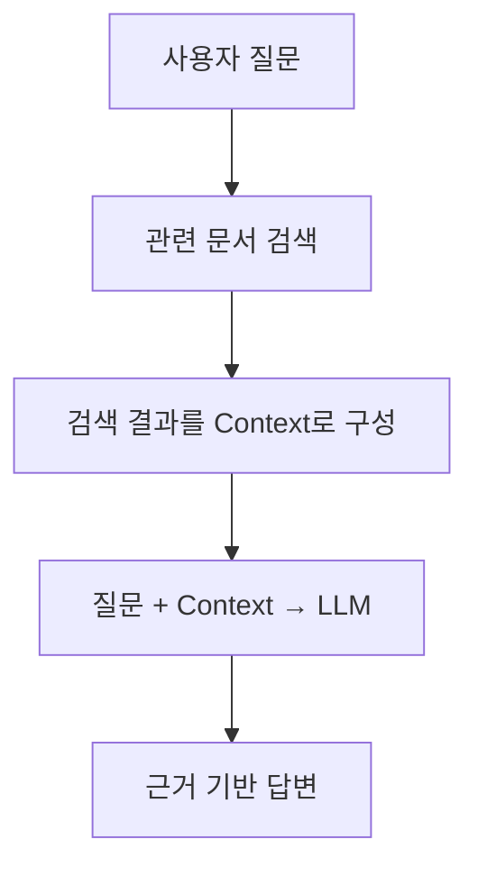
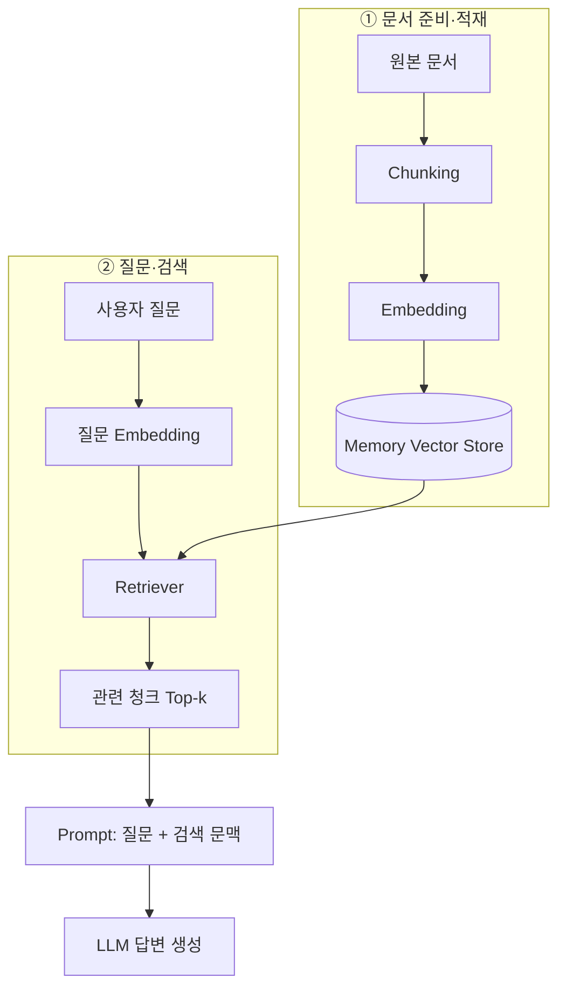

# TIL | 2026.11.12 목요일 — LLM 기초와 RAG 파이프라인 설계

**Course:** Chapter 3 — RAG & LLM  
**Progress:** RAG 파이프라인 설계 · 1장 1~5강  
**Tech Stack:** Python · OpenAI API · LangChain · VS Code · Jupyter Notebook · uv

## 0. 오늘의 학습 키워드

`LLM` · `RAG` · `Hallucination` · `Embedding` · `Vector` · `Cosine Similarity` · `Chunking` · `Overlap` · `Vector Store` · `Retriever` · `Hybrid Search` · `BM25` · `Reranking` · `Fine-tuning` · `LoRA`

**오늘의 핵심:** LLM의 지식 한계를 이해하고, 외부 문서를 검색해 답변에 활용하는 RAG의 전체 흐름을 학습했다. 특히 검색 품질을 결정하는 임베딩·청킹·리트리버를 실습했다.

---

## 1. Targets & Goals

- [x] LLM API 개발 환경 구성 및 호출 실습
- [x] LLM의 지식 한계와 RAG의 필요성 학습
- [x] 임베딩과 벡터 유사도 개념 학습
- [x] 문서 청킹과 오버랩 실습
- [x] Vector Store 및 Retriever 구성 실습
- [x] 검색 문맥을 활용한 기본 RAG 답변 생성 실습
- [x] Hybrid Search·Reranking·Fine-tuning 개념 학습

---

## 2. STUDY & EXERCISE

### A. LLM 개발 환경과 RAG의 필요성

**실습 흐름**

1. 수업용 계정 및 API 키 준비
2. Windows/macOS 환경 변수 설정
3. Python 가상환경 및 라이브러리 설치
4. VS Code·Notebook에서 LLM 호출
5. 모델 접근 권한과 API 호출 결과 확인

**주의:** API 키는 환경 변수로 관리하고 코드나 공개 저장소에 포함하지 않는다. 수업용 계정의 사용 범위와 비용을 확인한다.

**LLM의 주요 한계**

| 한계 | 설명 | RAG의 보완 방식 |
|---|---|---|
| 지식 시점 | 최신 정보 부족 | 최신 문서 검색 |
| 전문 지식 | 특정 분야 정보 부족 | 전문 자료 검색 |
| 내부 정보 | 기업 내부 문서 접근 불가 | 허용된 내부 자료 검색 |
| 환각 | 근거 없는 답변 생성 | 검색 근거 제공 및 검증 |

RAG는 모델 자체를 재학습시키지 않고도 외부 지식을 활용할 수 있지만, 잘못된 문서를 검색하면 답변도 부정확해질 수 있다.

### B. RAG — Retrieval-Augmented Generation

**검색 증강 생성(RAG)** 은 질문과 관련된 외부 자료를 검색(Retrieval)하고, 검색 결과를 참고해 답변을 생성(Generation)하는 방식이다.



**핵심:** RAG 성능은 LLM 자체뿐 아니라, 얼마나 관련성 높은 문서를 검색하는지에 크게 좌우된다.

### C. Embedding — 텍스트의 벡터화

임베딩(Embedding)은 텍스트를 의미적 특성을 반영한 숫자 벡터로 변환하는 과정이다.

**실습 모델:** `text-embedding-3-small` (기본 1,536차원)

```text
"반품 규정" → [0.12, -0.31, 0.08, ...]
"환불 정책" → [0.10, -0.28, 0.11, ...]
```

위 숫자는 개념 설명을 위한 임의 예시다.

**유사도 비교**

| 방식 | 판단 기준 |
|---|---|
| Cosine Similarity | 벡터 방향이 비슷할수록 유사 |
| Euclidean Distance | 벡터 간 거리가 가까울수록 유사 |

- 코사인 유사도는 방향을 비교한다.
- 유클리드 거리는 두 벡터 사이의 거리를 측정한다.
- 점수는 모델과 데이터에 따라 해석해야 한다.

### D. Chunking — 문서 분할

긴 문서를 검색 가능한 작은 단위(Chunk)로 나누는 과정이다.

**실습:** LangChain의 `RecursiveCharacterTextSplitter`

| 설정 | 실습 예시 | 역할 |
|---|---:|---|
| `chunk_size` | 90 | 청크의 최대 크기 설정 |
| `chunk_overlap` | 20 | 인접 청크 간 겹치는 구간 |
| `k` | 조정 가능 | 검색할 문서 개수 |

<text color="secondary" size="xs">청크 크기 90, 오버랩 20은 수업 실습값이며 최적의 고정값은 아니다.</text>

**청킹 구조**

```text
원본 문서
[ A ─────────────── B ─────────────── C ]

Chunk 1  [ A ───────── B ]
Chunk 2           [ B ───────── C ]
                  ↑
               Overlap
```

**트레이드오프**

- 너무 작은 청크 → 문맥 손실 가능
- 너무 큰 청크 → 불필요한 정보 증가
- 오버랩 → 문맥 단절 완화, 대신 중복 증가

청크 크기와 오버랩은 문서 특성 및 실제 검색 결과를 평가해 조정한다.

### E. Vector Store와 Retriever

- **Vector Store:** 문서 청크의 임베딩과 관련 정보를 저장
- **Retriever:** 질문과 관련성이 높은 문서를 찾아 반환하는 검색기

**실습 흐름**



실습에서는 메모리 기반 벡터 스토어를 사용했다. 실제 서비스에서는 데이터 규모에 따라 PostgreSQL 기반 벡터 저장소 등을 고려할 수 있다.

### F. 검색 품질 개선 기법

| 기법 | 목적 |
|---|---|
| Query Rewriting | 질문을 검색에 적합하게 정리 |
| Semantic Search | 의미가 비슷한 문서 검색 |
| BM25 | 키워드 일치 기반 검색 |
| Hybrid Search | 의미 검색 + 키워드 검색 결합 |
| Reranking | 검색 결과의 관련성을 재평가해 순서 조정 |
| Top-k | 최종 검색 문서 수 조절 |

**학습 포인트:** 의미가 비슷한 문장을 찾는 것과 정확한 상품명·법률 용어를 찾는 것은 서로 다른 검색 전략이 필요할 수 있다.

### G. RAG와 Fine-tuning 비교

| 구분 | RAG | Fine-tuning |
|---|---|---|
| 접근 | 외부 자료 검색 | 모델 추가 학습 |
| 정보 갱신 | 문서·인덱스 갱신 | 추가 학습 필요 |
| 주요 목적 | 최신·내부 지식 활용 | 특정 작업·응답 특성 조정 |
| 관련 개념 | Retriever, Vector Store | LoRA |

`LoRA`(Low-Rank Adaptation)는 모델의 기존 가중치 대부분을 고정하고 소수의 추가 파라미터를 학습하는 효율적인 미세조정 기법이다.

---

## 3. 문제 해결 및 새롭게 이해한 점

| 구분 | 문제·고민 | 해결 및 학습 방향 |
|---|---|---|
| API 연동 | 모델 호출 실패 가능 | API 키·환경 변수·모델 권한 확인 |
| 최신 정보 | LLM의 학습 시점 한계 | 외부 자료 검색으로 보완 |
| 검색 정확도 | 의미 검색만으로 정확한 용어 검색이 어려울 수 있음 | Hybrid Search 검토 |
| 문맥 단절 | 작은 청크에서 앞뒤 내용 분리 | Overlap 및 청크 크기 조정 |
| 검색 노이즈 | 관련 없는 문서가 포함될 수 있음 | Top-k·Reranking 조정 |
| 환각 | 검색 자료에 없는 내용 생성 가능 | 문서 근거 기반 답변 및 모를 때 답변 제한 |

**중요:** 위 표는 강의에서 다룬 문제와 해결 접근을 정리한 것으로, 모든 문제가 오늘 실제 발생하거나 해결 완료됐다는 뜻은 아니다.

---

## 4. REVIEW

### A. 오늘 배운 핵심

1. **LLM은 모든 지식을 알고 있지 않다.** 최신 정보와 내부 정보에는 한계가 있다.
2. **RAG는 검색과 생성을 결합한다.** 검색한 문서를 LLM의 컨텍스트로 제공한다.
3. **임베딩은 의미 검색의 기반이다.** 문장을 벡터로 표현하고 유사도를 비교한다.
4. **청킹은 검색 품질에 영향을 준다.** 크기·오버랩·문맥 보존을 함께 고려해야 한다.
5. **Retriever가 관련 문서를 선택한다.** 검색 결과가 부정확하면 최종 답변도 영향을 받는다.

### B. 다음 학습 및 복습

- [ ] Embedding과 Vector Store의 역할 구분
- [ ] 청크 크기·오버랩 변화에 따른 검색 결과 비교
- [ ] `k` 값 변경에 따른 검색 품질 확인
- [ ] Semantic Search와 BM25 비교
- [ ] 검색 결과가 부족할 때 답변을 제한하는 방법 검증
- [ ] RAG 파이프라인을 실제 서비스 API에 연결하는 구조 학습

**한 줄 정리:** RAG는 단순히 LLM에 문서를 추가하는 기술이 아니라, 필요한 지식을 **준비 → 분할 → 벡터화 → 저장 → 검색 → 생성**하는 전체 파이프라인을 설계하는 과정이다.
