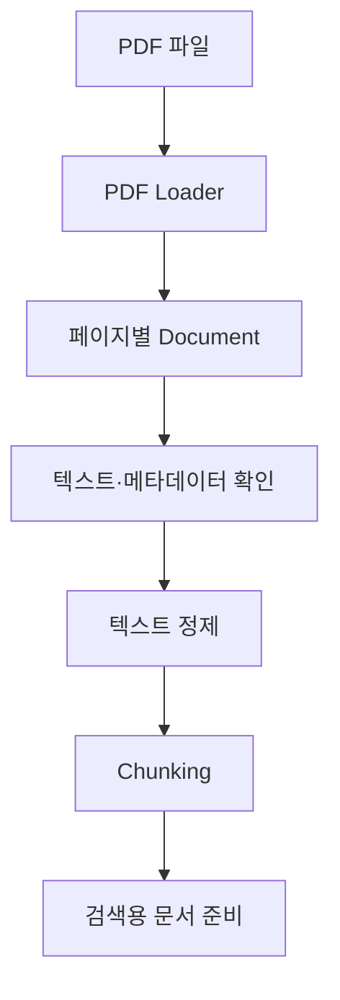

# TIL | 2026.11.13 금요일 — LangChain 문서 분할·메타데이터와 PDF 기반 RAG

**Course:** Chapter 4 — RAG & LLM  
**Progress:** RAG 파이프라인 설계  
**Tech Stack:** Python · LangChain · OpenAI API · VS Code · PostgreSQL(확장 개념)

## 0. 오늘의 학습 키워드

`RAG` · `Chunking` · `CharacterTextSplitter` · `RecursiveCharacterTextSplitter` · `Chunk Overlap` · `Document` · `Metadata` · `Prompt Template` · `Chain` · `Output Parser` · `PDF Loader` · `Vector Search`

**오늘의 핵심:** 문서를 단순히 나누는 것에서 나아가, 문맥과 출처 정보를 보존하면서 검색에 활용하고, 검색된 문서를 LLM의 프롬프트에 연결하는 방법을 학습했다.

---

## 1. Targets & Goals

- [x] LLM의 지식 한계와 RAG 동작 원리 복습
- [x] LangChain의 문자 기반·재귀적 문서 분할 방식 학습
- [x] 청크 크기와 오버랩에 따른 결과 비교
- [x] `Document`와 `metadata` 구조 이해
- [x] 프롬프트 템플릿과 체인 구성 학습
- [x] PDF 로더와 페이지별 문서 처리 학습
- [x] 검색 결과에 출처 정보를 포함하는 방법 이해

---

## 2. STUDY & EXERCISE

### A. RAG 원리 복습 및 실습 환경

**LLM의 한계**

| 한계 | RAG의 보완 방식 |
|---|---|
| 최신 정보 부족 | 외부 문서 검색 |
| 내부·전문 지식 부족 | 관련 자료를 컨텍스트로 제공 |
| 환각(Hallucination) | 근거 자료 제공 및 답변 제한 |

**RAG 처리 흐름**


- **Retrieval:** 관련 문서 검색
- **Augmentation:** 검색된 내용을 프롬프트의 맥락으로 추가
- **Generation:** LLM이 맥락을 참고해 답변 생성

**실습 환경 점검**

- OpenAI API 키를 환경 변수로 관리
- VS Code에서 프로젝트별 Python 가상환경 선택
- LangChain 관련 패키지 설치 및 버전 확인
- 모델 호출 시 API 키·접근 권한·지원 파라미터 확인

환경 변수 설정 후에도 값이 인식되지 않으면 VS Code나 터미널을 다시 시작해야 할 수 있다.

### B. LangChain Text Splitter — 문서 분할

긴 문서를 검색에 적합한 청크(Chunk)로 나누는 방법을 학습했다.

| 구분 | CharacterTextSplitter | RecursiveCharacterTextSplitter |
|---|---|---|
| 분할 기준 | 지정한 구분자 | 여러 구분자를 순차 적용 |
| 특징 | 단순한 구조 | 문단·줄바꿈 등 경계를 우선 고려 |
| 주의점 | 구분자에 따라 큰 청크가 남을 수 있음 | 문서 특성에 맞는 구분자 설정 필요 |

**청크 크기와 오버랩**

```text
원본 문서
[ A ───────── B ───────── C ]

Chunk 1 [ A ───── B ]
Chunk 2       [ B ───── C ]
              ↑
           Overlap
```

- `chunk_size`: 청크의 목표 최대 길이
- `chunk_overlap`: 인접 청크가 공유하도록 설정하는 길이
- 청크가 너무 작으면 문맥이 끊길 수 있음
- 너무 크면 검색에 불필요한 내용이 포함될 수 있음

**실습 예시**

```python
from langchain_text_splitters import RecursiveCharacterTextSplitter

splitter = RecursiveCharacterTextSplitter(
    chunk_size=100,
    chunk_overlap=20
)

chunks = splitter.split_text(text)
```

청크 크기 100, 오버랩 20은 PDF 처리 강의에서 사용한 예시값이며, 모든 문서에 적합한 고정값은 아니다.

### C. Document와 Metadata — 본문과 출처 관리

LangChain의 `Document`는 문서 본문과 부가 정보를 함께 관리한다.

```python
from langchain_core.documents import Document

doc = Document(
    page_content="문서의 실제 내용",
    metadata={
        "source": "sample.pdf",
        "page": 1,
        "year": 2026
    }
)
```

| 속성 | 역할 |
|---|---|
| `page_content` | 실제 문서 내용 |
| `metadata` | 출처·페이지·연도 등 부가 정보 |

**메타데이터를 보존해야 하는 이유**

1. 답변의 근거 문서 추적
2. 페이지·문서명 등 출처 표시
3. 특정 연도나 문서 유형으로 검색 범위 제한
4. 검색 결과의 신뢰성과 검토 가능성 향상

예를 들어 2026년 규정만 검색하려면 문서에 연도 정보가 있어야 메타데이터 필터를 적용하기 쉽다.

**새롭게 이해한 점:** 청킹할 때 본문만 나누는 것이 아니라, 원본 문서의 출처 정보도 청크에 연결해야 한다.

### D. Prompt Template과 Chain — LLM 연결

프롬프트 템플릿은 시스템 지시사항과 사용자 질문, 검색 문맥을 일정한 구조로 전달한다.

**개념 예제**

```python
from langchain_core.prompts import ChatPromptTemplate
from langchain_core.output_parsers import StrOutputParser

prompt = ChatPromptTemplate.from_messages([
    (
        "system",
        "제공된 문맥을 근거로 답변하세요. "
        "근거가 없으면 모른다고 답하세요.\n"
        "문맥: {context}"
    ),
    ("human", "{question}")
])

chain = prompt | llm | StrOutputParser()
```

`llm`은 앞서 설정한 채팅 모델 객체를 의미한다.

**체인 실행 흐름**


- `Prompt Template`: 입력을 메시지 형식으로 구성
- `LLM`: 답변 생성
- `Output Parser`: 모델 출력을 원하는 형태로 변환

**학습 포인트**

프롬프트에 출처 표시를 요청할 수 있지만, 출처 정보가 실제 검색 문맥에 포함되어 있어야 정확한 인용을 구성할 수 있다.

모델마다 지원하는 설정이 다르므로 `temperature`나 추론 관련 옵션은 사용하는 모델에 맞춰 확인해야 한다.

### E. PDF Loader — 문서 불러오기와 전처리

PDF를 LangChain으로 불러오고, 페이지별 문서와 메타데이터를 확인하는 방법을 학습했다.

**처리 흐름**



**개념 예제**

```python
from langchain_community.document_loaders import PyPDFLoader

loader = PyPDFLoader("sample.pdf")
documents = loader.load()

for doc in documents:
    print(doc.page_content)
    print(doc.metadata)
```

**확인할 항목**

- 페이지별 텍스트 추출 여부
- `source`, `page` 등 메타데이터
- 깨진 문자 및 불필요한 공백
- 지나치게 짧거나 의미 없는 청크
- 문단·제목 등 문서 구조 보존 여부

PDF의 페이지 번호는 라이브러리에서 0부터 시작할 수 있으므로 사용자에게 표시할 때는 확인이 필요하다.

### F. 검색과 데이터베이스 확장

강의에서는 PostgreSQL과 벡터 검색, 메타데이터 기반 조건 검색도 다뤘다.

| 검색 방식 | 활용 |
|---|---|
| Vector Search | 의미적으로 유사한 문서 검색 |
| Metadata Filter | 연도·출처·문서 유형 등으로 제한 |
| SQL Search | 구조화된 데이터 조건 검색 |

실제 서비스에서는 벡터 유사도뿐 아니라 문서의 작성 시점과 출처 등도 함께 고려할 수 있다.

---

## 3. 문제 해결 및 새롭게 이해한 점

| 구분 | 문제·주의점 | 확인 및 해결 방향 |
|---|---|---|
| API 키 | 환경 변수 인식 실패 | 키 설정·실행 환경 확인 및 재시작 |
| 패키지 | LangChain 버전별 API 차이 | 설치 버전과 import 경로 확인 |
| 문서 분할 | 청크가 너무 작거나 큼 | 크기·구분자·오버랩 조정 |
| 문맥 손실 | 청크 경계에서 내용 단절 | 재귀적 분할과 오버랩 활용 |
| 출처 누락 | 검색 결과의 근거 추적 어려움 | Metadata 보존 |
| PDF 추출 | 문자 깨짐·공백·짧은 조각 | 추출 결과 확인 후 정제 |
| 모델 설정 | 지원하지 않는 옵션으로 오류 가능 | 모델별 파라미터 확인 |

*위 내용은 전사에 등장한 문제와 해결 방향이며, 모든 오류를 직접 겪었다는 의미는 아니다.*

---

## 4. REVIEW

### A. 오늘의 핵심

1. **청킹은 단순한 글자 수 분할이 아니다.** 문서 구조와 의미를 최대한 보존해야 한다.
2. **메타데이터는 검색의 중요한 정보다.** 출처 추적과 조건 검색에 활용된다.
3. **체인은 여러 처리 단계를 연결한다.** 프롬프트·모델·출력 파서를 조합할 수 있다.
4. **PDF는 추출 결과를 검증해야 한다.** 원본 문서의 구조와 텍스트가 그대로 보존된다고 가정하면 안 된다.
5. **RAG의 검색 품질은 답변 품질과 연결된다.** 검색된 문서의 관련성과 근거를 함께 확인해야 한다.

### B. 다음 학습 및 복습

- [ ] 두 Text Splitter의 실제 분할 결과 비교
- [ ] 청크 크기·오버랩 변경에 따른 결과 확인
- [ ] Document의 `page_content`와 `metadata` 구분
- [ ] Prompt Template → LLM → Output Parser 연결 복습
- [ ] PDF 추출 결과와 페이지 메타데이터 확인
- [ ] 메타데이터 필터와 벡터 검색 결합 학습

**한 줄 정리:** 오늘은 RAG에서 사용할 문서를 **불러오고 → 나누고 → 출처를 보존하고 → 검색 문맥으로 전달하는 방법**을 학습했다.
