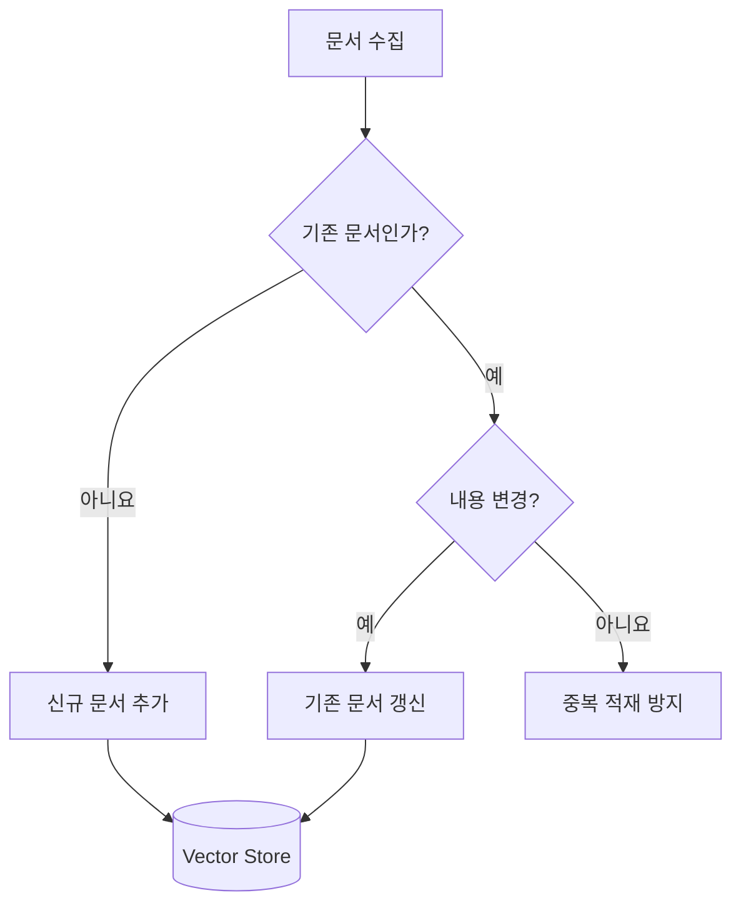
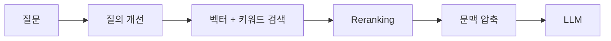
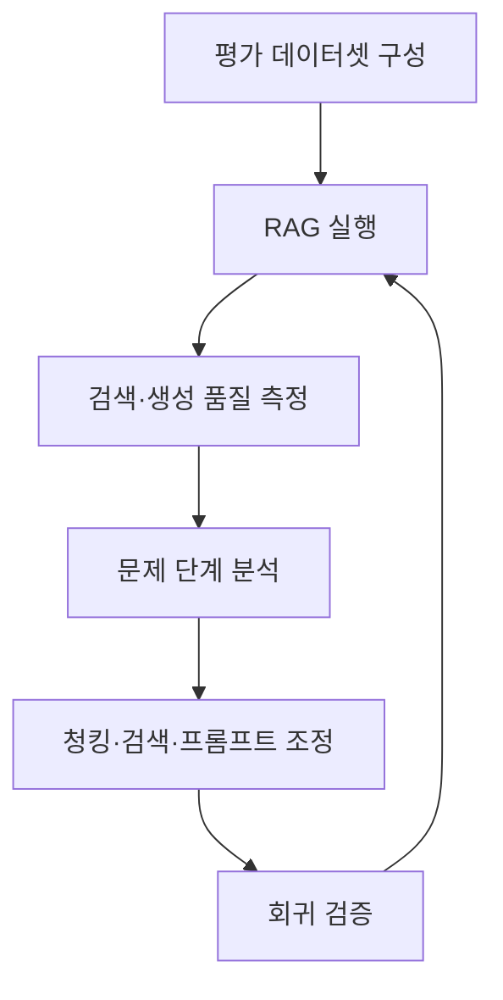
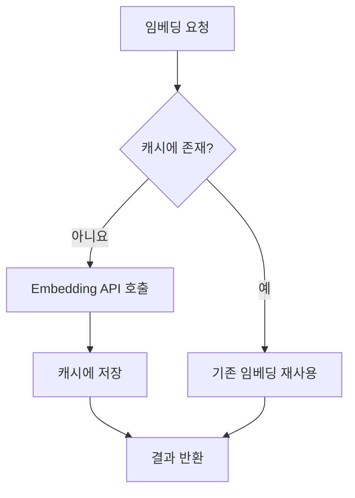
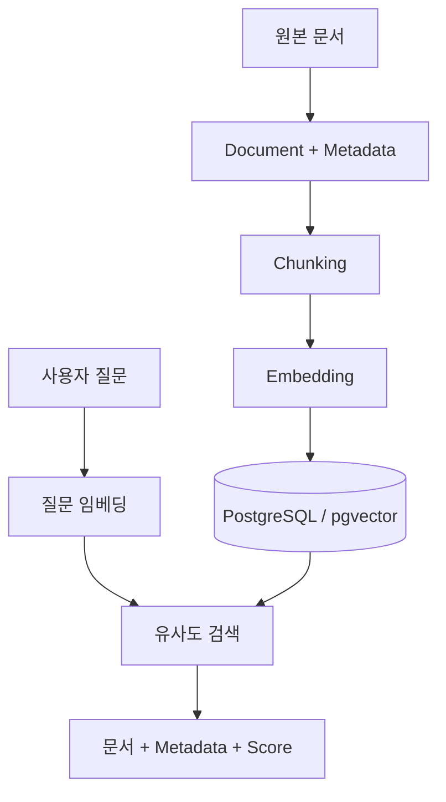

# TIL | 2026.11.16 월요일 — RAG 검색 최적화·품질 평가와 PostgreSQL 벡터 저장소

**Course:** Chapter 4 — RAG & LLM  
**Progress:** RAG 파이프라인 설계 · 2장 7강까지  
**Tech Stack:** Python · LangChain · OpenAI API · PostgreSQL · pgvector · Docker · SQLAlchemy

## 0. 오늘의 학습 키워드

`Chunking` · `Metadata` · `Incremental Indexing` · `Semantic Search` · `BM25` · `Hybrid Search` · `Reranking` · `Top-K` · `Context Compression` · `Precision` · `Recall` · `F1` · `Faithfulness` · `CacheBackedEmbeddings` · `PGVector` · `SQLRecordManager`

**오늘의 핵심:** RAG의 성능은 LLM뿐 아니라 문서 관리, 검색 방식, 검색 결과의 품질에 따라 달라진다. 오늘은 이를 평가하고 개선하는 방법과 PostgreSQL 기반 벡터 저장소 운영 구조를 학습했다.

---

## 1. Targets & Goals

- [x] 청킹·메타데이터·증분 인덱싱 개념 학습
- [x] 벡터·키워드·하이브리드 검색 방식 비교
- [x] Reranking 및 문맥 압축 원리 학습
- [x] 검색 품질과 생성 품질의 평가 지표 학습
- [x] LangChain 임베딩 캐싱 방식 학습
- [x] PostgreSQL 벡터 저장소 연결·적재·검색 실습 내용 학습
- [x] 문서 ID와 SQL Record Manager를 이용한 인덱스 관리 학습

---

## 2. STUDY & EXERCISE

### A. RAG 검색·인덱싱 최적화

**1. 청킹과 메타데이터 설계**

| 요소            | 역할                  | 주의점                       |
| --------------- | --------------------- | ---------------------------- |
| `chunk_size`    | 문서 분할 크기        | 너무 작으면 문맥 손실        |
| `chunk_overlap` | 청크 간 문맥 공유     | 너무 크면 중복 증가          |
| `metadata`      | 출처·연도·페이지 관리 | 검색 필터와 근거 추적에 필요 |
| 문서 ID         | 문서 식별 및 갱신     | 중복 적재 방지에 활용        |

법률·규정처럼 개정되는 자료는 작성 연도와 출처를 메타데이터에 포함해 검색 범위를 제한할 수 있다.

**2. 증분 인덱싱(Incremental Indexing)**

이미 적재한 문서를 무조건 다시 추가하지 않고 변경 여부에 따라 관리한다.

삭제된 문서나 오래된 청크를 정리하는 정책도 별도로 고려해야 한다.

### B. 검색 방식 비교

| 방식            | 특징                         | 적합한 사례                       |
| --------------- | ---------------------------- | --------------------------------- |
| Semantic Search | 임베딩 기반 의미 검색        | 유사한 표현의 질문                |
| BM25            | 단어 빈도·희소성 기반 검색   | 상품 코드·고유 명칭               |
| Hybrid Search   | 의미 검색과 키워드 검색 결합 | 두 종류의 검색이 모두 중요한 경우 |
| Reranking       | 1차 검색 결과 재평가         | 관련성 높은 문서 상위 배치        |

**검색 품질 개선 흐름**

**검색 설정**

- `Top-K`: 반환할 검색 결과 수
- 유사도 임계값: 관련성이 낮은 결과를 제외하기 위한 기준
- 검색 결합 비율: 벡터 검색과 키워드 검색의 영향력 조정

**학습 포인트:** 검색 결과가 많다고 항상 좋은 것은 아니다. 필요한 문서를 놓치지 않으면서 불필요한 문맥을 줄이는 것이 중요하다.

### C. 질의 개선과 문맥 압축

**Query Rewriting**

사용자의 모호한 질문을 검색에 적합한 표현으로 변경한다.

**가상 문서 기반 검색**

질문에 대한 가상의 답변 문서를 생성한 뒤, 이를 검색에 활용하는 방식도 소개됐다.

**Context Compression**

검색 결과에서 답변에 필요한 핵심 정보만 남기는 과정이다.

| 압축 정도 | 발생 가능한 문제        |
| --------- | ----------------------- |
| 부족함    | 무관한 정보·노이즈 증가 |
| 과도함    | 필요한 근거 누락        |
| 적절함    | 관련성 높은 문맥 유지   |

---

### D. RAG 품질 평가 — Retrieval vs Generation

RAG의 품질은 **검색이 잘됐는가**와 **답변이 잘 생성됐는가**를 구분해 평가해야 한다.

**1. 검색 품질 지표**

| 지표               | 의미                                      |
| ------------------ | ----------------------------------------- |
| Precision (정밀도) | 검색된 문서 중 관련 문서의 비율           |
| Recall (재현율)    | 전체 관련 문서 중 찾아낸 비율             |
| F1 Score           | 정밀도와 재현율의 조화 평균               |
| Context Precision  | 검색 문맥의 관련성과 순위 품질 평가       |
| Context Recall     | 필요한 근거가 검색 문맥에 포함됐는지 평가 |

**기본 공식**

\[
Precision=\frac{TP}{TP+FP}
\]

\[
Recall=\frac{TP}{TP+FN}
\]

\[
F1=2\times\frac{Precision\times Recall}{Precision+Recall}
\]

- `TP`: 검색된 관련 문서
- `FP`: 검색됐지만 관련 없는 문서
- `FN`: 관련 있지만 검색하지 못한 문서

**2. 생성 품질 지표**

| 지표                           | 확인할 질문                             |
| ------------------------------ | --------------------------------------- |
| Faithfulness (충실도)          | 답변이 제공된 근거에 의해 뒷받침되는가? |
| Answer Relevance (답변 관련성) | 답변이 사용자 질문에 적절한가?          |

**평가 및 개선 과정**

**핵심:** 검색 성능이 좋아도 LLM이 근거 없는 내용을 생성할 수 있다. 반대로 LLM 성능이 좋아도 필요한 문서를 찾지 못하면 답변 품질이 떨어진다.

---

### E. LangChain 임베딩 캐싱

**CacheBackedEmbeddings**

이미 생성한 임베딩을 저장해 동일한 입력을 다시 처리할 때 재사용하는 방식이다.

**실습 내용**

1. 임베딩 모델 설정
2. 로컬 파일 캐시 저장소 구성
3. 첫 실행 시 임베딩 생성 및 저장
4. 동일 입력 재실행 시 캐시 재사용
5. 실행 시간과 API 호출 감소 여부 비교

**학습 포인트**

- 반복적인 임베딩 API 호출 감소
- 처리 시간과 비용 절감
- 임베딩 모델이 변경되면 기존 캐시의 호환성을 확인해야 함

---

### F. PostgreSQL 기반 Vector Store

LangChain과 PostgreSQL 기반 벡터 저장소를 연결해 문서를 적재하고 검색하는 구조를 학습했다.

**데이터 처리 흐름**

**주요 구성 요소**

| 요소            | 역할                            |
| --------------- | ------------------------------- |
| PostgreSQL      | 관계형 데이터 저장              |
| pgvector        | 벡터 데이터 및 유사도 검색 지원 |
| Collection      | 문서 그룹 구분                  |
| Embedding Table | 문서 벡터와 관련 정보 저장      |
| Document ID     | 문서 또는 청크 식별             |
| Metadata        | 출처·페이지·카테고리 등 관리    |

**실습 흐름**

- Docker 기반 벡터 저장소 환경 준비
- DB 연결 URL을 환경 변수에서 불러오기
- 임베딩 모델 및 컬렉션 설정
- 초기 실행 시 컬렉션·임베딩 테이블 생성 확인
- 문서와 메타데이터 적재
- `Top-K` 기반 유사도 검색
- 문서 내용·메타데이터·관련성 점수 확인

### G. SQL Record Manager — 인덱스 관리

문서의 추가·갱신·삭제를 관리하기 위한 도구다.

**학습한 주요 개념**

- 문서 ID를 기준으로 기존 데이터 식별
- 중복 문서 적재 방지
- 수정된 문서의 갱신
- 오래된 문서 및 청크 정리
- 인덱싱 정책에 따른 데이터 관리

**주의:** 문서 ID를 지정하는 것만으로 모든 중복 문제가 자동 해결되지는 않는다. 사용하는 Vector Store와 인덱싱 방식의 갱신 동작을 확인해야 한다.

---

## 3. 문제 해결 및 새롭게 이해한 점

| 문제·고민                 | 학습한 해결 방향                    |
| ------------------------- | ----------------------------------- |
| 검색 결과가 너무 많음     | Top-K·임계값·문맥 압축 조정         |
| 정확한 용어 검색이 어려움 | BM25 및 Hybrid Search 검토          |
| 검색 순위가 부정확함      | Reranking 적용                      |
| 문서가 중복 저장됨        | 문서 ID와 증분 인덱싱 관리          |
| 오래된 문서가 남음        | 갱신·삭제 정책 설정                 |
| 임베딩 비용이 반복 발생   | CacheBackedEmbeddings 활용          |
| 답변 품질이 낮음          | 검색 지표와 생성 지표를 분리해 평가 |
| Docker·DB 환경 충돌 가능  | 기존 컨테이너·데이터 확인 후 설정   |

_위 항목은 강의에서 다룬 문제와 해결 방향이며, 모두 직접 발생하거나 해결 완료한 오류를 의미하지는 않는다._

---

## 4. REVIEW

### A. 오늘 배운 핵심

1. **검색 품질은 검색 방식과 문서 관리에 달려 있다.** 벡터 검색만으로 모든 질문을 해결하기는 어렵다.
2. **정밀도와 재현율은 함께 평가해야 한다.** 검색 범위를 넓히거나 좁힐 때 발생하는 영향을 확인해야 한다.
3. **RAG 평가는 검색과 생성을 분리해야 한다.** 검색 실패와 답변 생성 실패는 개선 방법이 다르다.
4. **임베딩 캐싱은 비용과 시간을 절약한다.** 동일 입력에 대한 중복 계산을 줄일 수 있다.
5. **벡터 저장소는 데이터 관리도 중요하다.** 적재뿐 아니라 문서 식별·갱신·삭제까지 고려해야 한다.

### B. 복습 및 다음 학습

- [ ] Precision·Recall·F1 계산 연습
- [ ] Faithfulness와 Answer Relevance 구분
- [ ] BM25·Semantic·Hybrid Search 결과 비교
- [ ] Top-K와 유사도 임계값 조정
- [ ] 임베딩 캐싱 전후 실행 시간 비교
- [ ] PostgreSQL 컬렉션·임베딩 테이블 확인
- [ ] 동일 문서 재적재 시 중복 여부 확인
- [ ] SQL Record Manager의 갱신·삭제 동작 검증

**한 줄 정리:** 오늘은 RAG를 단순히 작동시키는 단계를 넘어, **검색 품질을 평가하고 개선하며 문서를 지속적으로 관리하는 방법**을 학습했다.
