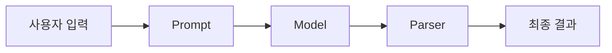
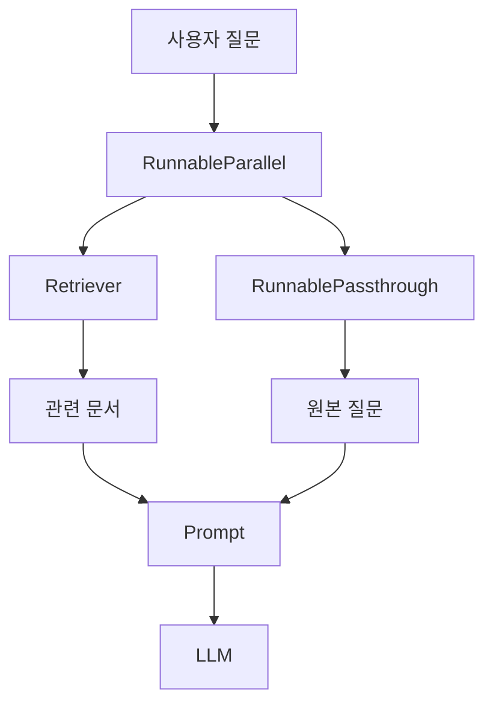
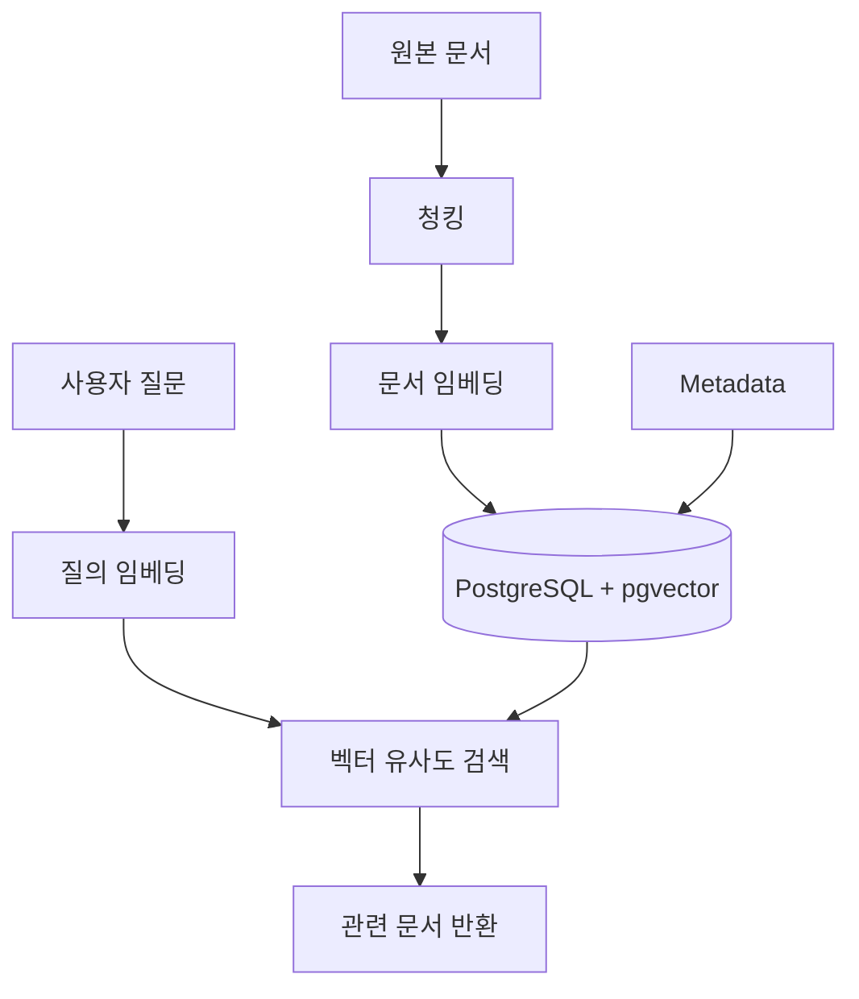
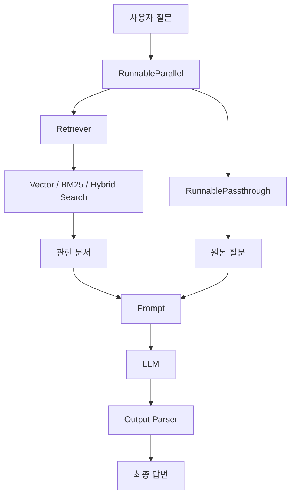

# TIL | 2026.11.17 화요일 — LangChain 추상화와 RAG 검색 파이프라인

**Course:** RAG & LLM — 3장 및 5장 1~3강  
**Environment:** Python · uv · Jupyter Notebook · LangChain · PostgreSQL · pgvector · OpenAI

## 0. 🎯 오늘의 학습 키워드

### 🟣 설계 및 객체지향 개념
`Abstraction` · `Interface` · `Implementation` · `Object`

### 🔵 LangChain 실행 구조
`Runnable` · `invoke()` · `LCEL` · `Pipe Operator (|)` · `RunnableParallel` · `RunnablePassthrough`

### 🟢 RAG 및 검색 기술
`PGVector` · `Vector Store` · `Retriever` · `Query Embedding` · `BM25` · `Hybrid Search` · `RRF`

### 🟠 검색 품질 제어
`Top-K` · `Score Threshold` · `Relevance Score` · `Distance` · `Metadata Filter` · `Weights`

**오늘의 핵심**

LangChain은 서로 다른 기능을 공통 인터페이스로 추상화하여 연결하기 쉽게 만든다. `Runnable` 인터페이스를 따르는 구성 요소는 `invoke()`로 실행할 수 있고, LCEL의 `|` 연산자로 하나의 파이프라인을 구성할 수 있다.

Retriever는 이러한 실행 구조에 검색 기능을 연결하며, 벡터 검색뿐 아니라 BM25 및 Hybrid Search에도 활용할 수 있다.

---

## 1. 🟣 LangChain의 핵심 — 추상화와 인터페이스

### A. 추상화(Abstraction)

**추상화란 내부의 복잡한 구현을 감추고, 외부에서 공통된 방식으로 기능을 사용하도록 만드는 설계 방식이다.**

LangChain에서는 서로 다른 기능을 수행하는 객체가 공통 실행 인터페이스를 제공한다.

```python
prompt.invoke(...)
model.invoke(...)
retriever.invoke(...)
```

각 객체의 내부 동작은 다르지만 실행 방식이 통일되어 있다.

| 개념 | 의미 |
|---|---|
| Interface | 객체가 제공해야 하는 기능의 공통 규약 |
| Implementation | 규약을 실제로 구현한 클래스 |
| Object | 클래스를 통해 생성하거나 사용하는 객체 |
| Runnable | LangChain의 실행 가능한 구성 요소를 위한 공통 인터페이스 |

### B. 인터페이스와 구현체의 차이

TypeScript 예시:

```typescript
interface Runnable {
  invoke(input: string): string;
}

class UpperCaseRunnable implements Runnable {
  invoke(input: string): string {
    return input.toUpperCase();
  }
}

const runnable = new UpperCaseRunnable();
console.log(runnable.invoke("hello")); // HELLO
```

- `Runnable`: 인터페이스
- `UpperCaseRunnable`: 구현체 클래스
- `runnable`: 실제 객체

Python 기반 LangChain에서는 TypeScript의 `implements` 문법 대신 클래스 상속과 메서드 구현 등을 통해 Runnable 규약을 따른다.

**💡 학습 포인트:** 공통 인터페이스를 따른다고 해서 반환값이나 내부 처리 과정까지 동일하다는 의미는 아니다.

---

## 2. 🔵 Runnable과 LCEL 체이닝

### A. Runnable이란?

Runnable은 LangChain에서 실행 가능한 구성 요소가 따르는 공통 인터페이스다.

대표적인 실행 방식:

| 메서드 | 역할 |
|---|---|
| `invoke()` | 단일 입력 실행 |
| `batch()` | 여러 입력 처리 |
| `stream()` | 결과를 스트리밍 방식으로 처리 |

### B. LCEL(LangChain Expression Language)

LCEL은 Runnable을 선언적인 방식으로 연결하여 실행 흐름을 구성하는 문법이다.

```python
chain = prompt | model | parser

result = chain.invoke({
    "question": "RAG란?"
})
```

**중요한 구분**

- `|`: Runnable을 연결하여 파이프라인을 구성
- `chain.invoke()`: 구성한 파이프라인을 실제 실행

즉, `|`를 작성하는 순간 각 단계가 실행되는 것은 아니다.



앞 단계의 출력 타입과 다음 단계의 입력 타입이 호환되어야 한다.

### C. 체이닝의 장점

- 가독성: 전체 데이터 처리 흐름을 쉽게 파악
- 재사용성: 프롬프트·검색기·모델 재사용
- 교체 용이성: 호환되는 Runnable로 구성 요소 교체
- 실행 방식 통일: `invoke()`, `batch()`, `stream()` 등 활용
- 조합 가능성: 검색·변환·모델 호출·출력 파싱 연결

🟠 **주의:** 체이닝 자체가 검색 정확도나 LLM 성능을 자동으로 높이지는 않는다.

---

## 3. 🔵 RunnableParallel과 RunnablePassthrough

### A. RunnablePassthrough

`RunnablePassthrough`는 입력값을 변경하지 않고 그대로 반환한다.

```python
from langchain_core.runnables import RunnablePassthrough

passthrough = RunnablePassthrough()

print(passthrough.invoke("RAG란?"))
# RAG란?
```

### B. RAG에서 사용하는 이유

RAG에서는 하나의 사용자 질문을 두 가지 목적으로 활용한다.

1. Retriever에 전달하여 관련 문서를 검색
2. Prompt에 원본 질문을 그대로 전달

```python
chain = {
    "context": retriever,
    "question": RunnablePassthrough()
} | prompt | model
```

딕셔너리 형태의 구성은 LCEL에서 `RunnableParallel`로 변환되어 같은 입력을 여러 경로에 전달한다.



| 개념 | 핵심 역할 |
|---|---|
| `RunnableParallel` | 동일한 입력을 여러 실행 경로에 전달 |
| `RunnablePassthrough` | 전달받은 입력을 변경하지 않고 반환 |

**💡 새롭게 이해한 점:** `RunnablePassthrough`가 직접 데이터를 분기하는 것이 아니다. 데이터 분기는 `RunnableParallel`이 담당한다.

---

## 4. 🟢 PostgreSQL과 PGVector 벡터 검색

### A. 실습 환경

- `uv`: Python 프로젝트 및 가상환경 구성
- PostgreSQL: 문서 데이터 저장
- `pgvector`: 벡터 저장 및 유사도 검색
- LangChain: 검색 기능과 LLM 연결
- OpenAI Embeddings: 텍스트를 벡터로 변환
- `JSONB`: 출처·연도·카테고리 등 메타데이터 저장

강의에서 사용한 임베딩 모델은 `text-embedding-3-small`이다.

### B. 벡터 저장 및 검색 과정



**Query Embedding**은 사용자 질문을 문서와 비교할 수 있는 벡터로 변환하는 과정이다.

문서와 질문은 호환되는 임베딩 공간에서 비교되어야 한다.

---

<a name="til-rag-retriever"></a>

## 5. 🟢 Vector Store와 Retriever의 차이

### A. Vector Store

Vector Store는 벡터 저장과 검색 기능을 제공한다.

```python
docs = vector_store.similarity_search(
    query="경매 입찰 제한",
    k=3
)
```

### B. Retriever

Retriever는 사용자 질문과 관련된 문서를 검색하여 반환하는 인터페이스다.

```python
retriever = vector_store.as_retriever(
    search_kwargs={"k": 3}
)

docs = retriever.invoke("경매 입찰 제한")
```

`as_retriever()`는 Vector Store의 검색 기능을 Retriever 인터페이스로 사용할 수 있게 한다.

| 비교 | Vector Store 직접 검색 | Retriever |
|---|---|---|
| 호출 | `similarity_search()` | `invoke()` |
| 역할 | 저장소의 검색 기능 호출 | 검색 기능의 공통 인터페이스 |
| LCEL 연결 | 별도 래핑 등이 필요할 수 있음 | Runnable로 연결 가능 |
| 검색 방식 | 저장소가 지원하는 방식 | 벡터·BM25 등 다양한 구현 |

**💡 오늘의 핵심 질문에 대한 결론**

Retriever는 새로운 검색 알고리즘이 아니다. 기존 검색 기능을 공통 인터페이스로 다루게 하므로 체이닝과 구성 요소 교체가 쉬워진다.

Retriever로 변환한다고 검색 정확도가 자동으로 높아지지는 않는다.

---

## 6. 🟠 검색 품질 제어 — Top-K, Score, Metadata

### A. Top-K

`k`는 검색 결과로 반환할 상위 문서의 최대 개수를 의미한다.

```python
retriever = vector_store.as_retriever(
    search_kwargs={"k": 3}
)
```

`k`가 너무 크면 관련성이 낮은 문서가 포함되고, LLM에 전달하는 토큰 비용이 증가할 수 있다.

### B. Distance와 Relevance Score

| 구분 | 의미 | 관련성이 높을수록 |
|---|---|---|
| Distance | 벡터 간 거리 | 값이 작아짐 |
| Relevance Score | 관련도 점수 | 값이 커짐 |

🟠 **중요:** 검색 결과의 `score`가 어떤 기준인지 먼저 확인해야 한다.

관련도 점수가 반드시 원래 코사인 유사도와 동일한 것은 아니다. 거리 전략과 점수 변환 방식에 따라 달라질 수 있다.

### C. Metadata Filter

메타데이터 필터는 문서의 구조화된 속성을 이용해 검색 범위를 제한한다.

예를 들어 "2026년 11월의 경매 관련 문서"를 검색한다면:

- 날짜 조건: 메타데이터 또는 SQL 필터
- 문서 내용: 벡터 검색 또는 키워드 검색

### D. 최신성 문제

임베딩 유사도만으로는 최신 규정인지 판단하기 어렵다.

법률·규정처럼 개정되는 문서는 문서의 출처·개정일·유효기간 등을 함께 관리해야 한다.

문서 변경 시 기존 데이터를 삭제하고 다시 추가하는 방식으로 갱신할 수 있으며, 중복 임베딩 호출은 캐싱으로 줄일 수 있다.

---

<a name="til-rag-bm25"></a>

## 7. 🟢 BM25 키워드 검색

BM25는 검색어의 등장 빈도, 희소성, 문서 길이 등을 고려해 관련도를 계산하는 알고리즘이다.

| 요소 | 의미 |
|---|---|
| TF | 문서 내 단어 출현 빈도 |
| IDF | 전체 문서에서 단어의 희귀성 |
| Length Normalization | 문서 길이에 따른 점수 보정 |
| Tokenizer | 텍스트를 검색 가능한 토큰으로 분리 |

```python
from langchain_community.retrievers import BM25Retriever

documents = [
    "경매 입찰 제한은 최근 거래 기록을 기준으로 판단한다.",
    "사용자는 경매에 입찰할 수 있다.",
    "결제가 완료되면 거래 내역을 기록한다."
]

bm25_retriever = BM25Retriever.from_texts(documents)
bm25_retriever.k = 2

docs = bm25_retriever.invoke("경매 입찰 제한")
```

**필요한 의존성**

```bash
uv add rank-bm25
```

BM25 역시 Retriever 인터페이스를 사용하므로 LCEL 체인에 연결할 수 있다.

---

<a name="til-rag-hybrid"></a>

## 8. 🟢 Hybrid Search와 RRF

### A. 검색 방식 비교

| 검색 방식 | 판단 기준 | 적합한 용도 |
|---|---|---|
| Vector Search | 의미적 유사성 | 다른 표현의 관련 문서 검색 |
| BM25 | 키워드 기반 관련도 | 고유명사·전문 용어 검색 |
| Keyword Filter | 문자열 포함 여부 | 정확한 포함 조건 |
| Metadata Filter | 날짜·유형·ID | 구조화된 조건 제한 |

### B. Hybrid Search

Hybrid Search는 벡터 검색과 키워드 검색을 함께 활용한다.

```python
from langchain_classic.retrievers import EnsembleRetriever

hybrid_retriever = EnsembleRetriever(
    retrievers=[vector_retriever, bm25_retriever],
    weights=[0.5, 0.5]
)

docs = hybrid_retriever.invoke("경매 입찰 제한")
```

위 코드는 두 Retriever가 이미 정의되어 있다는 전제다.

### C. RRF(Reciprocal Rank Fusion)

RRF는 검색기별 점수 자체가 아니라 **검색 결과의 순위**를 이용하여 결과를 통합한다.

\[
RRF(d)=\sum_i\frac{w_i}{c+rank_i(d)}
\]

- `w`: 검색기별 가중치
- `rank`: 해당 검색기에서의 문서 순위
- `c`: 순위 차이의 영향을 완화하는 상수

| 검색 전략 | BM25 : Vector |
|---|---|
| 키워드 중심 | 0.8 : 0.2 |
| 균형 검색 | 0.5 : 0.5 |
| 의미 중심 | 0.2 : 0.8 |

이 비율은 실습용 비교 예시다. 실제 최적값은 검색 품질 평가를 통해 정해야 한다.

---

## 9. 🔴 TROUBLESHOOTING — Relevance Score 임계값 오류

### A. 실제 발생한 오류

```python
SCORE_THRESHOLD = 0.7

searched_docs2 = vector_store.similarity_search_with_relevance_scores(
    query=query,
    score_theshold=1 - SCORE_THRESHOLD
)
```

**오류 메시지**

```text
TypeError:
PGVector.similarity_search_with_score()
got an unexpected keyword argument 'score_theshold'
```

### B. 원인 1 — 매개변수 오타

- ❌ `score_theshold`
- ✅ `score_threshold`

`score_theshold`는 LangChain이 인식하는 매개변수 이름이 아니므로 내부 PGVector 검색 메서드에 전달되었고, 해당 메서드가 지원하지 않아 오류가 발생했다.

### C. 원인 2 — 점수 방향 혼동

기존 코드에서는 `1 - SCORE_THRESHOLD`를 사용했다.

그러나 `similarity_search_with_relevance_scores()`는 관련도 점수를 기준으로 필터링한다.

관련도 0.7 이상을 원한다면 `score_threshold=0.7`을 전달해야 한다.

### D. 수정 코드

```python
SCORE_THRESHOLD = 0.7

searched_docs2 = vector_store.similarity_search_with_relevance_scores(
    query=query,
    score_threshold=SCORE_THRESHOLD
)
```

### E. 새롭게 이해한 점

1. 오류 메시지에서 지원하지 않는 인자 이름을 먼저 확인해야 한다.
2. `score_threshold`와 같은 매개변수는 철자를 정확히 입력해야 한다.
3. Distance와 Relevance Score는 값의 방향이 다르다.
4. 검색 결과가 없는 경우 임계값 문제인지, 데이터·설정 문제인지 구분해야 한다.

**🔴 기억할 규칙**

- Distance: 낮을수록 가까움
- Relevance Score: 높을수록 관련성이 높음
- `similarity_search_with_relevance_scores()`: 관련도 임계값 사용

---

## 10. 🔵 전체 RAG 실행 흐름

오늘 학습한 개념을 하나의 파이프라인으로 연결하면 다음과 같다.



### LCEL 예시

```python
from langchain_core.prompts import ChatPromptTemplate
from langchain_core.runnables import RunnablePassthrough
from langchain_core.output_parsers import StrOutputParser

def format_docs(docs):
    return "\n\n".join(doc.page_content for doc in docs)

prompt = ChatPromptTemplate.from_template(
    "다음 문서를 참고해 질문에 답하세요.\n"
    "문서:\n{context}\n"
    "질문: {question}"
)

chain = (
    {
        "context": retriever | format_docs,
        "question": RunnablePassthrough()
    }
    | prompt
    | model
    | StrOutputParser()
)

answer = chain.invoke("경매 입찰 제한 정책은?")
print(answer)
```

`retriever`와 `model`은 미리 생성되어 있다는 전제다.

이 구조에서는 검색 결과를 문맥으로 만들고, 원본 질문을 유지한 뒤, 프롬프트·모델·출력 파서로 전달한다.

---

## 11. 📝 REVIEW — 오늘 헷갈렸던 개념

| 질문 | 이해한 내용 |
|---|---|
| LangChain의 추상화란? | 내부 구현이 달라도 공통 인터페이스로 사용 |
| Runnable과 구현체의 차이는? | 실행 규약과 실제 구현 클래스의 차이 |
| 파이프 연산자는 즉시 실행인가? | 아님. 파이프라인을 구성 |
| `RunnablePassthrough`는 무엇인가? | 입력을 그대로 반환 |
| 데이터 분기는 누가 담당하나? | `RunnableParallel` |
| Retriever는 벡터 검색 전용인가? | 아니며 BM25 등에도 적용 |
| Retriever로 바꾸면 정확도가 높아지나? | 아니며 체이닝과 교체가 쉬워짐 |
| Distance와 Relevance Score는? | 거리와 관련도는 점수 해석 방향이 다름 |

### 다음 학습 및 확인할 내용

- [ ] Vector Store 직접 검색과 Retriever 검색 결과 비교
- [ ] LCEL에서 `RunnableParallel`과 `RunnablePassthrough` 동작 확인
- [ ] BM25와 벡터 검색 결과 비교
- [ ] PostgreSQL/pgvector의 거리 전략과 점수 변환 방식 확인
- [ ] Top-K·Threshold 변경 결과 비교
- [ ] RRF 가중치 변경에 따른 순위 변화 확인
- [ ] 체인 단계별 입력값과 반환값 타입 출력

### 🔁 1·3·7 복습 질문

**Q1.** `prompt | model | parser`를 작성하면 즉시 실행되는가?

**Q2.** `RunnablePassthrough`와 `RunnableParallel`은 각각 어떤 역할인가?

**Q3.** 관련도 0.7 이상인 문서만 검색하려면 `score_threshold`를 어떻게 설정해야 하는가?

**Q4.** Retriever와 Vector Store는 어떤 차이가 있는가?

**Q5.** 문서의 최신성 조건은 벡터 유사도만으로 판단할 수 있는가?

---

## 12. 💡 오늘의 한 줄 정리

**LangChain은 Runnable 인터페이스로 실행 방식을 통일하고, LCEL로 기능을 연결하며, Retriever로 다양한 검색 방식을 RAG 파이프라인에 통합한다. 오늘은 이 구조를 이해하고 검색 점수의 해석과 실제 임계값 오류를 학습했다.**
