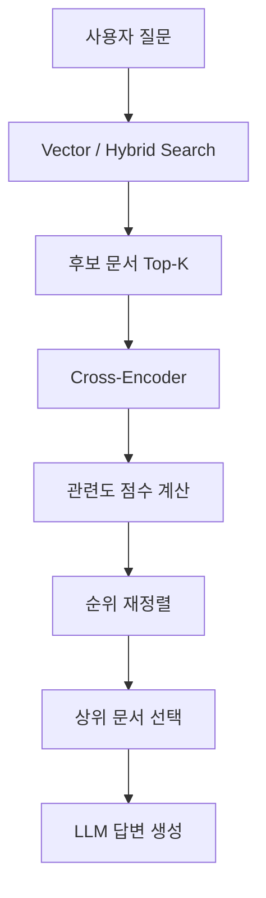
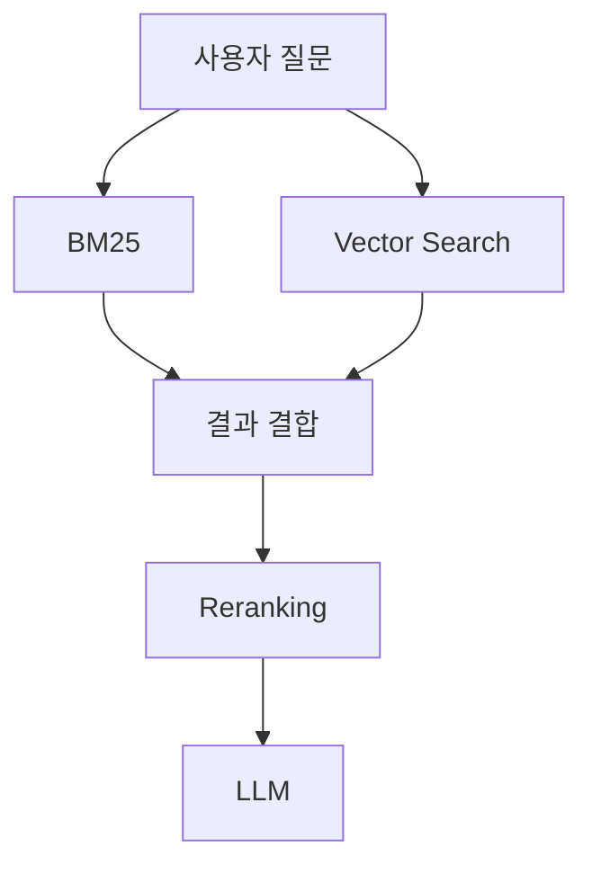
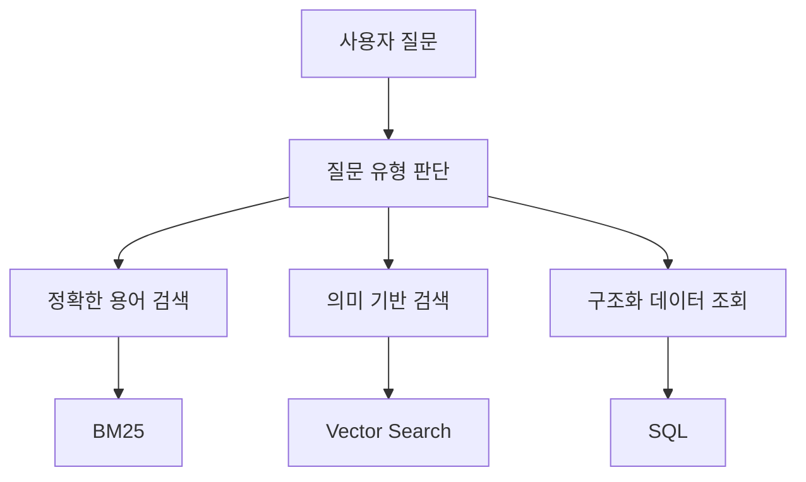
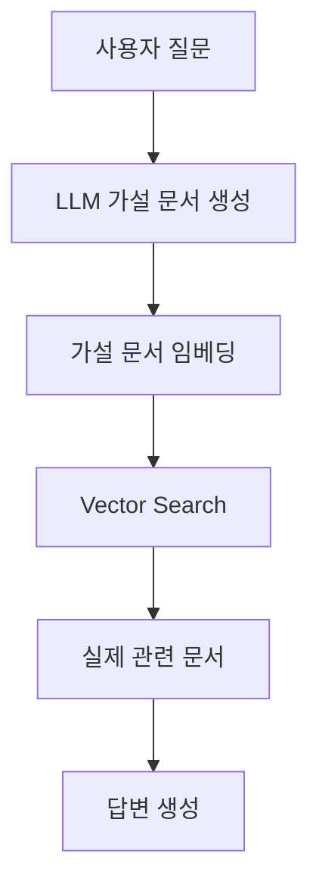
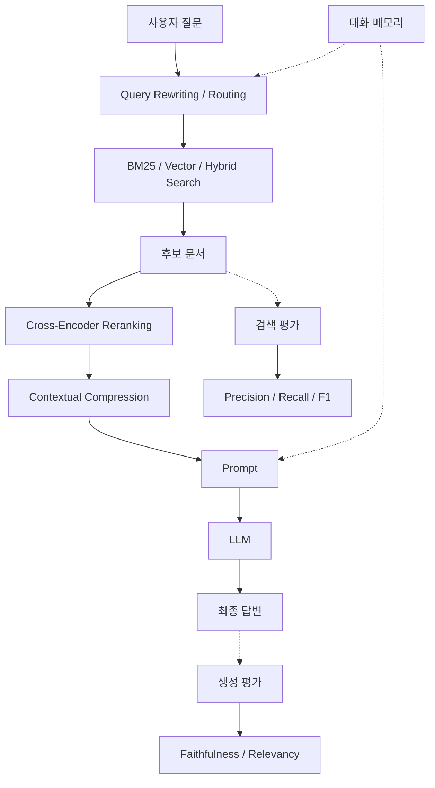

# TIL | RAG 검색 최적화와 성능 평가 — Reranking, RAGAS, LangGraph

**Date:** 2026.11.18  
**Topic:** RAG Retrieval Optimization & Evaluation  
**Environment:** Python · LangChain · PostgreSQL/pgvector · RAGAS

**Keywords:** `Bi-Encoder` · `Cross-Encoder` · `Reranking` · `Contextual Compression` · `Hybrid Search` · `Precision` · `Recall` · `F1-score` · `Faithfulness` · `Response Relevancy` · `Query Rewriting` · `HyDE` · `LangGraph`

---

## 0. 오늘의 학습 목표

오늘 수업에서는 RAG(Retrieval-Augmented Generation, 검색 증강 생성)의 검색 결과를 개선하고, 검색 및 생성 품질을 정량적으로 평가하는 방법을 학습했다.

학습 내용은 다음 세 영역으로 구분한다.

| 영역 | 주요 개념 | 학습 목적 |
|---|---|---|
| 검색 최적화 | Bi-Encoder, Cross-Encoder, Reranking, Compression | 관련 문서를 정확하게 검색하고 정리 |
| 성능 평가 | Precision, Recall, F1, Faithfulness, Relevancy | 검색과 생성 단계의 품질 측정 |
| RAG 고도화 | Query Rewriting, Routing, HyDE, Memory | 질문 처리와 대화 맥락 유지 |

**핵심:** RAG의 성능은 LLM 자체뿐 아니라 검색 방식, 문서 분할, 검색 순위, 문맥 구성, 프롬프트 등 여러 요소의 영향을 받는다.

---

# Part 1. 검색 정확도 향상

## 1. Bi-Encoder와 Cross-Encoder

### A. Bi-Encoder — 바이 인코더

질문과 문서를 각각 독립적으로 임베딩(Embedding)한 후 벡터 간 유사도를 계산한다.

```text
질문 → Encoder → 질문 벡터 ─┐
                           ├→ 유사도 계산
문서 → Encoder → 문서 벡터 ─┘
```

**특징**

- 문서 벡터를 미리 계산하여 저장할 수 있다.
- 대규모 문서에서 빠르게 후보를 검색하는 데 적합하다.
- 질문과 문서 사이의 세밀한 상호작용을 직접 분석하는 데 한계가 있다.

**주요 활용:** Vector Search의 초기 후보 검색

### B. Cross-Encoder — 크로스 인코더

질문과 문서를 하나의 입력 쌍으로 처리하여 관련도 점수를 계산한다.

```text
[질문 + 후보 문서]
        ↓
   Cross-Encoder
        ↓
    관련도 점수
```

**특징**

- 질문과 문서 사이의 관계를 함께 고려한다.
- 후보 문서마다 별도 추론이 필요하다.
- 일반적으로 대규모 전체 검색보다는 소수 후보의 재정렬에 적합하다.

**주요 활용:** Reranking

### C. 비교

| 항목 | Bi-Encoder | Cross-Encoder |
|---|---|---|
| 입력 | 질문과 문서를 각각 처리 | 질문과 문서를 함께 처리 |
| 출력 | 임베딩 벡터 | 관련도 점수 |
| 문서 사전 처리 | 임베딩 저장 가능 | 질문별 재계산 필요 |
| 대규모 검색 | 유리 | 상대적으로 비효율적 |
| 주요 목적 | 후보 검색 | 후보 재정렬 |

**정리:** Bi-Encoder로 빠르게 후보를 찾고, Cross-Encoder로 후보의 순위를 다시 판단하는 방식이 실용적이다.

---

## 2. Reranking — 검색 결과 재정렬

리랭킹은 초기 검색으로 확보한 후보 문서를 별도 모델로 재평가하고, 관련성이 높은 순서로 다시 정렬하는 과정이다.



### A. 예시

질문: "경매 입찰 제한은 어떻게 적용되는가?"

| 초기 검색 순위 | 검색 문서 |
|---|---|
| 1 | 경매 서비스 소개 |
| 2 | 경매 입찰 제한 정책 |
| 3 | 경매 결제 처리 방식 |

리랭킹 후에는 실제 질문과 관련성이 높은 **경매 입찰 제한 정책**이 첫 번째로 올라올 수 있다.

### B. 주의할 점

- 리랭킹은 기존 후보의 순위를 변경한다.
- 초기 검색에서 누락된 문서를 새로 찾아주지는 않는다.
- 후보 수가 많을수록 추론 시간과 비용이 증가한다.
- 리랭커 점수는 모델에 따라 범위와 의미가 다르다.

특히 Cross-Encoder의 원시 점수를 코사인 유사도 또는 확률로 단정해서는 안 된다.

### C. 한국어 리랭커 사례

**모델:** `Dongjin-kr/ko-reranker`

- 한국어 데이터로 파인튜닝된 리랭커
- 질문과 문서 쌍을 입력받아 관련도 점수 출력
- Hugging Face Transformers 기반으로 활용 가능
- 한국어 검색 결과 재정렬에 활용할 수 있음

모델 카드에는 자체 평가 결과가 제시되어 있지만, 실제 프로젝트에서의 성능은 별도 검증이 필요하다.

**참고:** https://huggingface.co/Dongjin-kr/ko-reranker

---

## 3. Contextual Compression — 맥락 압축

검색된 문서에서 질문과 관련성이 낮은 내용을 제거하거나 핵심 정보를 추출·요약하는 과정이다.

### A. 주요 방식

| 방식 | 설명 |
|---|---|
| 문서 필터링 | 관련성이 낮은 문서 전체 제거 |
| 근거 추출 | 문서에서 필요한 부분만 추출 |
| 문서 요약 | 핵심 의미를 유지하면서 내용 축약 |

### B. Reranking과의 차이

- **Reranking:** 문서의 순서를 바꾸는 작업
- **Contextual Compression:** LLM에 전달할 문맥을 줄이거나 정리하는 작업

LangChain에서는 문서 필터링이나 재정렬 구성 요소도 `ContextualCompressionRetriever`와 결합할 수 있다.

따라서 이름에 Compression이 포함되었다고 해서 항상 문장 요약을 수행하는 것은 아니다.

### C. 적용 시 주의점

- 압축 과정에서 정답에 필요한 근거가 삭제될 수 있다.
- 불필요한 문맥을 줄이면 토큰 사용량이 감소할 수 있다.
- 이미 짧고 관련성이 높은 문서에는 압축 효과가 작을 수 있다.

**핵심:** 압축은 문서를 무조건 짧게 만드는 것이 아니라, 답변에 필요한 정보를 보존하면서 노이즈를 줄이는 과정이다.

---

## 4. Hybrid Search — 하이브리드 검색

하이브리드 검색은 서로 다른 검색 방식을 조합하는 전략이다.

대표적으로 BM25와 벡터 검색을 함께 사용한다.

| 방식 | 강점 | 한계 |
|---|---|---|
| BM25 | 정확한 용어·키워드 검색 | 다른 표현으로 작성된 문서를 놓칠 수 있음 |
| Vector Search | 의미적으로 유사한 문서 검색 | 고유명사·숫자 등 정확한 일치에 약할 수 있음 |
| Hybrid Search | 두 방식의 상호 보완 | 결과 결합 전략 필요 |



검색 결과는 점수를 단순 합산하는 방식뿐 아니라 RRF(Reciprocal Rank Fusion, 역순위 융합)처럼 순위를 활용하는 방식으로도 결합할 수 있다.

---

# Part 2. RAG 검색 품질 평가

## 5. Context Precision — 문맥 정밀도

**검색된 문맥 중 실제로 관련 있는 정보가 얼마나 포함되어 있는가?**

일반적인 정보 검색의 정밀도 공식:

\[
Precision=\frac{TP}{TP+FP}
\]

- TP: 관련 정보를 올바르게 검색
- FP: 관련 없는 정보를 검색

### A. 문서 단위 예시

검색된 문서 5개 중 관련 문서가 3개라면:

\[
Precision=\frac{3}{5}=0.6
\]

정밀도는 60%다.

### B. 문장 단위 예시

하나의 청크에 10개 문장이 있고, 그중 6개가 질문과 관련 있다면 문장 단위 정밀도는 다음과 같다.

\[
Precision_{\text{sentence}}=\frac{6}{10}=0.6
\]

문서 하나만 검색된 경우에도 문장 또는 진술 단위로 평가할 수 있다.

다만 여러 문장이 함께 의미를 구성할 수 있으므로 문장 단위 평가가 언제나 더 정확한 것은 아니다.

### C. RAGAS의 Context Precision

RAGAS의 Context Precision은 단순한 관련 문서 비율과 다르다.

**검색 결과에서 관련 있는 문맥이 얼마나 높은 순위에 배치되었는지**도 고려한다.

즉, 관련 문서 3개를 검색했더라도 상위에 배치되었는지, 하위에 배치되었는지에 따라 평가가 달라질 수 있다.

또한 RAGAS는 기준 정답을 사용하는 방식과 기준 정답 없이 평가하는 방식 등 여러 구현을 제공한다.

**정리:** 일반 Precision 공식은 기본 개념을 이해하는 데 사용하고, RAGAS 점수는 해당 평가 방식의 정의에 따라 해석해야 한다.

공식 문서: https://docs.ragas.io/en/stable/concepts/metrics/available_metrics/context_precision/

---

## 6. Context Recall — 문맥 재현율

**정답에 필요한 전체 근거 중 실제 검색된 문맥으로 얼마나 뒷받침할 수 있는가?**

일반적인 정보 검색 공식:

\[
Recall=\frac{TP}{TP+FN}
\]

- TP: 필요한 정보를 검색한 경우
- FN: 필요한 정보를 검색하지 못한 경우

### A. 문장 단위 예시

문서 전체에 10개 문장이 있다고 가정한다.

그중 정답에 필요한 근거가 6개이고, 검색된 문맥에서 확보한 근거가 3개라면:

\[
Recall=\frac{3}{6}=0.5
\]

즉, 정답에 필요한 근거의 50%만 확보했다.

**중요:** 분모의 6개는 전체 정답 근거 문장이어야 한다.

검색된 문장 6개 중 3개가 관련 있다는 뜻이라면 이는 Recall이 아니라 Precision을 설명하는 예시다.

### B. RAGAS의 Context Recall

RAGAS의 LLM 기반 Context Recall은 기준 정답을 여러 진술로 분해한 뒤, 검색된 문맥이 각 진술을 뒷받침할 수 있는지 평가할 수 있다.

따라서 단순히 검색된 문서 수를 세는 방식과 다르다.

**주의:** 검색된 근거를 LLM이 최종 답변에서 실제로 사용했는지는 생성 품질과 연결되는 문제다. Context Recall은 우선 필요한 근거가 검색 문맥에 확보되었는지를 평가한다.

공식 문서: https://docs.ragas.io/en/stable/concepts/metrics/available_metrics/context_recall/

---

## 7. F1-score — 정밀도와 재현율의 균형

Precision과 Recall은 서로 다른 측면을 평가한다.

- Precision: 불필요한 정보가 얼마나 적은가?
- Recall: 필요한 정보를 얼마나 놓치지 않았는가?

두 지표를 함께 고려하기 위해 조화평균을 사용한다.

\[
F1=2\times\frac{Precision\times Recall}{Precision+Recall}
\]

예를 들어 Precision이 1.0이고 Recall이 0.2라면:

- 산술평균: 0.6
- F1-score: 약 0.333

F1-score는 두 지표 중 하나가 낮을 때 전체 점수가 크게 낮아지는 특징이 있다.

**주의:** F1-score는 일반적인 검색 성능의 균형 지표다. RAGAS Context Precision과 Context Recall의 점수를 조합한 값이 모든 RAGAS 구현에서 공식 기본 지표로 제공되는 것은 아니다.

---

# Part 3. RAG 생성 품질 평가

## 8. Faithfulness — 근거 충실성

**생성된 답변의 진술이 검색된 Context로 입증 가능한가?**

Faithfulness는 근거 없는 생성, 즉 환각(Hallucination)을 판단하는 데 활용한다.

### A. 계산 방식

\[
Faithfulness=
\frac{\text{Context로 입증 가능한 진술 수}}
{\text{답변에서 추출한 전체 진술 수}}
\]

### B. 예시

LLM 답변:

> Python은 간결한 문법을 지닌 언어로, 1991년 귀도 반 로섬이 발표했다.

이를 두 진술로 분리한다.

1. Python은 간결한 문법을 지닌 언어다.
2. Python은 1991년 귀도 반 로섬이 발표했다.

검색된 Context가 첫 번째 진술만 입증한다면:

\[
Faithfulness=\frac{1}{2}=0.5
\]

### C. 중요한 구분

**Faithfulness와 사실 정확성은 다르다.**

검색 문맥에 없는 내용을 답변했다고 해서 반드시 사실이 틀린 것은 아니다.

반대로 검색 문맥 자체에 잘못된 정보가 있다면, 그 정보를 충실하게 반영한 답변은 Faithfulness가 높더라도 사실적으로 틀릴 수 있다.

### D. 점수가 낮을 때

1. 검색 문맥에 충분한 근거가 있는지 확인한다.
2. 문맥이 지나치게 길거나 충돌하는 정보가 있는지 점검한다.
3. 프롬프트에서 문서 기반 답변을 명시한다.
4. 근거가 없으면 모른다고 답하도록 설정한다.
5. 문제가 반복되면 LLM 모델을 비교한다.

공식 문서: https://docs.ragas.io/en/stable/concepts/metrics/available_metrics/faithfulness/

---

## 9. Answer Relevancy / Response Relevancy — 답변 관련성

**생성된 답변이 사용자의 질문에 얼마나 적절하게 대응하는가?**

### A. 예시

질문: "Python은 언제 발표되었는가?"

- 답변 A: "Python은 1991년에 발표되었다." → 관련성 높음
- 답변 B: "Python은 다양한 분야에서 사용되는 언어다." → 관련성 낮음

### B. 관련성 평가 방법

| 방식 | 평가 원리 |
|---|---|
| Bi-Encoder | 질문과 답변을 각각 임베딩하여 비교 |
| Cross-Encoder | 질문과 답변을 함께 입력하여 관련도 계산 |
| LLM-as-a-Judge | LLM이 평가 기준에 따라 관련성 판단 |
| RAGAS Response Relevancy | 답변에서 역으로 생성한 질문과 원래 질문의 의미적 유사성 등을 활용 |

**최신 문서 반영:** RAGAS 공식 문서에서는 `Response Relevancy`라는 명칭을 사용하며, 기존 `Answer Relevancy`라는 표현도 설명에 등장한다.

RAGAS의 해당 방식은 단순히 원래 질문과 생성 답변의 임베딩을 직접 비교하는 것과는 구분해야 한다.

또한 관련성이 높다고 해서 답변의 사실 정확성까지 보장되는 것은 아니다.

공식 문서: https://docs.ragas.io/en/stable/concepts/metrics/available_metrics/answer_relevance/

---

## 10. 생성 품질의 추가 지표

| 지표 | 평가 대상 | 구분 |
|---|---|---|
| Faithfulness | 답변과 검색 근거 | 근거 충실성 |
| Response Relevancy | 질문과 답변 | 질문 관련성 |
| Factual Correctness | 기준 정답과 생성 답변 | 사실적 정확성 |
| Semantic Similarity | 기준 정답과 생성 답변의 의미 | 의미적 유사성 |

Semantic Similarity가 높더라도 숫자나 부정 표현이 틀릴 수 있으므로, 사실 정확성 평가를 완전히 대체할 수 없다.

---

# Part 4. RAG 평가 실습과 정량 지표

## 11. RAGAS 평가 데이터

RAGAS 평가에서는 지표에 따라 다음 데이터가 사용된다.

| 필드 | 의미 |
|---|---|
| `user_input` | 사용자 질문 |
| `retrieved_contexts` | 검색된 문맥 |
| `response` | LLM이 생성한 답변 |
| `reference` | 기준 정답 |

모든 지표가 네 필드를 전부 요구하는 것은 아니다.

### 기존 자료와 최신 문서의 차이

2025년 RAGAS 실습 자료에서는 다음과 같은 코드가 사용되었다.

```python
from ragas import evaluate
from ragas.metrics import (
    faithfulness,
    answer_relevancy,
    context_precision,
    context_recall,
)
```

이 코드는 당시의 평가 방식과 API를 이해하는 참고 예시다.

현재 RAGAS 공식 문서에는 `Faithfulness`, `LLMContextPrecisionWithReference`, `LLMContextRecall`, `ResponseRelevancy` 등 클래스 기반 평가 방식도 안내되어 있다.

**실습 시에는 설치된 RAGAS 버전을 먼저 확인하고 해당 버전의 공식 예제를 사용하는 것이 안전하다.**

공식 문서: https://docs.ragas.io/

---

## 12. 시스템 성능과 비용 평가

RAG 품질 외에도 운영 효율을 정량적으로 측정할 수 있다.

| 지표 | 의미 | 주의점 |
|---|---|---|
| TTFT | 첫 토큰 응답 시간 | 스트리밍 응답에서 측정 |
| End-to-End Latency | 전체 응답 완료 시간 | 검색·생성 단계 구분 가능 |
| Token Usage | 입력·출력 토큰 사용량 | 모델별 과금 기준 확인 |
| Output Tokens/sec | 초당 출력 토큰 수 | 생성 속도 측정 |
| Cost per Request | 요청당 비용 | 임베딩·리랭킹·생성 비용 포함 가능 |

품질이 좋아지더라도 리랭킹이나 압축 과정에서 처리 시간이 증가할 수 있다.

따라서 개선 전후의 품질과 속도, 비용을 함께 비교해야 한다.

---

# Part 5. 질문 개선과 검색 전략

## 13. Query Rewriting — 질의 재작성

모호한 질문을 검색에 적합한 형태로 바꾸는 전략이다.

예시:

- 원래 질문: "배터리는 얼마나 가나요?"
- 이전 대화 맥락: 특정 노트북 모델에 대해 이야기 중
- 재작성 질문: "해당 노트북 모델의 배터리 사용 시간은 얼마인가?"

이전 대화에서 확인된 정보를 활용하되, 존재하지 않는 사실을 임의로 추가해서는 안 된다.

---

## 14. Query Routing — 검색 경로 선택

질문의 특성에 따라 검색 방법이나 데이터 저장소를 선택한다.



예시:

- 정책명 검색 → BM25
- 유사한 의미의 문서 검색 → Vector Search
- 특정 기간 거래 건수 → SQL

질문에 따라 단일 경로를 선택하거나 여러 경로를 함께 사용할 수 있다.

---

## 15. HyDE — 가설 문서 임베딩

HyDE(Hypothetical Document Embeddings)는 사용자 질문에 대한 가상의 답변 문서를 생성하고, 이를 임베딩하여 실제 문서를 검색하는 방식이다.



가설 문서는 검색을 돕기 위한 중간 표현이며, 검증된 사실이나 최종 답변이 아니다.

---

# Part 6. LangGraph와 대화 메모리

## 16. LangGraph란?

LangGraph는 그래프 기반으로 AI 애플리케이션과 에이전트의 실행 흐름을 구성하는 프레임워크다.

주요 구성 요소는 다음과 같다.

| 개념 | 의미 |
|---|---|
| State | 실행 중 공유·갱신하는 데이터 |
| Node | 특정 작업을 수행하는 단계 |
| Edge | 노드 사이의 실행 연결 |
| Conditional Edge | 상태에 따라 다음 실행 경로 선택 |
| Checkpointer | 실행 상태를 저장·복원하는 구성 요소 |

LangChain의 LCEL이 Runnable을 연결하는 데 유용하다면, LangGraph는 **상태를 유지하면서 조건 분기, 반복, 재시도 등이 필요한 워크플로**를 표현하는 데 유용하다.

단순한 RAG 파이프라인을 구현하기 위해 반드시 LangGraph를 사용해야 하는 것은 아니다.

---

## 17. LangGraph의 메모리

LangGraph 공식 문서는 메모리를 크게 두 가지로 구분한다.

### A. Short-term Memory — 단기 메모리

현재 대화 스레드의 상태와 메시지 기록을 유지한다.

- 여러 차례의 대화 맥락 유지
- Checkpointer를 이용한 상태 저장
- 같은 `thread_id`를 통한 대화 상태 연결

### B. Long-term Memory — 장기 메모리

서로 다른 세션에서도 사용할 정보를 저장한다.

- 사용자 또는 애플리케이션 수준의 정보 보관
- 별도 Store를 활용한 데이터 관리
- 필요에 따라 의미 기반 검색 사용

**중요:** LangGraph의 메모리가 모두 벡터 검색으로 구현되는 것은 아니다.

단기 메모리는 Checkpointer 기반으로 관리할 수 있고, 장기 메모리는 Store를 통해 관리할 수 있다.

벡터 검색은 저장된 정보 중 관련 내용을 찾는 선택적인 방법이다.

공식 문서: https://docs.langchain.com/oss/python/langgraph/add-memory

---

# Part 7. 전체 RAG 아키텍처

## 18. 오늘 학습한 기술의 연결



위 구성은 학습을 위한 종합 예시이며, 모든 RAG 시스템에 모든 단계가 필요한 것은 아니다.

---

# Part 8. 검수 결과와 학습 회고

## 19. 기존 필기와 공식 문서 크로스체크

| 항목 | 검수 결과 | 수정·보완 내용 |
|---|---|---|
| Bi-Encoder | 개념 적절 | 대규모 후보 검색 역할 명확화 |
| Cross-Encoder | 개념 적절 | 원시 점수와 확률 구분 |
| Reranking | 적절 | 후보 누락 문제를 해결하지 못하는 한계 추가 |
| Compression | 보완 | 필터링·추출·요약 구분 |
| Hybrid Search | 적절 | 결과 결합 전략 추가 |
| Context Precision | 수정 | RAGAS의 순위 기반 평가 반영 |
| Context Recall | 수정 | 기준 정답의 근거 충족 여부 명확화 |
| F1-score | 적절 | 일반 정보 검색 지표와 RAGAS 지표 구분 |
| Faithfulness | 적절 | 근거 충실성과 사실 정확성 구분 |
| Answer Relevancy | 수정 | RAGAS Response Relevancy와 일반 임베딩 비교 구분 |
| RAGAS API | 업데이트 | 기존 함수형 예제와 클래스 기반 API 구분 |
| Query Rewriting | 적절 | 사실 추가·의미 변형 위험 명시 |
| HyDE | 적절 | 가설 문서를 검증된 사실과 구분 |
| LangGraph Memory | 보완 | Checkpointer와 Store의 역할 구분 |

## 20. 학습하면서 헷갈리기 쉬운 부분

**A. Precision과 Recall**

- Precision: 검색한 것 중 얼마나 관련 있는가?
- Recall: 필요한 것 중 얼마나 확보했는가?

**B. Reranking과 Compression**

- Reranking: 순서를 바꾼다.
- Compression: 전달할 문맥을 줄이거나 정리한다.

**C. Faithfulness와 Correctness**

- Faithfulness: 검색 근거에 충실한가?
- Correctness: 기준 정답과 사실적으로 일치하는가?

**D. LangGraph State와 Memory**

- State: 워크플로 실행 중 관리하는 데이터
- Short-term Memory: 스레드의 상태를 지속적으로 유지
- Long-term Memory: 세션을 넘어 정보를 저장·활용

---

## 21. 복습 질문

1. Bi-Encoder와 Cross-Encoder를 함께 사용하는 이유는 무엇인가?
2. 초기 검색에서 정답 문서가 누락되었다면 리랭킹만으로 해결할 수 있는가?
3. 검색 문서 5개 중 관련 문서가 3개라면 일반 Precision은 얼마인가?
4. 기준 정답의 근거 6개 중 검색 문맥으로 입증 가능한 근거가 3개라면 Recall은 얼마인가?
5. Faithfulness가 높지만 사실적으로 틀린 답변이 가능한 이유는 무엇인가?
6. LangGraph의 Checkpointer와 Store는 어떤 차이가 있는가?

---

# 22. 참고 자료

### 강의에서 제공된 자료

1. [Dongjin-kr/ko-reranker — Hugging Face](https://huggingface.co/Dongjin-kr/ko-reranker)
2. [OpenSearch란 무엇인가? — WikiDocs](https://wikidocs.net/280293)
3. [RAGAS를 이용한 실전 RAG 평가 — Velog](https://velog.io/@judy_choi/RAG-%EC%8B%9C%EB%A6%AC%EC%A6%88-RAGAS-%EB%A5%BC-%EC%9D%B4%EC%9A%A9%ED%95%9C-%EC%8B%A4%EC%A0%84-RAG-%ED%8F%89%EA%B0%80-3u6xgtxe)
4. [LangGraph란 무엇인가? — IBM](https://www.ibm.com/kr-ko/think/topics/langgraph)

### 공식 문서

5. [RAGAS — Context Precision](https://docs.ragas.io/en/stable/concepts/metrics/available_metrics/context_precision/)
6. [RAGAS — Context Recall](https://docs.ragas.io/en/stable/concepts/metrics/available_metrics/context_recall/)
7. [RAGAS — Faithfulness](https://docs.ragas.io/en/stable/concepts/metrics/available_metrics/faithfulness/)
8. [RAGAS — Response Relevancy](https://docs.ragas.io/en/stable/concepts/metrics/available_metrics/answer_relevance/)
9. [LangGraph — Memory](https://docs.langchain.com/oss/python/langgraph/add-memory)

---

## 최종 한 줄 요약

**RAG 최적화는 검색 후보를 확보하고, 관련도에 따라 재정렬하며, 필요한 근거를 보존하도록 문맥을 구성한 뒤, 검색·생성 품질과 시스템 효율을 각각 평가하여 개선하는 과정이다.**