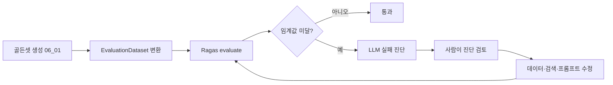

# TIL | 2026.11.19 목요일 — RAG 평가: 골든셋 · 검색/생성 지표 · Ragas · 실패 원인 분석

- **Course**: KANT AI 수업 — RAG 파이프라인 설계
- **Progress**: 데일리퀘스트(11/18분) 리뷰 → 6장 1강 「평가셋 구성과 검색 지표」 → 실습 노트북 `06_01`, `07_03`, `07_04`, `07_05` (세션 코드 261119-01, 261119-02, 3교시) · 7장 강 번호는 노트북 파일명 기준이라 `확인 필요`
- **Tech Stack**
  - 직접 사용: Python 3.13, Jupyter, uv, LangChain, Pydantic, Ragas, pandas
  - 환경 버전(`uv.lock` 확인): `ragas 0.4.4`, `langchain 1.5.2`, `langchain-core 1.8.3`, `langchain-openai 1.8.3`, `pydantic 2.14.3`
  - 모델: 평가자/생성 `gpt-6-luna`(`init_chat_model`), 임베딩 `text-embedding-3-small`

---

## 0. 오늘의 학습 키워드

- 🟣 **골든셋(평가셋)** = 질문 `user_input` · 기준 답변 `reference` · 근거 문서 `retrieved_contexts`
- 🟣 **정밀도 · 재현율 · F1(조화평균)** / **신뢰도(충실도)** vs **답변 관련성**
- 🔵 평가 → 기준 미달 사례 추출 → LLM으로 원인 진단 → 개선 → **같은 골든셋으로 재평가**
- 🟢 **Ragas** `ContextPrecision` · `ContextRecall` · `Faithfulness` · `ResponseRelevancy`, `EvaluationDataset`, `evaluate()`
- 🟢 **Pydantic 구조화 출력** `with_structured_output(RagEvalDataset)`
- 🟠 Ragas 0.4.4에서 `ragas.metrics` import, `LangchainLLMWrapper`, `evaluate()`는 **deprecated**
- 🟠 **LLM 심판은 실행마다 점수가 흔들림**, 임계값은 오탐을 만들 수 있음 → 사례 검토 필수

> **한 줄 요약**: 검색과 생성을 따로 재야 실패 원인이 보이고, LLM이 매긴 점수와 진단은 결론이 아니라 사람이 검토할 출발점이다.

---

## 1. Targets & Goals

- [x] 11/18 데일리퀘스트 5문항 리뷰
- [x] 정밀도 · 재현율 · F1, 충실도 · 답변 관련성 개념 학습
- [x] **`06_01`** Pydantic 구조화 출력으로 골든셋 4문항 생성 — 실행 및 출력 확인
- [x] **`07_03`** 검색 지표(Context Precision/Recall) 평가 → CSV 저장 → 임계값 0.8 미달 사례 LLM 진단 → `search_failure_report.csv` — 실행 및 출력 확인
- [x] **`07_05`** 검색 실패 분석 노트북 — 실행 및 출력 확인
- [ ] **`07_04`** 생성 지표(Faithfulness/Relevancy) 평가까지 실행 완료, **임계값 기반 실패 추출과 생성 실패 보고서는 미작성**(진행 중)
- [ ] Ragas `collections` API로 마이그레이션 — 계획 단계

---

## 2. STUDY & EXERCISE

### 2-1. 데일리퀘스트 리뷰 (11/18분)

| 문항 | 정답 | 내 필기 / 수업 설명 |
|---|---|---|
| 질문과 문서 간 문체·전문성 격차가 클 때, LLM이 먼저 가상의 예상 답변 문서를 생성하고 이를 임베딩해 검색에 활용하는 쿼리 변환 기법 | **HyDE** (Hypothetical Document Embeddings) | 가상 답변을 임베딩하면 실제 정답 문서와의 벡터 유사도가 높아짐. Query Rewrite(맞춤법·핵심 명사 재구성), Query Routing(경로 선택), Memory 기반 검색(대화 맥락 복원)과 구분 |
| 복수의 특화 DB(문서, SQL, 웹)가 있을 때 질문 성격을 판별해 적절한 저장소로 검색 요청을 분기 | **Query Routing** | 질문 의도에 맞는 수집 경로를 골라 불필요한 탐색 비용을 줄이고 정확도를 높임 |
| 2단계 검색에서 1차 검색기와 2차 리랭커(Cross-Encoder)를 분리하는 이유 | 모든 대용량 문서에 무거운 모델을 쓰면 느려지므로, **소수 후보만 정밀 채점** | 속도와 순서 관련 설명을 하심 (`전사 나중에 크로스 참고`) |
| 맥락 압축(Contextual Compression)과 리랭킹의 기능적 차이 | 리랭킹 = **문서 단위 순서 재배열** / 맥락 압축 = **문서 내부의 불필요한 문장 제거** | 노이즈가 낄 수 있어서 압축이 필요. LLM 프롬프팅, LangChain 클래스, HuggingFace 모델 등 다양한 프레임워크로 작업 가능 |
| 의미는 같지만 표기가 달라 BM25가 관련 문서를 못 찾는 현상 | **어휘 불일치** (Vocabulary Mismatch) | 이런 경우 벡터 검색이 더 적합할 수 있음 |

### 2-2. 지난 수업 리뷰 — RAG 평가 지표 (검색 품질 · 생성 품질)

**① 정밀도 · 재현율 · F1 Score를 말로 설명해 보기** (수업 활동)

- **정밀도(Precision)**: 검색기가 가져온 문서 중 실제 정답 근거 문서가 차지하는 비율 → 검색 결과의 **순도**
- **재현율(Recall)**: 찾아야 할 전체 정답 근거 문서 중 검색기가 놓치지 않고 가져온 비율 → 검색의 **포괄 범위**
- 둘은 상충: 검색 범위를 무작정 넓히면 정답을 놓치지 않지만(재현율↑) 무관 문서가 섞여 품질이 떨어짐(정밀도↓)
- **F1** = 2 × P × R / (P + R)
  - 산술평균은 한쪽 지표가 심각하게 낮아도 수치가 괜찮아 보이는 왜곡이 생김
  - 조화평균은 **작은 값에 더 큰 가중치** → 둘 중 하나라도 0에 가까우면 전체 점수가 급락해 결함이 드러남
- **판단은 1차적으로 LLM을 통해서** (관련/무관 판정을 LLM이 수행 = LLM-as-a-Judge)

`강의/자료 예시` — 6장 1강 자료

| 케이스 | P | R | 산술평균 | F1 |
|---|---|---|---|---|
| 편향 검색기 | 0.10 | 0.90 | 0.50 | **0.18** |
| 균형 검색기 | 0.80 | 0.80 | 0.80 | **0.80** |

> 0.18 = 2 × 0.09 / 1.00 으로 재계산해 확인. 자료의 ID 집합 예시(정답 {1,2,3} vs 검색 {1,2,9})도 P = R = F1 = 2/3 ≈ 0.6667로 맞음.

**② 생성 품질 지표: 신뢰도(충실도)와 답변 관련성**

- **신뢰도(Faithfulness, 충실도)**: 주입된 문서와 답변을 매칭 비교
  - 답변이 문서가 아닌 **모델 파라미터 기반**으로 나왔다면 → **환각**
- **답변 관련성(Answer Relevancy)**: 답변이 질문에 맞게 대응했는지
  - 임베딩값을 비교해서 유사도로 판단 — **Bi-Encoder**, **Cross-Encoder**
  - 반대로 **역질문**을 쓰기도 함: “이런 답변을 할 만한 질문을 뽑아줘”라고 시킨 뒤, 생성된 질문들과 원래 질문을 비교
  - Ragas의 `ResponseRelevancy`는 이 중 **역질문 + 임베딩 코사인 유사도** 방식 (그래서 LLM과 임베딩 모델이 둘 다 필요)

### 2-3. 1교시 — RAG 시스템의 구축과 평가 (261119-01)

> 전사 시스템상 세션 제목은 「Prompt injection 공격 방어」로 붙었지만 실제 내용은 RAG 평가

**개요**: RAG의 검색·생성 품질을 평가하는 방법과, 평가용 데이터셋을 준비해 LangChain 기반 실습 환경을 구성하는 과정. 핵심은 **적절한 지표와 표준 정답을 마련하고, 실제 사례로 결과를 점검하며 반복 개선**하는 것

**평가 데이터셋(골든셋) 구성**

- 질문 · 정답 · 근거 문서로 구성. 각 항목이 시스템 결과를 비교·검증하는 기준
- 처음부터 완벽하게 만들기 어려움 → 문서에서 질문과 정답을 만들고, **운영 중 축적되는 사례와 사용자 피드백**을 반영해 보완
- 질문 유형을 다양하게, **답변이 불가능하거나 근거가 부족한 사례도** 평가 대상에 포함
- JSON 등 정형화된 형식으로 관리하고 **필드 이름과 데이터 구조를 일관되게**

**검색 결과 분석**

- 검색된 문서 가운데 정답에 필요한 내용을 담은 문서가 얼마나 있는지 확인
- 검색 문서 수가 늘면 관련 문서를 찾을 가능성은 높아지지만 무관 문서가 섞여 정밀도가 떨어질 수 있음
- 그래서 **검색 개수와 점수만 보지 말고** 실제 문서의 관련성과 근거 내용을 함께 검토

**답변 품질 분석**

- 답변을 **문장 또는 개별 주장으로 나눠** 각 주장이 제공 문서로 뒷받침되는지 확인
- 주요 오류: **근거 문서에 없는 내용 추가**, **서로 상충하는 문서를 혼합**
- 검색 결과가 모호하거나 충돌하면 → 질문을 명확하게 하거나 문서를 정리해서 개선
- 두 지표(충실도·관련성)를 함께 보면 근거에서 벗어난 답변과 질문에 맞지 않는 답변을 구분할 수 있음
- 자동 평가 지표는 판단 보조 도구일 뿐 모든 품질 문제를 완벽히 판정하지 못함 → 실제 사례 검토와 함께 해석

**반복 개선**: 점수만으로 품질을 단정하지 말고, 실제 검색 문서와 답변을 확인해 원인을 찾은 뒤 **검색 설정, 문서 구성, 질문 형식** 등을 조정

**실습 환경**: LangChain과 모델·검색 구성 요소로 RAG 및 평가 파이프라인 설정, 문서와 평가 샘플 준비 → 모델 생성 답변을 평가하는 구조. 설치와 데이터 준비에 시간이 걸려 세부 실습은 다음 시간에 이어서

### 2-4. 2교시 — RAG 시스템 평가와 개선 (261119-02)

> 전사 시스템상 세션 제목은 「GPT 문서 평가 및 구조화」

**개요**: 골든셋을 구성하고 검색과 생성 성능을 **별도로 측정해 문제 원인을 찾는** 실습. Ragas 등 도구로 평가 데이터를 처리하고 결과를 CSV로 저장

**골든셋 질문 유형 3가지** — 균형 있게 담아야 함

1. 단일 문서로 답할 수 있는 **사실 질문**
2. 여러 문서를 종합해야 하는 **복합 추론 질문**
3. 제공된 문서만으로 **답할 수 없는 질문** → 문서 밖 정보를 묻고 시스템이 근거 없이 답하지 않는지 평가

**평가 데이터 준비**

- 문서가 여러 개일 수 있으므로 평가 데이터에 **문서 내용과 출처** 등 필요한 맥락을 명확히 담음. 문서 형식·공백 등 입력 데이터도 정리
- 필드: 질문(`user_input`), 기준 답변(`reference`), 검색된 맥락(`retrieved_contexts`) 등 → JSON이나 CSV로 저장

**프롬프트 구성**: 역할 · 작업 · 맥락 · 제약 조건 · 출력 형식을 구체적으로 지정. 구조화된 출력이 필요하면 스키마나 형식 명시

**구조화 출력 — `06_01.ipynb`** `직접 실습 — 결과 확인`

- 필기: LangChain `withStructuredOutput` 문서 참고, 노션 6장 1강 코드와 비교 → **실습 코드처럼 Pydantic 기반으로 하는 걸 권장**한다고 하심 (이유는 3장 Q1·Q2)
- 내 코드 주석: “pydantic은 type 지정이 필요함”, “근거 문서를 기반으로 llm 돌릴 예정”, “llm json문자열로 정해두기”

```python
class RagEvalSample(BaseModel):
    user_input: str = Field(description="제공된 근거 문서를 바탕으로 사용자가 질의할 법한 질문")
    reference: str = Field(description="근거 문서에 기반한 모범정답(Ground Truth)")
    retrieved_contexts: List[str] = Field(description="해당 질문과 정답을 도출하는 데 실제로 사용된 1개 이상의 원본 문서 내용")

class RagEvalDataset(BaseModel):
    samples: List[RagEvalSample] = Field(description="근거 문서로부터 생성된 평가 샘플 목록")

structured_model = model.with_structured_output(RagEvalDataset)
chain = prompt | structured_model
results = chain.invoke({"context": format_documents(source_docs), "num_samples": 4})
```

- 근거 문서: `Document` 3개(근태규정 · 복리후생 · 인사핸드북) + 메타데이터 `source`, `chunk_id`
- 프롬프트 작성 지침: **단순 사실 확인 / 복합 추론 / 문서 외 함정 질문(환각 확인 목적)**
- 관찰 결과: 4문항이 `RagEvalSample` 인스턴스로 생성. 복합 추론 문항(수습 기간 중 재택근무·지원금)은 `retrieved_contexts`에 문서 2개가 담김
- 필드명을 처음부터 **Ragas 표준 이름**으로 맞춰 둬서 바로 `EvaluationDataset`으로 이어 쓸 수 있음

**Ragas**

- RAG Assessment에서 이름이 유래했다는 수업 설명 (`공식 문서 미확인`)
- 라가스는 **문장 단위로** 평가함 (답변·정답을 문장/주장으로 쪼개 LLM이 판정)
- import는 최근 걸로 바꿈: `from ragas.metrics import ContextPrecision, ContextRecall` — 실습과제에 나온 건 구버전이라 이걸로 하면 된다고 안내 (단, 0.4.4 기준으로는 이것도 deprecated → 3장 Q4)
- Wrapper Class? → 3장 Q3

**Ragas 검색 지표 평가 — `07_03`, `07_05`** `직접 실습 — 결과 확인`

흐름: `dict` → `pd.DataFrame` → `EvaluationDataset.from_pandas()` → `evaluate()` → `.to_pandas()` → CSV

```python
model = init_chat_model(model="gpt-6-luna", model_provider="openai",
                        reasoning_effort="none", temperature=0)  # 엄격하게!
evaluator_llm = LangchainLLMWrapper(model, bypass_temperature=True)
metrics = [ContextPrecision(llm=evaluator_llm), ContextRecall(llm=evaluator_llm)]
evaluation_result = evaluate(dataset=ragas_dataset, metrics=metrics, raise_exceptions=True)

df_result = evaluation_result.to_pandas()
df_result.to_csv("search_eval_report.csv", index=False, encoding="utf-8-sig")  # csv 한글 인코딩
```

- 내 주석: “luna 여기서 쓰면 안됨 — temperature 변경 가능한 모델 사용을 위해” (3장 Q3)

의도적으로 결함을 넣은 샘플 3개 (학교 공지 데이터)

| 케이스 | 의도한 결함 | Precision | Recall (`07_03`) | Recall (`07_05`) |
|---|---|---|---|---|
| 2024-1 장학금 마감일 | 메타데이터 필터 미흡 → 2023년 문서 검색 | 0.0 | 0.0 | 0.0 |
| 도서관 주말 운영·대출 규정 | 청킹 실패 → 문장이 중간에 잘림 | 1.0 | **0.0** | **0.5** |
| 기숙사 조식 시간 | 정상 검색 | 1.0 | 1.0 | 1.0 |

- 전체 평균(`07_03`): precision 0.6667, recall 0.3333
- 같은 입력인데 Recall이 0.0과 0.5로 다르게 나옴 → 3장 Q5

**검색 지표 해석 · 그 밖의 원칙**

- 정밀도와 재현율은 상충 → 한쪽만 높이지 말고 균형 고려
- **평균 점수만 보면 일부 지표의 극단값이 가려짐** → 지표별·사례별 결과 확인
- 생성 평가는 근거 충실도, 관련성, **답변 가능성** 점검 → 근거와 안 맞는 답변, **답할 수 없는 질문에 추측으로 응답**하는 경우를 찾아냄
- 여러 모델 비교 시 **동일한 평가 데이터와 조건**, 자동 점수만으로 결론 내리지 말고 실제 사례도 함께 검토
- API 키 등 민감한 설정값은 코드에 노출하지 않고 **환경변수**(`.env`, `load_dotenv()`)로 관리
- 다음 개선 단계: 검색·생성 문제 사례 분석 → 데이터·검색 설정·프롬프트 조정 → **같은 골든셋으로 재평가**

### 2-5. 3교시 — RAG 답변 품질 평가와 실패 원인 분석

**개요**: 모델 설정과 데이터 구성을 점검하고, 검색·생성 결과를 지표로 평가한 뒤 실패 사례를 분석·개선하는 절차. 평가 결과를 평균 점수로만 보지 않고 **기준 미달 사례를 추려 원인을 기록하고 개선안으로 연결**하는 것이 핵심

**핵심 개념**

- **모델 설정**: 성능 · 비용 · 응답 특성을 고려해 선택. 프롬프트 설정도 결과에 영향 → 모델이나 설정을 바꾼 뒤 **다시 실행해 확인**
- **검색·데이터 품질**: 문서의 **연도나 운영시간** 같은 세부 정보가 틀리거나 검색 결과가 질문에 안 맞으면 답변의 신뢰도·관련성이 떨어짐
- **평가 지표**: 검색(Context Precision, Context Recall)과 생성(답변 관련성, 사실성)을 각각 측정
- **임계값 기반 분석**: 지표별 허용 기준(예: 0.7 또는 0.6)을 정하고 미달 사례만 추출
- **실패 분석 보고서**: 실패 유형 · 상세 원인 · 구체적 개선안을 짧고 명확하게 → DataFrame이나 CSV로 저장

**① 평가 데이터와 실행 확인**

- 평가 데이터셋을 바꾼 뒤에는 **변경 내용이 실제 실행에 반영됐는지** 확인. 이전 데이터가 계속 쓰이면 결과도 갱신되지 않음
- 질문 수와 지표 수에 따라 평가 결과 수가 달라지므로 **결과 건수가 예상과 맞는지** 점검
- 실행 후 개별 사례에서 문서–답변 불일치, 근거 없는 정보, 누락된 정보 확인
- 참고: 튜터 `07_03`은 셀 실행 번호가 위아래 순서와 다름(CSV 저장 셀 5 → 데이터 셀 6). 데이터를 바꾼 뒤에는 위에서부터 다시 실행하는 습관이 안전

**② 검색 실패 분석** — `07_03`, `07_05` `직접 실습 — 결과 확인`

- 검색 지표 기준을 정하고 미달 사례 추출 (내 코드 `SCORE_THRESHOLD = 0.8`)
- 실패 원인 분류: 관련 문서 미검색·부족 / 질문과 문서 내용 불일치 / **메타데이터·필터 조건 부정확** / 문서에 필요한 정보가 없거나 오래됨
- 보고서: 실패 유형 · 상세 원인 + 검색 조건 · 문서 구성 · 메타데이터 개선 제안
- 진단 프롬프트 선택지: **청킹 실패 / 임베딩 실패 / 메타데이터 필터링 실패 / 기타 실패** 중 택 1, 원인·개선안은 각 2줄 이내
- 내 주석: “이런 결과는 모아서 보고서로 만들면 좋음!”
- 결과: 청킹 케이스는 의도대로 `청킹 실패`로 진단됐지만, 메타데이터 케이스는 `임베딩 실패`(튜터 실행은 `기타 실패`)로 진단됨 → 3장 Q6

**③ 생성 답변 분석** — `07_04` `실습 시도 — 미해결`

- 생성 답변을 질문·참고 문서와 대조해 관련성·사실성 확인
- 문서에 없는 **운영시간이나 주말 규정**을 답변에 추가하는 환각 점검
- 생성 실패도 임계값으로 추려 ① 실패 유형 ② 상세 원인 ③ 구체적 개선안 기록
- 개선 방향: 프롬프트 보완, 필요한 지식·운영 정보 추가, 검색 결과 품질 개선

```python
evaluator_llm = LangchainLLMWrapper(model)
evaluator_embeddings = LangchainEmbeddingsWrapper(OpenAIEmbeddings(model="text-embedding-3-small"))
metrics = [
    Faithfulness(llm=evaluator_llm),
    ResponseRelevancy(llm=evaluator_llm, embeddings=evaluator_embeddings),
]
```

| 답변 | 설계 의도 | faithfulness | answer_relevancy (내 실행) | answer_relevancy (튜터 실행) |
|---|---|---|---|---|
| 주말 10~17시 운영, 1인 최대 5권 (문서 그대로) | 정상 | 1.0 | 0.593 | 0.593 |
| 시험기간 평일 22시 + “주말 24시간 특별 개방” 추가 | 환각 | **0.5** | 0.567 | 0.653 |

- 충실도는 의도대로 동작: 주장 2개 중 1개(24시간 개방)가 근거 없음 → 0.5
- 내 메모: “0.6 정도로 임계치를 바꾸고 해보고 보고서에 반영해볼 수 있음” → 여기서 멈춤
- 남은 단계(튜터 코드 기준): 임계값 0.6으로 미달 사례 추출 → `오류 없음 / 환각 / 문맥 무시 / 프롬프트 지시 불이행 / 기타` 판정 프롬프트 → `generation_failure_report.csv`

**④ 결과 정리와 반복 개선**

- 실패 사례와 분석 보고서를 DataFrame에 모으고 필요하면 CSV로 내보내 검토
- 일부 사례만 보고 끝내지 말고, 원인을 수정한 뒤 **전체 평가를 다시 실행**
- 평가 → 실패 사례 추출 → 원인 분석 → 개선 → 재평가를 반복



| 구분 | 지표 | 대표 실패 원인 | 개선 방향 |
|---|---|---|---|
| 검색 실패 | Context Precision · Recall | 관련 문서 미검색, 질문–문서 불일치, 메타데이터·필터 부정확, 정보 없음·오래됨, 청킹으로 문장 잘림 | 검색 조건, 청크 경계·중첩, 메타데이터 필터, 문서 갱신 |
| 생성 실패 | Faithfulness · Relevancy | 문서에 없는 운영시간·주말 규정 추가(환각), 상충 문서 혼합, 질문 의도 이탈 | 근거 제한 프롬프트, 지식·운영 정보 추가, 검색 품질 개선 |

---

## 3. 문제 해결 및 새롭게 이해한 점

### Q1. 노션 6장 1강 코드와 `06_01.ipynb`는 뭐가 다른가?

| 항목 | 노션 6장 1강 | `06_01.ipynb` |
|---|---|---|
| 출력 받기 | `StrOutputParser()` → 문자열 | `with_structured_output(RagEvalDataset)` → Pydantic 인스턴스 |
| 생성 개수 | 질문/정답 1쌍 | `num_samples`개 (실습 4개) |
| 질문 유형 | 지정 없음 | 사실 확인 / 복합 추론 / 문서 외 함정 |
| 근거 문서 | 문서 1개 문자열 | `Document` 3개 + 메타데이터(`source`, `chunk_id`) |
| 필드 이름 | `context`, `generated_data` | Ragas 표준 `user_input` / `reference` / `retrieved_contexts` |

- **새롭게 이해한 점**: 문자열은 다시 파싱해야 하고 형식이 흔들릴 수 있음. 구조화 출력은 처음부터 필드로 나뉘어 나와 `EvaluationDataset`으로 바로 이어짐
- 내 `06_01`은 튜터 코드와 주석 외에 동일
- **코드 점검**: `format_documents(docs)`가 매개변수 `docs` 대신 전역 `source_docs`를 순회함(튜터 코드도 동일). 지금은 같은 리스트를 넘겨서 결과가 맞지만, 다른 문서 목록을 넘기면 무시됨 → `for doc in docs`로 고쳐야 함 (`보충 예시 — 미실행`)

### Q2. 왜 Pydantic 기반을 권장하나?

- LangChain `ChatOpenAI.with_structured_output` 공식 레퍼런스 기준: 스키마를 **Pydantic 클래스로 주면 결과가 인스턴스로 오고 필드가 검증**됨. TypedDict나 JSON Schema면 결과는 **검증 없는 dict**
- 얻는 것: 필드 누락·타입 오류를 즉시 잡음(골든셋 오염 방지), `Field(description=...)`이 모델에게 필드 의미를 알려줌, `List[str]` 같은 중첩 구조도 강제, 속성 접근과 `model_dump()` 변환이 쉬움
- 참고: 링크한 문서는 JavaScript 레퍼런스(`withStructuredOutput`), 실습은 Python(`with_structured_output`)

### Q3. Wrapper Class란? + `bypass_temperature`는 뭐지?

- **개념**: 기존 객체를 감싸 다른 라이브러리가 기대하는 인터페이스로 맞춰 주는 어댑터 클래스
- 실습: `LangchainLLMWrapper(model)`, `LangchainEmbeddingsWrapper(embedding_model)` → LangChain 모델을 Ragas 평가자로 사용
- **`bypass_temperature`** (`ragas 0.4.4` 소스 코드 확인, 실행 테스트 아님): 래퍼는 호출할 때마다 LangChain 모델의 `temperature`를 **자체 값으로 덮어씀**(기본 0.01, 여러 개를 생성할 때 0.3). `bypass_temperature=True`면 덮어쓰지 않고 모델 설정을 그대로 둠
  - 그래서 `07_03`/`07_05`는 bypass를 켰고, `07_04`는 꺼져 있어 `init_chat_model`의 `temperature=0`이 평가 중에는 유지되지 않았을 수 있음 (`원인 가설`)
  - 노트북 주석 “luna 여기서 쓰면 안됨 — temperature 변경 가능한 모델 사용을 위해”와 연결되는 부분. `gpt-6-luna`의 temperature 제약은 `확인 필요`
- **최신화**: Ragas v0.4 가이드에서 Wrapper 클래스는 deprecated → `llm_factory()` + 네이티브 클라이언트 권장

### Q4. import가 왜 이렇게 여러 가지인가?

- 실습과제(노션 실습 3): `from ragas.metrics import context_precision, ...` 소문자 인스턴스 + `question/contexts/answer/ground_truth` → 초기 버전 방식
- 수업: `from ragas.metrics import ContextPrecision, ContextRecall` 클래스 + `user_input/retrieved_contexts/reference/response`
- **확인 결과**: 내 환경은 `ragas 0.4.4`이고 노트북 출력에 실제로 `DeprecationWarning: Importing ContextPrecision from 'ragas.metrics' is deprecated and will be removed in v1.0. Please use 'ragas.metrics.collections'`가 찍힘
- **결론**: 수업 코드는 0.4.4에서 **경고와 함께 동작**. 현재 버전 권장은 `ragas.metrics.collections` + `llm_factory()` + `ascore()` 방식이고, `evaluate()` 자체도 `@experiment()`로 대체 권장. 수업 진행과 호환성을 위해 지금은 수업 코드를 유지하고, 마이그레이션은 별도 연습으로 분리

### Q5. 같은 데이터인데 왜 점수가 다르게 나오나?

- **증상**: 도서관 청킹 실패 케이스 Recall이 `07_03`에선 0.0, `07_05`에선 0.5. 환각 답변의 answer_relevancy도 내 실행 0.567, 튜터 실행 0.653
- **원인**: Ragas 지표는 LLM이 정답 문장을 쪼개고 판정하거나(Recall), 역질문을 생성(Relevancy)하는 **생성 과정을 포함** → 실행마다 판정이 달라질 수 있음. 0.0 vs 0.5는 기준 답변을 1개 주장으로 봤는지 2개(운영시간 / 대출 권수)로 쪼갰는지의 차이로 보임 (`원인 가설`)
- **새롭게 이해한 점**: 소수점 차이로 비교하지 말고, 여러 번 돌리거나 같은 조건(모델·temperature·데이터)으로 고정해서 비교해야 함

### Q6. 임계값을 넘었다고 다 실패인가?

- **증상**(튜터 `07_04`, 임계값 0.6): 문서 그대로 답한 **정상 답변**이 relevancy 0.593이라 실패로 추출됨 → 진단 LLM은 `오류 없음` 판정
- 반대로 검색 실패 진단에서 의도는 “메타데이터 필터 실패”였는데 LLM은 내 실행에서 `임베딩 실패`, 튜터 실행에서 `기타 실패`로 판정
- **새롭게 이해한 점**: 임계값은 오탐을 만들 수 있고, LLM 진단도 **가설**일 뿐. 3교시의 “점수만으로 단정하지 말고 사례를 직접 보라”가 실제로 확인된 사례

### 기타 관찰

- 노트북 첫 셀의 vertexai 더미 모듈 패치: 예전 Ragas가 `langchain-community`에서 제거된 vertexai 모듈을 import해서 생긴 에러 우회용. `ragas 0.4.4`의 `llms/base.py`는 이미 import 실패를 안전하게 처리하도록 되어 있어 **이 버전에서도 필요한지는 `확인 필요`**

### 검수 및 최신화 반영

| 기존 내용 | 수정·반영한 내용 | 이유와 확인 기준 | 실행 확인 |
|---|---|---|---|
| Context Precision = 검색 문서 중 정답 문서 비율 (6장 1강, 집합 비교) | Ragas의 Context Precision은 **순위 가중**(관련 청크가 상위에 있을수록 높음). 6장 1강의 ID 집합 계산은 `IDBasedContextPrecision`에 가까움 | 개념 차이 보완. Ragas 공식 문서 Context Precision (latest), 2026-11-19 | 미실행 |
| 데이터셋 필드 `context` (필기) | `user_input`, `response`, `retrieved_contexts`(리스트), `reference` | 필드명 정정. Ragas v0.3→v0.4 마이그레이션 가이드 + 내 노트북 코드 | `07_03`/`07_04` 실행 확인 |
| `from ragas.metrics import ContextPrecision, ContextRecall`를 “최근 방식”으로 이해 | `ragas 0.4.4`에서는 deprecated(경고 출력됨), v1.0 제거 예정. 권장은 `ragas.metrics.collections` | 버전 구분. `uv.lock` + 노트북 경고 출력 + 마이그레이션 가이드 | 경고 출력 확인 |
| `LangchainLLMWrapper`, `LangchainEmbeddingsWrapper`, `evaluate()` | v0.4에서 deprecated → `llm_factory()`, 네이티브 임베딩, `@experiment()` | 구 패턴 업데이트. 마이그레이션 가이드 + `ragas 0.4.4` 소스 | 수업 코드는 동작 확인 |
| 답변 관련성: Bi/Cross-Encoder, 역질문 | Ragas는 **역질문(기본 3개) + 임베딩 코사인 평균**. 0 미만도 이론상 가능 | 지표 동작 명확화. Ragas 공식 문서 Response Relevancy | `07_04` 실행 확인 |
| `format_documents(docs)` | 매개변수 대신 전역 `source_docs`를 사용 → `docs`로 수정 필요 | 코드 점검 | 미실행 |
| 데일리퀘스트 HyDE 필기 “검색에 할당” | “검색에 **활용**” | 필기 오타 정정 | 해당 없음 |

- 확인 자료: 노션 6장 1강, 실습 3(RAGAS), 튜터·내 GitHub `12_rag/chapter06_07`의 노트북·CSV·`uv.lock`, `ragas 0.4.4` 패키지 소스
- 미확인: 노션 실습과제 메인·실습 1·실습 2 페이지, Faithfulness 공식 문서 페이지

---

## 4. REVIEW

**요약**: Pydantic 구조화 출력으로 Ragas 필드명에 맞춘 골든셋을 만들고(`06_01`), 검색 지표와 생성 지표를 따로 평가했다(`07_03`·`07_05`·`07_04`). 결함을 넣은 데이터에서 지표는 대체로 의도대로 반응했지만, 같은 입력에서도 점수가 흔들리고 임계값·LLM 진단이 틀릴 수 있어 사람이 사례를 검토해야 한다는 걸 직접 확인했다.

**미해결**

- `07_04` 생성 실패 추출 + `generation_failure_report.csv` 작성
- `format_documents`의 `docs` 매개변수 수정
- `bypass_temperature`와 `gpt-6-luna` temperature 제약의 관계
- vertexai 더미 패치가 0.4.4에서도 필요한지
- 2단계 검색(속도·순서) 전사 크로스체크

**다음 액션**: `07_04`를 튜터 코드 흐름대로 마무리 → 같은 평가를 2~3회 반복해 점수 흔들림 범위 기록 → `ragas.metrics.collections` 방식으로 `ContextRecall` 하나만 옮겨 보기

### 1-3-7 복습 질문

| 복습 시점 | 질문 |
|---|---|
| D+1 (11/20 금) | 정밀도·재현율·F1을 예시 없이 말로 설명해 보자. 왜 조화평균을 쓰나? |
| D+1 (11/20 금) | 골든셋 필드 3개의 Ragas 이름은? 생성 지표 평가에는 어떤 필드가 하나 더 필요했나? |
| D+3 (11/22 일) | `StrOutputParser`와 `with_structured_output(Pydantic)`은 결과 타입과 오류 처리에서 어떻게 다른가? |
| D+3 (11/22 일) | `LangchainLLMWrapper`에서 `bypass_temperature`를 끄면 모델의 `temperature=0` 설정은 어떻게 되나? |
| D+7 (11/26 목) | 청킹 실패 케이스의 Recall이 0.0과 0.5로 갈린 이유를 설명하고, 신뢰할 수 있는 비교를 하려면 무엇을 고정·반복해야 할까? |
| D+7 (11/26 목) | 정상 답변이 relevancy 0.593으로 임계값 0.6에 걸렸다. 임계값을 낮출지, 지표를 바꿀지, 사람 검토를 넣을지 판단 기준을 세워 보자. |