# 2026.11.20 (금) LangChain Runnable과 구조화된 출력

## 학습 개요

LangChain에서는 프롬프트, 모델, 출력 파서, 리트리버, 내가 만든 함수까지 **모두 Runnable이라는 같은 규격**을 따른다. 규격이 같으니 레고 블록처럼 `|`로 이어 붙이고, 나란히 놓고(병렬), 갈림길을 만들고(분기), 실패했을 때 다른 길로 돌릴 수 있다(대체·재시도). 그리고 이 파이프라인의 끝에서 LLM 응답이 **매번 같은 모양**으로 나오도록 JSON 모드 → JSON Schema → Pydantic 순서로 형식을 점점 단단하게 묶는다.

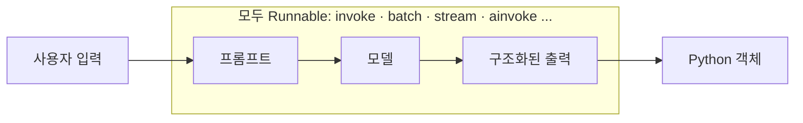

- **키워드**: Runnable, LCEL, `|`, `invoke` / `ainvoke`, `RunnableLambda`, `@chain`, `RunnableParallel`, `RunnablePassthrough`, `RunnableBranch`, `RunnableEach`, `with_fallbacks`, `with_retry`, JSON 모드, JSON Schema, Pydantic, `with_structured_output`
- **과정**: KANT AI 수업 — RAG 평가 마무리, LLM 프롬프트 엔지니어링 교안 5장 2강 JSON Schema 설계 · 5장 3강 Pydantic 기반 출력 검증 · 5장 4강 Validation Error와 출력 복구 (6장 2강 Retry, 6장 3강 Fallback과 연결)
- **실습 파일**: `12_rag/chapter06_07/runnables/01~07`, `structured_output/01~02`
- **환경**: Python 3.13, `langchain 1.5.2`, `langchain-core 1.8.3`, `langchain-openai 1.8.3`, `pydantic 2.14.3`, 모델 `gpt-6-luna`

## 목차

- [이전 학습 연결: RAG 평가 마무리](#til-rag-eval-wrapup)
- [데일리퀘스트 리뷰 (11/20)](#til-daily-quest-1120)
- [대화 맥락과 메모리](#til-conversation-memory)
- [Runnable: LangChain의 공통 규격](#til-runnable-interface)
- [`|`로 잇기: LCEL](#til-lcel-pipe)
- [나란히 실행: RunnableParallel](#til-runnable-parallel)
- [그대로 넘기기: RunnablePassthrough](#til-runnable-passthrough)
- [갈림길: RunnableBranch](#til-runnable-branch)
- [리스트 순회: RunnableEach](#til-runnable-each)
- [실패 대비: with_retry와 with_fallbacks](#til-fallback-retry)
- [구조화된 출력: 왜 필요하고 어떻게 단단해지나](#til-structured-output)
- [JSON Schema로 모양 정하기](#til-json-schema)
- [Pydantic으로 스키마 쓰기](#til-pydantic-schema)
- [검증 오류와 재시도](#til-validation-retry)
- [돌아보기](#til-reflection)
- [검수·업데이트](#til-corrections)

## 학습 기록

<a name="til-rag-eval-wrapup"></a>
### 이전 학습 연결: RAG 평가 마무리

어제 배운 평가를 “어디서 틀렸나”를 가리는 관점으로 정리했다. 핵심은 **검색과 생성을 따로 의심하는 것**이다.

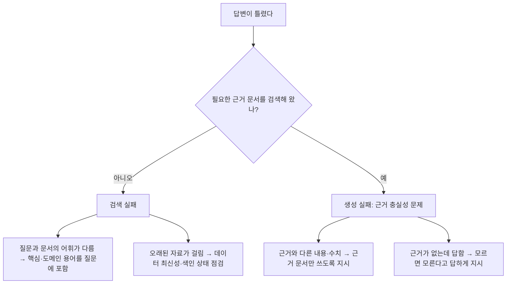

- 검색기가 근거를 가져왔는데도 답이 근거와 다르거나 수치가 틀리면, 문제는 검색이 아니라 **생성 단계**다.
- 질문과 문서의 표현이 달라 유사도가 낮게 나오면 **검색 실패**다. 어제 데일리퀘스트의 **어휘 불일치**와 같은 현상이다.
- 파이프라인을 만든 뒤에는 검색 결과, 답변 정확성, 응답 품질을 **반복해서 확인하고 고친다**.

참고로 받은 LangSmith 문서 「How to evaluate a runnable」은, 오늘 배운 Runnable(체인·모델·리트리버)을 LangSmith의 `evaluate()`에 그대로 넣어 평가하는 방법을 다룬다. 체인 입력 변수와 데이터셋 예제의 키가 같아야 하고, 체인이 문자열을 돌려주면 평가 함수에서 `outputs["output"]`으로 꺼낸다. Ragas가 지표를 정해 주는 쪽이라면, 이쪽은 **평가 함수를 내가 직접 정의**하는 쪽이다.

<a name="til-daily-quest-1120"></a>
### 데일리퀘스트 리뷰 (11/20)

| 문제 | 정답 | 핵심 |
|---|---|---|
| 파이프라인을 고친 뒤, 원래 잘 되던 기능이 망가지지 않았는지 **같은 평가셋으로** 다시 점검하는 작업 | **회귀 검증** (Regression Testing) | 증분 인덱싱·메타데이터 필터링·하이브리드 검색은 색인·검색을 개선하는 기법이지, 변경 후 점검 작업이 아님 |
| 답변이 참고 문서에 온전히 근거하는지(근거 없는 진술 여부)를 0~1점으로 재는 Ragas 지표 | **충실도** (Faithfulness) | 답변의 각 진술을 검색된 문서로 뒷받침할 수 있는지 판정. 문서에 없는 내용을 지어낼수록 점수 하락 |
| Ragas 0.2+에서 `evaluate()`에 넣을 평가 데이터를 감싸는 표준 컨테이너 | **`EvaluationDataset`** | 표준 키 `user_input`, `response`, `reference`, `retrieved_contexts` 등. `from_list()`, `from_pandas()`로 변환하며 필요한 필드는 지표마다 다름 |
| 핵심 단어는 있는데 문장이 경계에서 잘려 정답에 기여하지 못하는 현상 | **청킹 실패** → 청크 크기·오버랩 조정 | 임베딩 기반 검색 실패(표현·도메인 차이 등에 따른 순위 문제), 메타데이터 필터링 실패(날짜·부서 등 조건 오류)와 구분 |
| 올바른 문서를 줬는데도 모델이 사전 학습 지식 등에 기대 없는 사실을 지어내는 생성 단계 오류 | **환각** (Hallucination) | 시스템 프롬프트에 “문서에 명시된 사실만 근거로 답하라” 제약 추가. 제약만으로 완전히 막지는 못하므로 답변도 검증 |

어제 실습과 연결하면 이렇다.

- **청킹 실패**: 도서관 케이스에서 대출 규정 문장이 잘려 Context Recall이 낮게 나왔다. 청크 크기·오버랩을 늘리거나 문장 경계를 보존하도록 나눈 뒤 재평가한다.
- **환각**: “주말 24시간 개방”을 지어낸 답변의 충실도가 **0.5**로 떨어졌다. 어제 기록에서 확인한 실습 결과이며, 오늘 새로 실행한 값은 아니다.
- **회귀 검증**: “개선 → 같은 골든셋으로 재평가” 사이클에서 재평가 단계가 바로 이 작업이다. 비교할 때는 평가 지표·평가 모델 등 조건도 맞춘다.

#### 용어 정리

| 용어 | 영문 | 설명 |
|---|---|---|
| 회귀 검증 | Regression Testing | 수정 후 기존 기능이 그대로 동작하는지 다시 확인하는 작업. 이번 RAG 실습에서는 같은 평가셋으로 비교해 “고쳤더니 다른 데가 망가졌다”를 잡아냄 |
| 증분 인덱싱 | Incremental Indexing | 문서가 바뀔 때 전체를 다시 색인하지 않고, 추가·변경·삭제된 부분만 색인에 반영하는 방식 |
| 메타데이터 필터링 | Metadata Filtering | 날짜·부서·문서 종류 같은 속성 조건으로 검색 대상을 좁히는 기법 |
| 하이브리드 검색 | Hybrid Search | 키워드 검색(BM25)과 벡터 검색을 함께 써서 어휘 일치와 의미 유사성을 모두 활용하는 방식 |
| 충실도 | Faithfulness | 답변의 진술 중 검색된 문서로 뒷받침되는 비율(0~1). 근거 없는 진술을 평가하며, 문서 자체가 사실인지까지 보장하지는 않음 |
| 평가 데이터셋 | `EvaluationDataset` | Ragas 0.2+의 평가 데이터 컨테이너. 단일 턴 샘플에는 `user_input`, `retrieved_contexts`, `response`, `reference` 등을 담음 |
| 청킹 실패 | Chunking Failure | 문장·표가 분할 경계에서 잘려 필요한 정보가 여러 청크로 쪼개지고, 검색된 청크만으로 문맥을 복원하기 어려워지는 현상 |
| 청크 크기 | Chunk Size | 문서를 나눌 때 한 조각의 길이. 분할기에 따라 문자·토큰 등 측정 단위가 다름 |
| 청크 오버랩 | Chunk Overlap | 이웃한 청크끼리 겹치게 두는 구간. 경계에서 문맥이 끊기는 문제를 줄이지만, 늘린다고 항상 품질이 좋아지는 것은 아님 |
| 임베딩 실패 | Embedding Failure | 이번 진단 선택지에서는 표현·도메인 차이 등을 임베딩이 충분히 반영하지 못해 관련 문서의 유사도 순위가 밀리는 경우. 어휘가 다르다는 사실만으로 실패로 단정하지 않음 |
| 환각 | Hallucination | 모델이 근거로 뒷받침되지 않거나 사실과 다른 내용을 그럴듯하게 생성하는 현상. 사전 학습 기억에 기대는 것은 가능한 원인 중 하나 |

오답 선택지에 나온 `VectorStoreIndex`(LlamaIndex의 벡터 색인), `TextSplitter`(LangChain 문서 분할기), `DataFrameLoader`(DataFrame을 Document로 읽는 LangChain 로더)는 각각 색인·분할·로딩 도구이고, 평가 데이터 컨테이너가 아니다.

<a name="til-conversation-memory"></a>
### 대화 맥락과 메모리

대화형 시스템은 “방금 한 말”만 기억해서는 부족할 때가 있다. 예를 들어 처음에 밝힌 조건을 열 번째 질문에서 다시 쓰는 경우다. 그렇다고 **전체 대화 기록을 통째로 넣으면** 상관없는 정보까지 섞여 답이 흐려진다. 그래서 현재 질문과 **관련 있는 과거 맥락만 골라서** 넣는 것이 원칙이다.

<a name="til-runnable-interface"></a>
### Runnable: LangChain의 공통 규격

> 내 필기: 인터페이스 → **가이드**임!

인터페이스는 “이 메서드들은 꼭 갖고 있어야 한다”는 **약속**이다. 콘센트 규격이 같으면 어떤 가전이든 꽂을 수 있는 것처럼, LangChain 구성 요소는 모두 같은 실행 메서드를 갖고 있어서 서로 연결된다.

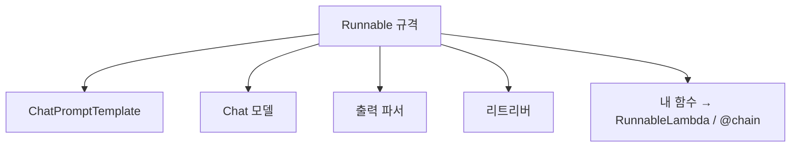

| | 하나 실행 | 여러 개 실행 | 조금씩 받기 |
|---|---|---|---|
| 동기 | `invoke()` | `batch()` | `stream()` |
| 비동기 | `ainvoke()` | `abatch()` | `astream()` |

<a name="til-lcel-pipe"></a>
### `|`로 잇기: LCEL

> 내 필기: LangChain은 연속된 작업을 체인 연결 방식(`|`)으로 표현 (LCEL). `|`는 클래스 정의 시 `__or__`, `__ror__` 매직 메서드를 정의한 것(연산자 오버로드). `A | B | C`

`|`는 **컨베이어 벨트**다. 앞 단계가 내놓은 결과가 그대로 다음 단계의 입력이 된다.


`직접 실습 — 결과 확인` (`runnables/01`, `02`)

```python
from langchain_core.runnables import RunnableLambda, chain  # 연산자 오버로드가 자동으로 됨

def func_a(text):
    return f"func_a:{text}"

def func_b(text):
    return f"func_b:{text}"

(RunnableLambda(func_a) | RunnableLambda(func_b)).invoke("안녕")  # 'func_b:func_a:안녕'
(RunnableLambda(func_a) | func_b).invoke("반갑습니다.")          # 일반 함수도 연결됨


@chain  # 하나가 러너블이면 다 적용됨 → 다 데코레이터로 싸서 정의 안 해도 됨
def func_c(text):
    return f"func_c:{text}"

(func_c | func_b).invoke("안녕!")  # 'func_b:func_c:안녕!'
```

**일반 함수가 어떻게 연결될까?** `|` 양쪽 중 **한쪽만 Runnable이면** LangChain이 나머지를 Runnable로 바꿔 준다. 누가 바꾸는지는 Runnable이 어느 쪽에 있느냐에 달렸다.

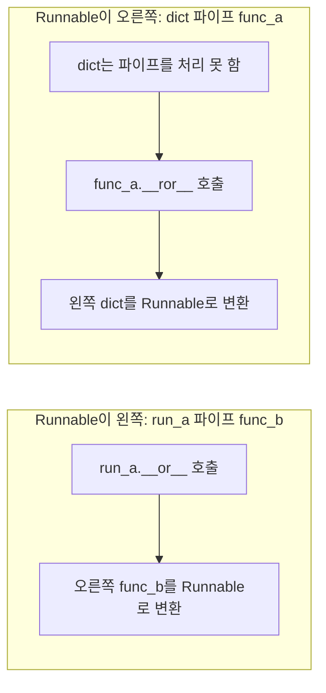

필기의 “`ror`은 러너블이 아니어도 러너블로 바꿔줌”은 맞고, `__or__`도 오른쪽을 똑같이 바꿔 준다. 그래서 “하나가 러너블이면 다 적용됨”이 성립한다.

**순차와 동기는 다른 축이다.** 필기에 “체인은 순차적 진행 '동기'임”이라고 적었는데, 정리하면 이렇다.

| | 동기 호출 `invoke()` | 비동기 호출 `ainvoke()` |
|---|---|---|
| 순차 체인 `A \| B` | A 끝나고 B, 그동안 프로그램이 기다림 | A 끝나고 B, 기다리는 동안 다른 작업 가능 |
| 병렬 `RunnableParallel` | 스레드로 동시에 | `asyncio.gather`로 동시에 |

`|`는 **순서**를 정하고, 동기·비동기는 **부르는 방식**이 정한다.

<a name="til-runnable-parallel"></a>
### 나란히 실행: RunnableParallel

> 내 필기: 순차적 진행 느리다는 단점 → 데이터 조회 등은 병렬로 처리하는 게 좋을 듯 → 비동기 처리 Runnable 사용 가능, 혹은 이미 개발되어 있는 기능 `RunnableParallel`

서로 결과를 기다릴 필요가 없는 작업(예: DB 조회와 웹 검색)은 줄 세울 이유가 없다. `RunnableParallel`은 **같은 입력을 여러 갈래로 동시에 보내고**, 결과를 키 이름별로 모은다.

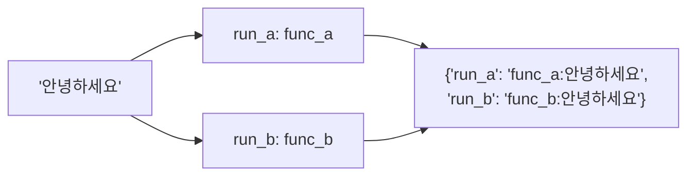

`직접 실습 — 결과 확인` (`runnables/03`)

```python
from langchain_core.runnables import RunnableLambda, RunnableParallel

chain = RunnableParallel(
    run_a=RunnableLambda(func_a),  # 키워드 매개변수 이름이 결과의 키가 됨
    run_b=RunnableLambda(func_b),
)
chain.invoke("안녕하세요")
```

`RunnableMap`은 같은 클래스의 다른 이름이고, 체인 안에 dict를 그냥 넣어도 자동으로 `RunnableParallel`이 된다.

<a name="til-runnable-passthrough"></a>
### 그대로 넘기기: RunnablePassthrough

> 내 필기: 데이터 변경 없이 처음부터 끝까지 그대로 넘겨주는 방법

파이프라인을 지나면서 값이 계속 바뀌면, 나중 단계에서 **처음 질문**이 필요할 때 이미 사라지고 없다. `RunnablePassthrough`는 입력을 손대지 않고 그대로 통과시켜서, 원본을 dict의 한 칸에 보관해 두는 용도로 쓴다.

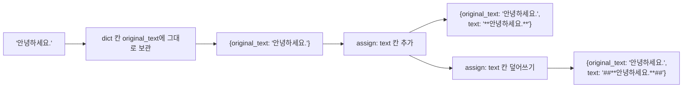

`직접 실습 — 결과 확인` (`runnables/04`)

```python
from langchain_core.runnables import RunnablePassthrough, chain

@chain
def func_a(data):
    data["text"] = f"**{data}**"
    return data

def func_b(data):
    data["text"] = f"##{data}##"
    return data

chain = {"original_text": RunnablePassthrough()} | func_a | func_b
chain.invoke({"안녕하세요."})
# {'original_text': {'안녕하세요.'}, 'text': '##{...dict 전체가 겹겹이...}##'}
```

출력이 복잡해진 이유는 두 가지다.

- `{"안녕하세요."}`는 중괄호 때문에 **set(집합)**이 된다. 그래서 원본 칸에도 set이 들어갔다.
- `f"**{data}**"`가 `data` 칸 하나가 아니라 **dict 전체**를 문자열로 넣고, 함수가 받은 dict를 직접 고쳐서 내용이 겹겹이 쌓였다.

원본은 그대로 두고 칸만 추가하는 `RunnablePassthrough.assign`을 쓰면 위 도식처럼 깔끔하게 흐른다. `보충 예시 — 로컬 실행 확인`

```python
from langchain_core.runnables import RunnablePassthrough

chain = (
    {"original_text": RunnablePassthrough()}
    | RunnablePassthrough.assign(text=lambda d: f"**{d['original_text']}**")
    | RunnablePassthrough.assign(text=lambda d: f"##{d['text']}##")
)
chain.invoke("안녕하세요.")
# {'original_text': '안녕하세요.', 'text': '##**안녕하세요.**##'}
```

<a name="til-runnable-branch"></a>
### 갈림길: RunnableBranch

입력에 따라 다른 길로 보내는 `if / elif / else`다. 조건을 위에서부터 차례로 검사하고, **처음 참이 되는 길**로 간다. 아무것도 맞지 않으면 마지막 **기본 경로**로 간다.

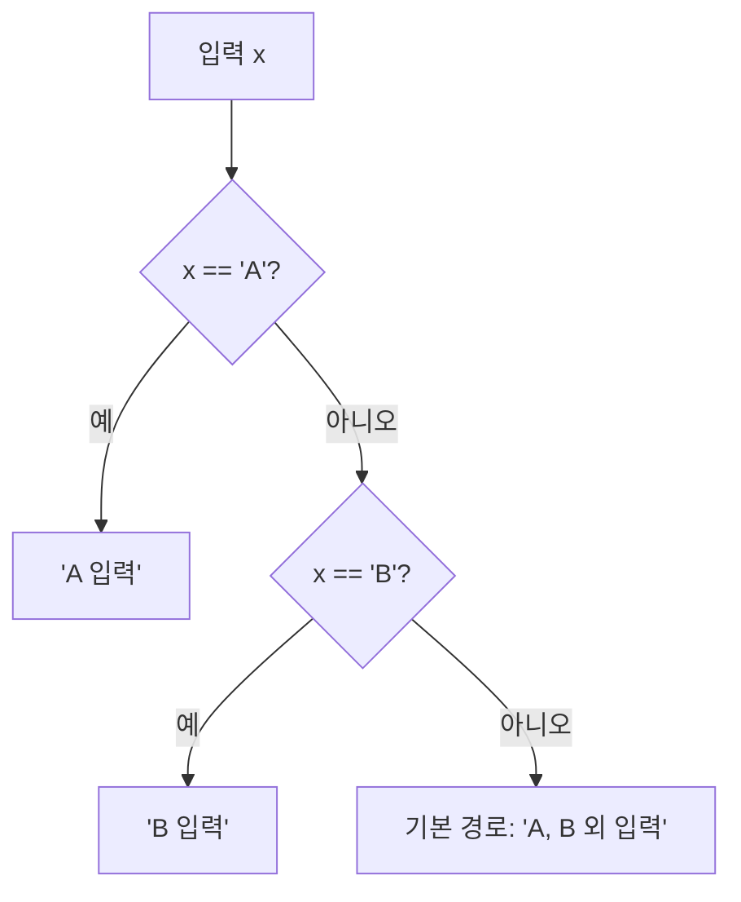

`직접 실습 — 결과 확인` (`runnables/05`)

```python
# 조건이 간단하면 함수 별도 정의 안 하고 람다 사용 가능, 여러 개 더 들어갈 수 있음
from langchain_core.runnables import RunnableBranch, RunnableLambda

branch = RunnableBranch(
    (lambda x: x == "A", RunnableLambda(lambda x: "A 입력")),
    (lambda x: x == "B", RunnableLambda(lambda x: "B 입력")),
    RunnableLambda(lambda x: "A, B 외 입력"),  # 마지막 함수를 넣어야 실행됨!
)
branch.invoke("C")  # 'A, B 외 입력'
```

- 필기의 “마지막 함수를 넣어야 실행됨!”은 맞다. 기본 경로 없이 만들면 `RunnableBranch requires at least two branches` 오류가 난다.
- 필기에서 마지막 인자를 “Fallback Runnable 객체”라고 불렀는데, 공식 명칭은 **기본 분기(default branch)**다. 오류가 났을 때 대신 실행하는 아래의 `with_fallbacks`와는 다른 개념이다.

<a name="til-runnable-each"></a>
### 리스트 순회: RunnableEach

리스트를 받아 **원소마다 같은 작업**을 적용하는 Runnable이다. 체인 안에서 `for`문 역할을 한다.

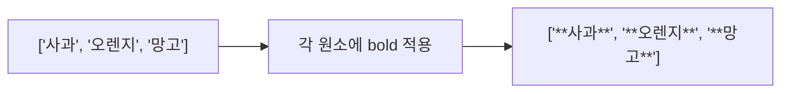

`직접 실습 — 사용자 보고` (`runnables/06`)

- 처음 `from langchain_core.runnables import RunnableEach`로 쓰니 `ImportError`가 났다. `langchain_core.runnables` 묶음이 `RunnableEach`를 밖으로 내보내지 않기 때문이다.
- 클래스가 실제로 있는 `langchain_core.runnables.base`에서 가져오도록 고쳤다.

```python
from langchain_core.runnables.base import RunnableEach, RunnableLambda

bold = RunnableLambda(lambda x: f"**{x}**")
RunnableEach(bound=bold).invoke(["사과", "오렌지", "망고"])
```

같은 일을 공개 API로 하려면 `.map()`이 더 간단하다. 모든 Runnable에 있고, 결과로 `RunnableEach`를 만들어 준다. `보충 예시 — 로컬 실행 확인`

```python
bold.map().invoke(["사과", "오렌지", "망고"])  # ['**사과**', '**오렌지**', '**망고**']
```

`batch()`와 헷갈리기 쉬운데, `batch([...])`는 **입력 여러 개를 각각 실행하는 호출 방식**이고, `.map()`은 **리스트 하나를 입력으로 받는 블록**이라 체인 중간에 끼울 수 있다.

<a name="til-fallback-retry"></a>
### 실패 대비: with_retry와 with_fallbacks

API 호출은 언제든 실패할 수 있다. 실패하자마자 프로그램을 멈추는 대신 두 가지 안전장치를 건다.

- **재시도(`with_retry`)**: 전화가 안 터지면 **조금 있다 다시 거는 것**. 네트워크 끊김, 요청 제한(rate limit) 같은 **일시적 오류**에 쓴다.
- **대체(`with_fallbacks`)**: 계속 안 되면 **다른 번호로 거는 것**. 다른 모델이나 다른 체인으로 넘긴다.
- 잘못된 입력처럼 **다시 해도 똑같이 실패할 오류**는 재시도해 봐야 소용없다. 오류 종류를 구분해서 재시도 대상을 정한다.
- 필기: **try/except보다는 `with_fallbacks`로 처리하기** (5장 4강). 교안 5장 4강은 `try-except`로 오류를 잡아 복구하는데, 수업에서는 체인에 바로 붙일 수 있는 `with_fallbacks`를 권했다. 구체적인 모양은 아래 [검증 오류와 재시도](#til-validation-retry)에서 정리.

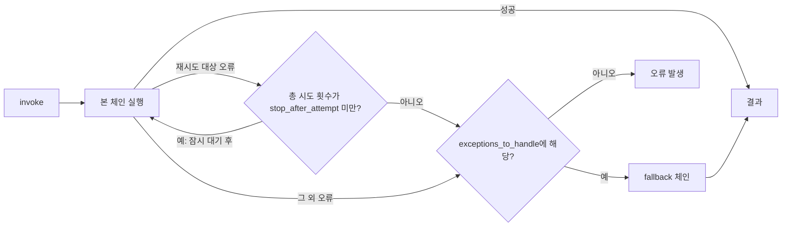

`직접 실습 — 결과 확인` (`runnables/07`)

```python
from langchain_core.runnables import chain

@chain
def func_a(x):
    if x <= 0:
        raise ValueError("숫자 0 이하의 값은 처리할 수 없음")
    return f"정상 처리: {x}"

@chain
def fallback_func_a(x):
    return f"대체 처리...{x}"

func_a.with_fallbacks([fallback_func_a]).invoke(-10)  # '대체 처리...-10'


attempts = 0

@chain
def unstable(text):
    global attempts
    attempts += 1
    print(f"시도 {attempts}회차 실행중...")
    if attempts < 3:
        raise ConnectionError("네트워크 장애...")
    return "성공, 처리 완료"

unstable.with_retry(
    stop_after_attempt=3,
    retry_if_exception_type=(ConnectionError,),  # tuple ','
).invoke("테스트")  # 1, 2회차 실패 → 3회차 성공
```

알아 둘 기본값 (`langchain-core 1.8.3`)

- `stop_after_attempt=3`은 **첫 시도를 포함한 총 횟수**다. 계속 실패하면 함수는 3번 불리고 오류가 난다.
- 재시도 사이 대기는 기본으로 **점점 길어지고 약간 무작위**다(`wait_exponential_jitter=True`). 서버가 바쁠 때 모두가 동시에 다시 몰리지 않게 하려는 것이다.
- `with_fallbacks`는 기본으로 **모든 예외**를 잡는다. 코드 버그까지 조용히 대체 처리될 수 있으니 `exceptions_to_handle=(ConnectionError,)`처럼 범위를 정해 두는 편이 안전하다.
- 실습의 `attempts`는 전역 변수라서 셀을 다시 돌리면 1회차에 바로 성공한다.

**무엇을 재시도하고, 언제 대체로 넘어가나** (교안 6장 2강·3강)

다시 해서 나아질 오류만 재시도한다. 열쇠가 틀렸으면 문을 백 번 당겨도 안 열린다.

| 구분 | 오류 예시 | 이유 |
|---|---|---|
| 재시도 대상 | `RateLimitError`(요청 한도 초과), `APITimeoutError`(일시적 지연), `InternalServerError`(제공자 쪽 5xx 장애) | 잠시 뒤엔 성공할 수 있음 |
| 재시도 금지 | `AuthenticationError`(API 키 오류·만료), `BadRequestError`(프롬프트 길이 초과, 잘못된 요청 구조) | 몇 번을 다시 해도 결과가 같음 → 설정을 고쳐야 함 |

재시도 간격은 **지수 백오프 + 지터**가 표준이다.

- **지수 백오프**: 실패할수록 대기 시간을 1초 → 2초 → 4초 → 8초처럼 배로 늘려 서버가 회복할 시간을 준다.
- **지터**: 대기 시간에 무작위 몇 초를 더해, 여러 클라이언트가 같은 순간에 우르르 다시 몰리지 않게 흩는다.
- 교안은 `tenacity` 라이브러리의 `@retry` 데코레이터로 직접 구현하고, LangChain의 `with_retry`도 내부적으로 같은 방식(`wait_exponential_jitter=True`)을 쓴다.

| | Retry (재시도) | Fallback (대체) |
|---|---|---|
| 동작 | 같은 모델·프롬프트로 잠시 후 다시 | 다른 모델·프롬프트로 즉시 전환 |
| 대상 | 일시적 지연, 순간 요청 초과 | 지속적인 장애, 형식 요구 실패 |
| 시간 | 대기(백오프) 발생 | 대기 없이 바로 플랜 B |
| 결과 | 원래 의도한 형태 그대로 | 대체 모델 결과 또는 축소된 기능 |

Fallback은 두 종류로 나눠 생각할 수 있다.

- **Model Fallback**: 주 모델에 장애가 나면 예비 모델로 우회한다.
- **Prompt Fallback**: 엄격한 JSON 같은 복잡한 요구가 실패하면, 단순한 텍스트 요약 같은 쉬운 지시로 바꿔서라도 답을 받는다.
- 둘 다 **우아한 기능 저하(Graceful Degradation)** 원칙이다. 배터리가 5%일 때 절전 모드로 버티는 것처럼, 전체가 멈추는 대신 기능을 줄여서라도 서비스를 이어 간다. 대체 모드로 답했다면 사용자에게 그 사실을 안내한다.

<a name="til-structured-output"></a>
### 구조화된 출력: 왜 필요하고 어떻게 단단해지나

LLM에게 “주문번호, 상품, 불만을 알려줘”라고 하면 매번 말투와 순서가 조금씩 다르다. 사람에게는 상관없지만, 그 결과를 받아 DB에 저장하는 **코드에게는 치명적**이다. 그래서 응답의 **모양**을 정해 둔다.

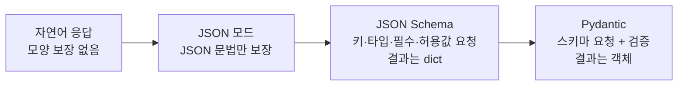

오른쪽으로 갈수록 “약속”이 단단해진다.

**1단계 — JSON 모드**

시스템 메시지에 원하는 모양을 적고, 모델에 JSON으로만 답하라는 옵션을 건다. 고객 문의에서 주문번호·상품명·불만 사항을 뽑는 예제다.

`직접 실습 — 결과 확인` (`structured_output/01`)

```python
import json
from langchain.chat_models import init_chat_model
from langchain_core.output_parsers import StrOutputParser
from langchain_core.prompts import ChatPromptTemplate

model = init_chat_model(model="gpt-6-luna", model_provider="openai", reasoning_effort="low")

prompt = ChatPromptTemplate.from_messages([
    ("system", """
    반드시 다음 JSON 형식으로 출력하세요. 추가적인 설명이나 문구는 포함하지 마세요.
    {{
        "order_id": "주문번호",
        "product_name": "상품명",
        "issue": "불만 사항 요약"
    }}
    """),
    ("user", "{question}"),
])

json_model = model.bind(response_format={"type": "json_object"})
chain = prompt | json_model | StrOutputParser()
result = chain.invoke("어제 주문번호 2026-9876으로 무선 키보드를 주문했는데 스페이스바가 안 눌려요.")
json.loads(result)
# {'order_id': '2026-9876', 'product_name': '무선 키보드', 'issue': '스페이스바가 눌리지 않음'}
```

- 프롬프트 안의 JSON 예시는 `{{ }}`로 감싸야 `{question}` 같은 템플릿 변수로 오인되지 않는다.
- JSON 모드는 **괄호와 따옴표가 맞는 JSON**만 보장한다. `order_id`를 `orderId`로 바꿔 쓰거나 빠뜨려도 막지 못한다. 그래서 형식을 명시해도 **결과 검증과 오류 처리**가 필요하다.
- 문자열로 받은 JSON은 `json.loads`(또는 JSON 파서)로 dict나 list로 바꿔야 코드에서 쓸 수 있다.

<a name="til-json-schema"></a>
### JSON Schema로 모양 정하기

> 필기: json schema (LLM 5장 2강)

JSON Schema는 “이 JSON은 이런 칸들로 이루어져야 한다”는 **설계도**다. 칸 이름, 타입, 필수 여부, 허용 값, 칸 안의 칸(중첩), 같은 칸의 반복(배열)까지 적을 수 있다.

영수증 예제의 설계도를 그림으로 보면 이렇다.

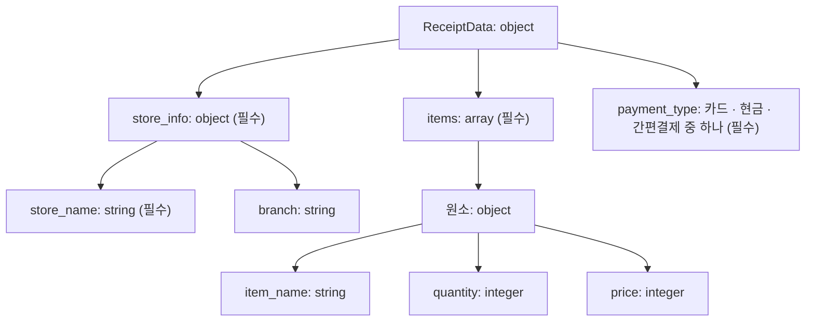

`직접 실습 — 결과 확인` (`structured_output/02`, 교안 5-2의 4.2)

```python
receipt_schema = {
    "title": "ReceiptData",
    "description": "영수증 텍스트에서 결제 정보와 구매 품목 목록을 추출하는 스키마",
    "type": "object",
    "properties": {
        "store_info": {  # 중첩 객체: 매장 정보
            "type": "object",
            "properties": {
                "store_name": {"type": "string", "description": "상점 이름"},
                "branch": {"type": "string", "description": "지점명"},
            },
            "required": ["store_name"],
        },
        "items": {  # 배열 구조: 구매 품목 리스트
            "type": "array",
            "description": "구매한 상품 항목들의 목록",
            "items": {
                "type": "object",
                "properties": {
                    "item_name": {"type": "string", "description": "상품명"},
                    "quantity": {"type": "integer", "description": "구매 수량"},
                    "price": {"type": "integer", "description": "개당 가격"},
                },
                "required": ["item_name", "quantity", "price"],
            },
        },
        "payment_type": {"type": "string", "enum": ["카드", "현금", "간편결제"], "description": "결제 수단"},
    },
    "required": ["store_info", "items", "payment_type"],
}

model.with_structured_output(receipt_schema).invoke(receipt_text)
```

입력과 결과를 나란히 보면 모델이 설계도에 맞춰 **정규화**한 게 보인다.

| 영수증 원문 | 추출 결과 |
|---|---|
| [스마트스토어 강남점] | `store_name: '스마트스토어'`, `branch: '강남점'` |
| 무선 마우스 2개 (개당 25,000원) | `quantity: 2`, `price: 25000` (쉼표 없는 정수) |
| 신용카드로 일시불 결제 | `payment_type: '카드'` (허용값 중 하나로) |

- `with_structured_output`을 쓰면 01처럼 JSON 모드를 따로 켤 필요가 없다. OpenAI 모델의 기본 방식이 스키마를 그대로 전달하는 Structured Outputs다.
- 제약이 구체적일수록 결과가 일관되지만, 설계도가 커질수록 **작성과 유지 관리가 번거롭다**. 이 설계도를 손으로 쓰는 대신 쓰는 것이 Pydantic이다.
- 이 방식의 결과는 **dict**이고, 받은 뒤 따로 검증되지는 않는다.

**정보가 없을 때는? — nullable** (교안 5장 2강)

본문에 없는 정보를 억지로 채우라고 하면 모델이 **지어낸다**(환각). 그래서 “없으면 비워도 된다”는 길을 열어 둔다. JSON Schema에서는 타입을 배열로 써서 null을 허용한다.

```python
"phone": {
    "type": ["string", "null"],
    "description": "고객 연락처. 본문에 언급이 없으면 null 반환",
},
# ...
"required": ["email", "phone"],
```

`required`에 넣은 채로 null을 허용한 것이 핵심이다. 칸 자체는 **반드시 있어야 하고**, 값만 비울 수 있다. 모델이 “이 정보가 있나 없나”를 꼭 판단하게 만든다. 이 패턴이 아래 Pydantic의 `str | None = Field(...)`과 정확히 대응한다.

<a name="til-pydantic-schema"></a>
### Pydantic으로 스키마 쓰기

> 필기: 우리는 스키마를 다 형식에 맞춰서 쓰는 게 아니고, 알아서 바뀌도록 Pydantic을 사용한다.

Pydantic 클래스를 만들면 LangChain이 그걸 **JSON Schema로 자동 변환**해 모델에 보내고, 돌아온 응답을 다시 **그 클래스의 객체로 검증**해서 돌려준다. 설계도 작성과 검수를 한 번에 해 주는 셈이다.

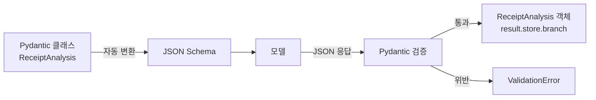

JSON Schema에서 배운 개념이 Pydantic에서는 이렇게 바뀐다 (교안 5장 2강 ↔ 5장 3강).

| JSON Schema | Pydantic | 예 |
|---|---|---|
| `properties`의 각 칸 | 클래스의 필드 | `store_name: str` |
| `type` | 타입 힌트 | `str`, `int`, `bool` |
| `description` | `Field(description=...)` | `Field(description="상점 이름")` |
| `required` | 기본값이 없는 필드 | `price: int = Field(...)` |
| `enum` | `Literal[...]` | `Literal["카드", "현금", "간편결제"]` |
| `"type": ["string", "null"]` | `X \| None` | `branch: str \| None` |
| 중첩 `object` | 하위 클래스를 타입으로 | `store: StoreInfo` |
| `array` + `items` | `list[하위클래스]` | `items: list[PurchasedItem]` |

Pydantic은 검사만 하는 게 아니라 **변환**도 한다. 문자열 `"100"`이 와도 `int` 칸이면 숫자 `100`으로 바꿔 준다. 반대로 바꿀 수 없는 값(`"백 원"`)이면 오류를 낸다.

**Pydantic 사용 방법**

1. `BaseModel`을 상속해 클래스를 만든다.
2. 칸마다 **타입 힌트**를 적는다: `str`, `int`, `list[하위클래스]`, `Literal[...]`, `X | None`
3. `Field(description=...)`로 **설명**을 단다.
4. 하위 클래스를 타입으로 쓰면 **중첩 객체**, `list[하위클래스]`면 **배열**이 된다.
5. `model.with_structured_output(클래스)`로 실행하면 결과가 **그 클래스의 객체**로 나온다.

> 필기: **description은 LLM이 참고하는 것으로 중요함! 잘 적자.**

`description`은 JSON Schema 안에 그대로 들어가 모델이 읽는다. 사람에게 주는 주석이 아니라 **모델에게 주는 작업 지시서**다. “원 단위, 쉼표 없는 정수”, “없으면 null”처럼 **판단 기준**까지 적어 두면 모델이 헷갈리거나 값을 지어낼 여지가 줄어든다.

**용어사전**

| 용어 | 영문 | 설명 |
|---|---|---|
| 파이단틱 | Pydantic | 파이썬 타입 힌트를 사용하여 데이터 구조 정의 및 유효성 검증을 수행하는 라이브러리 |
| 베이스 모델 | `BaseModel` | Pydantic에서 데이터 모델을 구축할 때 상속받는 기본 클래스 |
| 선택지 제한 | `Literal` | 정해진 값 목록 중 하나만 허용하도록 타입을 제한하는 문법 |
| 빈 값 허용 | `Optional` | 값이 존재하지 않을 경우 `None`을 인정하여 에러를 방지하는 타입 설정. 최신 문법은 `X \| None` |
| 필드 세부 설정 | `Field` | 모델 내 각 속성의 설명문(`description`), 기본값 등을 정의하는 Pydantic 함수 |

`직접 실습 — 결과 확인` (`structured_output/02` 후반, 수업 코드는 `Optional`·`List` 사용)

```python
from typing import List, Literal, Optional
from pydantic import BaseModel, Field

class PurchasedItem(BaseModel):
    item_name: str = Field(description="상품 이름")
    quantity: int = Field(description="구매 수량")
    price: int = Field(description="개당 가격(원 단위)")

class StoreInfo(BaseModel):
    store_name: str = Field(description="상점 이름")
    branch: Optional[str] = Field(default=None, description="지점명")  # 정보가 없으면 None 허용

class ReceiptAnalysis(BaseModel):
    store: StoreInfo = Field(description="매장 정보")                    # 중첩 객체
    items: List[PurchasedItem] = Field(description="구매한 상품 목록")    # 리스트
    payment_type: Literal["카드", "현금", "간편결제"] = Field(description="결제 수단")  # 3가지로 엄격히 제한

result = model.with_structured_output(ReceiptAnalysis).invoke(receipt_text)
type(result)  # <class '__main__.ReceiptAnalysis'>
```

결과가 dict가 아니라 **객체**라서 `result["store"]["branch"]` 대신 `result.store.branch`로 꺼내고, 편집기 자동완성도 된다.

최신 문법으로 쓰면 `Optional`, `List` import 없이 이렇게 된다. `보충 예시 — 스키마 생성만 로컬 확인, 모델 호출 미실행`

```python
from typing import Literal
from pydantic import BaseModel, Field

class PurchasedItem(BaseModel):
    item_name: str = Field(description="상품 이름")
    quantity: int = Field(description="구매 수량")
    price: int = Field(description="개당 가격. 원 단위, 쉼표 없는 정수")

class StoreInfo(BaseModel):
    store_name: str = Field(description="상점 이름")
    branch: str | None = Field(..., description="지점명. 영수증에 없으면 null")

class ReceiptAnalysis(BaseModel):
    store: StoreInfo = Field(description="매장 정보")
    items: list[PurchasedItem] = Field(description="구매한 상품 목록")
    payment_type: Literal["카드", "현금", "간편결제"] = Field(description="결제 수단")
```

**`X | None`은 “선택”이 아니라 “빈 값 허용”이다.** 이름 때문에 헷갈리기 쉬운데, 생략할 수 있느냐는 **기본값**이 정한다.

| 선언 | 칸을 비워도 되나 | `None`을 넣어도 되나 | 쓰는 곳 |
|---|---|---|---|
| `branch: str \| None = Field(...)` | 안 됨 | 됨 | LLM 추출: 모델이 값이든 null이든 **반드시 판단해서** 채우게 할 때 |
| `branch: str \| None = Field(default=None)` | 됨 | 됨 | 일반 데이터 검증, 생략을 허용할 때 |

LLM 추출에서는 첫 번째가 공식 예제의 패턴이고, 교안 5장 2강의 `required` + `["string", "null"]`과도 같은 뜻이다. 엄격 모드(`strict=True`)에서는 칸에 기본값을 둘 수 없다는 점도 이 패턴을 쓰는 이유다. 교안 5장 3강과 수업 코드처럼 `Optional[str] = Field(default=None)`을 쓴 경우도 기본 설정에서는 정상 동작했다. 다만 이건 “칸을 생략해도 된다”까지 허용하는 것이라, 5장 2강의 nullable과 완전히 같지는 않다.

**구조화된 출력과 모델 설정**

- 형식을 지키는 게 중요한 작업은 창의성보다 일관성이 우선이라 **낮은 temperature**가 어울린다. 다만 `gpt-6-luna` 같은 추론 모델은 temperature 조절을 지원하지 않을 수 있어서, 실습은 `reasoning_effort="low"`만 지정했다.
- 실행한 뒤에는 칸과 중첩 데이터가 제대로 채워졌는지 **눈으로 확인**한다.

<a name="til-validation-retry"></a>
### 검증 오류와 재시도

스키마를 줘도 모델이 가끔 규칙을 어긴다. 그러면 Pydantic이 `ValidationError`를 낸다. 교안 5장 4강은 원인을 세 가지로 나눈다.

| 원인 | 예 |
|---|---|
| 필수 필드 누락 | 기본값 없는 `menu_name`을 모델이 빠뜨림 |
| 타입 불일치 | `int` 칸인 `quantity`에 `"두 잔"`이 옴 |
| 선택지(`Literal`) 위반 | `Literal["HOT", "ICE"]` 칸에 `"따뜻하게"`가 옴 |

오류가 나면 프로그램이 그 자리에서 멈춘다. 그래서 오류를 잡아 **모델에게 무엇이 틀렸는지 알려 주고 다시 쓰게** 한다. 이걸 **복구(Repair)**라고 한다.

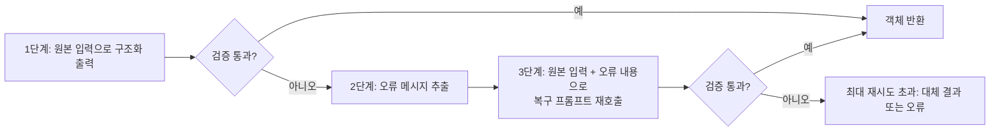

복구 프롬프트에는 **원본 사용자 입력**과 **구체적인 오류 내용** 두 가지가 꼭 들어가야 한다. 원래 의도와 어긴 규칙을 둘 다 알아야 모델이 제대로 고친다. 재시도 횟수는 무한 반복과 비용 폭주를 막기 위해 상한(`max_retries`)을 둔다.

`강의/자료 예시` — 교안 5장 4강은 이 흐름을 `try-except`로 쓴다 (출력문을 빼고 핵심만 줄임).

```python
def process_order_with_repair(user_text: str, max_retries: int = 1) -> CafeOrderSchema:
    try:
        return structured_model.invoke(user_text)
    except ValidationError as e:
        if max_retries <= 0:
            raise
        repair_prompt = f"""
다음 사용자 입력을 바탕으로 데이터를 추출하던 중 스키마 검증 오류가 발생했습니다.

[사용자 입력]
{user_text}

[발생한 검증 오류]
{e}

위 오류 메시지를 확인하고 규격에 맞추어 다시 생성해주세요.
"""
        return structured_model.invoke(repair_prompt)
```

> 필기: **try/except보다는 `with_fallbacks`로 처리하기**

같은 복구를 `with_fallbacks`로 쓰면 체인 모양을 유지할 수 있다. `exception_key`를 주면 **발생한 오류가 입력 dict에 담겨 대체 체인으로 넘어가서**, 복구 프롬프트가 원본 입력과 오류를 둘 다 받을 수 있다. `보충 예시 — 오류 전달 동작만 로컬 확인, 모델 호출 미실행`

```python
from typing import Literal
from pydantic import BaseModel, Field, ValidationError
from langchain_core.prompts import ChatPromptTemplate

class CafeOrderSchema(BaseModel):
    menu_name: str = Field(description="주문한 음료 또는 디저트 이름")
    temperature: Literal["HOT", "ICE"] = Field(description="음료 온도. 따뜻하면 HOT, 차가우면 ICE")
    quantity: int = Field(gt=0, description="주문 수량 (1개 이상의 정수)")

structured_model = model.with_structured_output(CafeOrderSchema)

first_prompt = ChatPromptTemplate.from_messages([("user", "{user_text}")])
repair_prompt = ChatPromptTemplate.from_messages([
    ("user", "[사용자 입력]\n{user_text}\n\n[발생한 검증 오류]\n{error}\n\n오류를 고쳐 규격에 맞게 다시 생성해 주세요."),
])

order_chain = (first_prompt | structured_model).with_fallbacks(
    [repair_prompt | structured_model],
    exceptions_to_handle=(ValidationError,),  # 검증 오류일 때만 복구
    exception_key="error",                     # 오류를 입력 dict의 "error" 칸으로 전달
)

order_chain.invoke({"user_text": "아메리카노 따뜻하게 2잔 준비해 주세요."})
```

- `exception_key`를 쓰려면 체인 입력이 **dict**여야 한다. 대체 체인은 `{"user_text": ..., "error": ValidationError(...)}`를 받는다(로컬에서 키 전달 확인).
- 교안 실행 결과처럼, 요즘 구조화 출력은 `"따뜻하게"`를 스스로 `HOT`으로 바꿔 1차에 성공하는 경우가 많다. description에 “따뜻하면 HOT”처럼 판단 기준을 적어 두면 1차 성공률이 더 올라간다.
- 오류 원인을 예외 대신 값으로 받고 싶으면 `include_raw=True`를 쓴다. 결과가 `raw`, `parsed`, `parsing_error` 세 칸짜리 dict로 온다.
- 끝까지 실패할 때 사용자에게 무엇을 돌려줄지(대체 결과, 안내 문구)도 함께 정해 둔다.

> 필기: FastAPI를 사용할 거라면 비동기로 해야 함. 그때는 `ainvoke`로 해야 함. 연습은 `invoke`로 하는 중.

웹 서버는 한 직원이 여러 손님을 번갈아 응대하는 구조다. `async def` 엔드포인트 안에서 `invoke`를 부르면, 모델 응답을 기다리는 몇 초 동안 그 직원이 **다른 손님을 전혀 못 받는다**. `await chain.ainvoke(...)`를 쓰면 기다리는 동안 다른 요청을 처리한다. (일반 `def` 엔드포인트는 FastAPI가 별도 스레드에서 돌려서 `invoke`도 동작한다.)

**다음에 이어질 응용**

- 구조화된 출력은 대화 기록·기억 관리, 문서 데이터 추출, 웹 콘텐츠 수집에 쓰인다.
- PDF, 웹 페이지 등 외부 자료는 **출처마다 접근 방식과 수집 방법**이 다르다.
- 도구를 호출해 최신 정보나 외부 데이터를 가져오는 흐름으로 이어진다.

<a name="til-reflection"></a>
## 돌아보기

**정리된 이해**

- LangChain의 모든 블록은 Runnable이라 `|`로 이어진다. 한쪽만 Runnable이면 나머지는 자동 변환된다.
- `|`는 **순서**를, `invoke`/`ainvoke`는 **기다리는 방식**을 정한다. 둘은 다른 축이다.
- `RunnableBranch`의 마지막은 **조건이 안 맞을 때의 기본 길**, `with_fallbacks`는 **오류가 났을 때의 대체 길**이다.
- 형식 보장은 JSON 모드(문법) → JSON Schema(모양, dict) → Pydantic(모양 + 검증, 객체) 순서로 단단해진다.
- `description`은 모델에게 주는 지시서이고, `X | None`은 “빈 값 허용”일 뿐 생략 여부는 기본값이 정한다.

**남은 궁금증**

- `gpt-6-luna`에서 temperature를 지정하면 실제로 오류가 나는지 &rarr; 예상하지 못한 인자값으로 인식해서 오류남

**다음 액션**

- `structured_output`을 `str | None = Field(...)`·`list[...]` 형태로 바꿔 실행해 보기
- `include_raw=True`로 일부러 실패하는 입력을 넣어 `parsing_error` 모양 확인하기
- 같은 체인을 `ainvoke`로 실행해 보기

**복습 질문**

- Runnable의 동기 메서드 3개와 비동기 메서드 3개를 쓰고, “순차 체인”과 “동기 실행”이 왜 다른 말인지 설명해 보자.
- `RunnableLambda(f) | g`와 `{"x": RunnablePassthrough()} | f`에서 각각 어느 쪽이 Runnable로 바뀌고, 어떤 매직 메서드가 불리나?
- 원본 질문을 체인 끝까지 들고 가야 할 때 `RunnablePassthrough`와 `.assign`을 어떻게 조합하나?
- `RunnableBranch`의 마지막 인자와 `with_fallbacks`는 각각 언제 실행되나?
- `with_retry(stop_after_attempt=3)`에서 계속 실패하면 함수는 총 몇 번 불리나? `with_fallbacks`에 예외 종류를 지정하지 않으면 어떤 위험이 있나?
- JSON 모드, JSON Schema dict, Pydantic 클래스로 구조화하면 결과 타입과 검증 여부가 각각 어떻게 다른가?
- 영수증에 지점명이 없을 때 `branch: str | None = Field(...)`와 `Field(default=None)`는 어떻게 다르게 동작할까? 교안 5장 2강의 `required` + `["string", "null"]`은 둘 중 어느 쪽과 같나?
- `RateLimitError`와 `AuthenticationError` 중 재시도할 오류는? 이유는?
- 검증 오류 복구 프롬프트에 꼭 들어가야 할 두 가지는? `with_fallbacks`로 이 복구를 구현할 때 `exception_key`는 어떤 역할을 하나?
- FastAPI `async def` 엔드포인트에서 `invoke`를 부르면 어떤 일이 생기나?

<a name="til-corrections"></a>
## 검수·업데이트

| 기존 내용 | 수정·반영한 내용 | 이유와 확인 기준 | 실행 확인 |
|---|---|---|---|
| `run_a \| func_b  # __ror__()` | 이 경우는 `run_a`의 `__or__`가 오른쪽을 변환. `__ror__`는 왼쪽이 Runnable이 아닐 때 | `langchain-core 1.8.3` 소스 | 동작은 노트북에서 확인 |
| “체인은 순차적 진행 '동기'임” | 순차는 구조, 동기·비동기는 호출 방식 | LangChain Runnable 레퍼런스 | 해당 없음 |
| `RunnableBranch` 마지막 = “Fallback Runnable” | 공식 명칭은 기본 분기. `with_fallbacks`와 구분 | `langchain-core 1.8.3` `branch.py` | 기본 분기 없을 때 오류 로컬 확인 |
| `from langchain_core.runnables import RunnableEach` | `langchain_core.runnables.base`에서 import, 또는 `.map()` | `langchain-core 1.8.3` `runnables/__init__.py`에 미포함 | 로컬 확인 |
| `chain.invoke({"안녕하세요."})` | set 리터럴 → 문자열로 전달. 원본 유지는 `RunnablePassthrough.assign` | 노트북 출력에 set이 그대로 찍힘 | 정리본 로컬 확인 |
| `with_fallbacks([...])` 기본 사용 | 기본값이 모든 예외 → 처리할 예외 지정 권장 | `langchain-core 1.8.3` 시그니처 | 로컬 확인 |
| `Optional[str]`, `List[...]` | `str \| None`, `list[...]`. LLM 추출용 nullable 필수 칸은 `Field(..., description=...)` | Pydantic v2 필수 필드 규칙, LangChain `ChatOpenAI.with_structured_output` 레퍼런스(엄격 모드는 기본값 불가), 2026-11-20 | 스키마 생성만 로컬 확인 |
| “별도 JSON 모드 설정이 필요 없는 경우도 있음” | `langchain-openai`의 `with_structured_output` 기본 방식이 `json_schema` | `ChatOpenAI.with_structured_output` 레퍼런스(0.3.0부터 기본값 변경) | 노트북 02 결과로 확인 |
| 교안 5장 3강: `Optional` + `default=None` = 5장 2강 nullable 처리와 동일 | 5장 2강 nullable은 `required` + null 허용(칸은 필수, 값만 비움). 정확히 대응하는 것은 `str \| None = Field(...)`. `default=None`은 칸 생략까지 허용 | JSON Schema `required` 의미, Pydantic v2 필수 필드 규칙 | 스키마 생성 로컬 확인 |
| 교안 5장 4강: “`Optional` 처리가 되지 않은 필수 속성” | 필수 여부는 `Optional` 여부가 아니라 **기본값 유무**가 정함 | Pydantic v2 필수 필드 규칙 | 로컬 확인 |
| 교안 6장 3강 Prompt Fallback: `primary_model.with_fallbacks([backup_chain])` | 주 체인은 `strict_prompt \| primary_model`이어야 의도대로 동작. 교안 코드는 `strict_prompt`를 쓰지 않음 | 코드 흐름 점검 | 해당 없음 |
